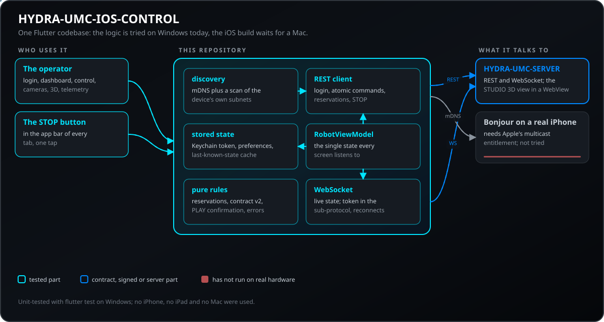
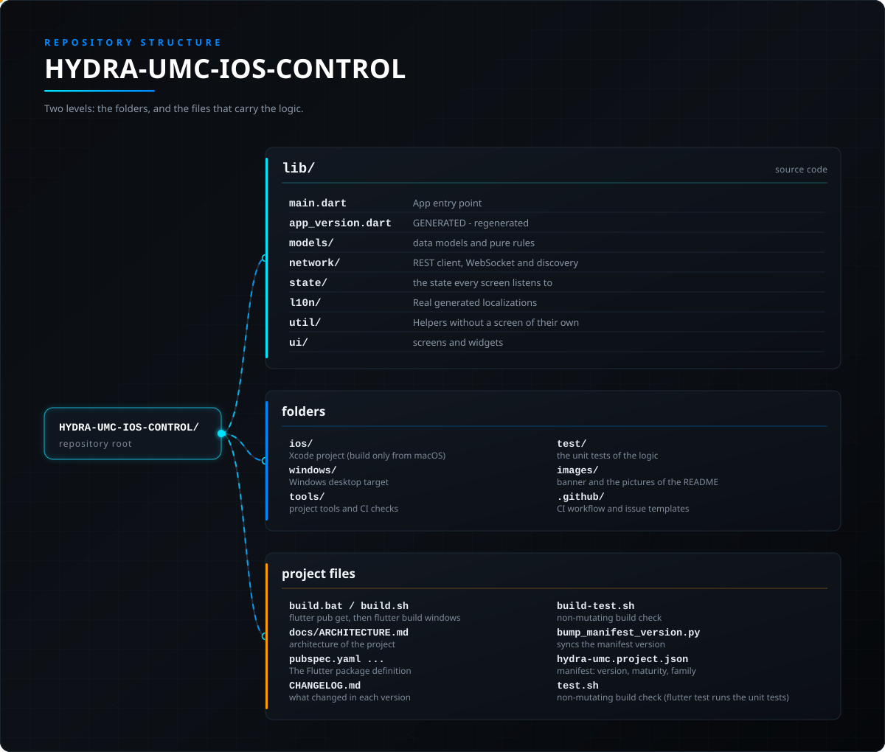

<!-- =============================================================================
HYDRA-UMC-IOS-CONTROL - iOS and iPadOS operator console for a HYDRA-UMC server, written in Flutter
Copyright (C) JuanenRac (Electro Hobby 3D) <electrohobby3d@gmail.com>
GPL-3.0-or-later - see LICENSE
============================================================================= -->

<p align="center">
  
</p>

# 🍎 HYDRA-UMC-IOS-CONTROL

<p align="center"><a href="README.md">🇺🇸 English</a> | <a href="README_spa.md">🇪🇸 Español</a> | <a href="README_fra.md">🇫🇷 Français</a> | <a href="README_ita.md">🇮🇹 Italiano</a> | <a href="README_deu.md">🇩🇪 Deutsch</a> | <a href="README_zho.md">🇨🇳 简体中文</a> | 🇯🇵 <b>日本語</b> | <a href="README_por.md">🇵🇹 Português</a></p>

### iPhone や iPad で HYDRA-UMC のロボットを：サーバーを見つけ、ロボットを動かして見守り、赤いボタン 1 つで全停止できます。

<p align="center">
  
  
  
  
  
  
  
</p>

---

Wi-Fi 経由で [HYDRA-UMC](https://github.com/JuanenRac/HYDRA-UMC) プラットフォーム上のロボットを制御する、クロスプラットフォームな Flutter アプリ（Dart）です。[HYDRA-UMC SUITE](https://github.com/JuanenRac/HYDRA-UMC-SUITE) と [HYDRA-UMC-ANDROID-CONTROL](https://github.com/JuanenRac/HYDRA-UMC-ANDROID-CONTROL) が使用しているのとまったく同じ [`REMOTE_API.md`](https://github.com/JuanenRac/HYDRA-UMC-SERVER/blob/main/docs/REMOTE_API.md) 契約を話します——稼働中の [HYDRA-UMC-SERVER](https://github.com/JuanenRac/HYDRA-UMC-SERVER) インスタンス（HYDRA-UMC STUDIO 自身のプロセスから切り離されたヘッドレスバックエンド——STUDIO は現在、本アプリと同様にその純粋なフロントエンドクライアントです）に対するディスカバリー、ログイン、原子的なロボットごとの指令、リアルタイム WebSocket 同期。

> **安全性とセキュリティの現状:** このエコシステムは認証された安全システムではありません。ハードウェアの E-STOP 経路、ファームウェアが強制する制限やインターロック、検証済みの動作コマンドはまだありません。ファームウェアイメージは CRC-32 と Ed25519 署名で検査し、リリースビルドは公開済みの開発用鍵を拒否します(リレーの先のツールヘッドと拡張ボードは引き続き URTC のブートローダーを使い、署名ではなく共有鍵の HMAC-SHA256 を使います)。TLS と相互 TLS は任意で、既定では無効です。独自基板はまだ実装も試験もされていません。ここに書かれた内容を人の安全のために頼る前に、[セキュリティベースライン](https://github.com/JuanenRac/HYDRA-UMC-DOCS/blob/main/docs/SECURITY_BASELINE.md)と[脅威モデル](https://github.com/JuanenRac/HYDRA-UMC-DOCS/blob/main/docs/THREAT_MODEL.md)をお読みください。

---

## 📋 ひと目で

| | |
|---|---|
| バージョン | `0.3.5` |
| 成熟度 | 機能する |
| テスト | 551 (`flutter test`) |
| 技術 | Flutter 3.x / Dart |
| 対象 | iPhone または iPad |
| 実機での確認 | まだです：このバージョンについて実機での動作記録はありません |

**移動：** [概要](#-概要) · [アーキテクチャ](#-アーキテクチャ) · [機能](#-機能) · [セキュリティと安全](#-セキュリティと安全) · [インターフェース](#-インターフェース) · [設定](#-設定) · [クイックスタート](#-クイックスタート) · [テスト](#-テスト) · [トラブルシューティング](#-トラブルシューティング) · [リポジトリの構成](#-リポジトリの構成) · [関連プロジェクト](#-関連プロジェクト)

## 🚦 プロジェクトの状況

各行はこのリポジトリの一部分で、信号は今日どこまで進んでいるかを示します。計画ではなく、リポジトリが示せるもの（テスト、ビルド、実行）に基づいて書かれています。

🟢 完了・検証済み · 🟡 動作する（既知の制限あり） · 🟠 一部のみ、または未検証 · 🔴 未実装または動作しない

| 領域 | 状態 | ここでの意味 |
|---|---|---|
| ソフトウェア | 🟡 | 主な目的では動作します。足りない点は上の正直さの確認に書かれています |
| テスト | 🟢 | 自動テスト 551 件。変更のたびに実行されます |
| 実機 | 🔴 | まだです：このバージョンについて実機での動作記録はありません |
| インターフェースとプロトコル | 🟡 | 提供するルートやメッセージは文書化され、クライアントで試験済みです。すべてのクライアントがまだ使ったわけではありません |
| 連携 | 🟠 | メッセージとルートは SDK の共通契約に照らして検証されていますが、実機と一緒に動かしたことはありません |
| セキュリティ | 🟡 | アクセス制御、入力の制限、署名のいずれかは実装されコンピューター上で試験済みですが、プロジェクト外の誰もレビューしていません |
| デプロイ | 🟠 | リリースとして公開されています。新しい環境へのインストールは文書化されていますが記録はありません |
| 停止と安全 | 🟠 | 停止経路とその制限は実装されシミュレーターで試験済みですが、実機で動かしたことはなく、認証された安全システムではありません |
| 言語とアクセシビリティ | 🟡 | インターフェースとヘルプは 8 言語ですが、キーボード操作とスクリーンリーダーでの利用は試していません |
| ドキュメント | 🟢 | 8 言語の README。変更のたびにマニフェストと照合されます |

## 🎯 概要

アプリの画面：**ログイン**（サーバーのアドレス、アカウント、ローカルネットワークのスキャン）、**ダッシュボード**（ロボットごとのカードとライブ LED、演算モジュールの状態）、**制御**（ジョグパッド、速度、バルブとポンプ、ロボットの予約、事前確認が任意の PLAY）、**カメラ**（ライブ MJPEG）、**3D ビュー**（STUDIO の実際のシーン）、**テレメトリ**（ターミナル風のログ）、**設定**（言語、生体認証ロック、スイッチ）。赤い**停止**ボタンはすべてのタブのバーにあります。

## 🧩 HYDRA-UMC での役割

**HYDRA-UMC-IOS-CONTROL** は iPhone と iPad 向けの HYDRA-UMC オペレーターコンソールです。ロジックを Windows でビルド・実行・テストできるよう Flutter で書かれており、iOS ビルド自体には引き続き Mac 上の Xcode が必要です。ローカルネットワーク上の HYDRA-UMC-SERVER を見つけてサインインし、ロボットの表示と操作、カメラと 3D ビューの確認、ワンタップでの全停止ができ、SUITE や Android アプリと同じリモート契約を使います。安全装置ではありません。

## 🏛️ アーキテクチャ

<p align="center">
  
</p>

### ネイティブ Swift ではなく Flutter を選んだ理由

本アプリは iOS/iPadOS をターゲットとしていますが、Swift/SwiftUI ではなく **Flutter** で構築されています：本リポジトリの作業環境は Windows のみであり、ネイティブ Swift プロジェクトは Windows 上で*記述*はできても、そこで*コンパイルまたは実行*することは決してできません（Xcode と iOS SDK は macOS 専用です）。Flutter 自身の Windows デスクトップターゲットにより、本アプリはこのマシン上で実際にビルド、実行、テストできます——`flutter analyze` はクリーン、`flutter build windows` は成功し、`flutter test` はパスし、ビルドされた `.exe` はランタイムエラーなく起動してレンダリングされます——Mac が手に入るまで何も検証できないまま、何千行もの Swift コードを盲目的に書くのではなく。

**これはアップル自身の制約を取り除くものではありません**——実際の `.ipa` は、依然として Mac 上の（あるいは macOS CI ランナー上の）Xcode でビルド・署名する必要があります。フレームワークの選択はそれを変えません。Flutter がもたらすのは、本アプリ自身のロジック（ネットワーキング、状態、UI）のあらゆる他の行を今日このマシン上で検証できる能力であり、後で書き直すことなく同一のコードベースを iOS に出荷できる能力です。

## ✨ 機能

- **ログイン**（`lib/ui/login_screen.dart`、`lib/state/robot_view_model.dart`）—— 編集可能なサーバー IP/ポートとオペレーター認証情報フィールド、および `POST /api/login` を使用します。アカウントやパスワードは事前入力されません。本番サーバーでは最初の管理者用に明示的に設定したブートストラップ認証情報が必要です。追加の低権限「オペレーター」アカウントはブラウザー UI の Config > Users から作成できます。セッショントークンは iOS キーチェーン（`flutter_secure_storage`）に保存されて起動をまたいで保持され、ホストとポートは `shared_preferences` に保存されます。「ローカルネットワークをスキャン」ボタン（`lib/network/discovery.dart`）は、ユーザーが IP を事前に知らなくてもサーバーを見つけられます。
- **ネットワークディスカバリー**（`lib/network/discovery.dart`）—— 「ローカルネットワークをスキャン」シートから 2 つの独立した経路が同時に実行されます: 実際の mDNS/Bonjour（`discoverMdns()`、`multicast_dns` パッケージ経由で `server.ts` が公開する `_hydra._tcp.local` サービスを問い合わせます——本アプリはエコシステムの 3 つのリモートクライアントの中で最初にこれを追加したものです）に加えて、このデバイス自身の実際のローカルサブネットに対する `GET /api/hydra-info` の並行総当たりスキャン（`scanSubnets()`、単一のハードコードされた推測ではなく `dart:io` の `NetworkInterface.list()` から導出されます。スマートフォンの LAN は `192.168.1.x` と同じくらい `192.168.0.x` や `10.x.x.x` である可能性があるため、インターフェースの列挙自体が空を返した場合にのみ `192.168.1.x` にフォールバックします）。権限が付与されていない iOS ビルドで mDNS が静かに失敗するのは想定内です（Apple の Multicast Networking 権限は通常の `flutter build ios` では付与されません）——いずれにせよサブネットスキャンは独立して動作し続けます。
- **生体認証ゲート**（`lib/network/biometric_helper.dart`、`lib/ui/biometric_gate_screen.dart`）—— `package:local_auth` による Face ID/Touch ID/Windows Hello。`Settings` のオプションのトグルで、起動時にすでに有効な保存済みセッションを復元する処理を保護します（本アプリは平文パスワードを一切保存せず、トークンのみを保存します——HYDRA-UMC-ANDROID-CONTROL 自身のパスワード再入力デザインをこの違いに合わせて適応させたものです）。
- **原子的な指令同期**（`lib/state/robot_view_model.dart` 自身の `_sendAtomicCommand()`）—— すべての書き込み（再生/一時停止/停止/ジョグ/バルブ/ポンプ/速度/ビジョン）は、実際の `POST /api/robot/:id/command` エンドポイントを使用し、設定ツリー全体を上書きするのではなく、小さな標的を絞ったペイロードを送信し、それが必要な 5 つの指令に対しては正しい統合ロボット（`combinedWith`）の伝播を行います。
- **リアルタイム WebSocket 同期**（`lib/network/hydra_websocket.dart`）—— トークンは `hydra.bearer` サブプロトコルで送り、接続 URL には含めません（`server.ts` は既定で `/ws?token=` を拒否します）。`"settings"` と `"delta"` の両方のブロードキャストタイプを処理し、切断時には自動的に再接続します。
- **ダッシュボード**（`lib/ui/dashboard_screen.dart`）—— ロボットごとのカード、`Provider` 自身の `ChangeNotifier` によるリアルタイムの反応、LED の慣例（緑の点滅=アクティブ、赤の点灯=非アクティブ）、そして統合ロボット表示（フォロワー側でのみ表示され、id で解決されます）——HYDRA-UMC-STUDIO 自身のダッシュボード概要と一致しています。
- **手動制御**（`lib/ui/control_screen.dart`、`lib/ui/widgets/joystick_pad.dart`）—— ジョグ方向パッド（XY テーブルターゲットあり/なし）、速度/加速度スライダー、バルブ/ポンプのトグル、そしてグローバル **STOP**（`lib/ui/widgets/stop_all.dart`）—— 1 回のタップのみで、長押しも確認もなく、全ロボットを停止し（`POST /api/stop-all`）、制御タブを含むすべてのタブの上部バーに常時表示されます。結果はロボットごとに表示され（ロボットが失敗した場合や停止が保存されなかった場合は警告、他のアカウントが予約中のロボットには印）、ネットワークエラーは 1 回再試行され、リクエスト上限を超えたサーバーやそのルートがないサーバーにはロボットごとの停止で対応し、応答がない場合は後の STOP が応答を得るまで「STOP 未確認」の表示が残ります。丸いロボット単位の停止ボタンは長押し保護を維持します。
- **予約と安全上限**（`lib/ui/widgets/access_panel.dart`、`lib/models/access.dart`、`lib/network/hydra_api_client.dart`、`lib/state/robot_view_model.dart`）- Control 画面は、選択したロボットを誰が保持しているか（誰も、この端末、別の端末の同じアカウント、別のアカウント）を表示し、**予約**と**解放**を提供し、サーバーのすべての予約の一覧（`GET /api/claims`）も表示します。端末はインストールごとにコントローラーIDを1つ保持し、予約・解放・ジョグのアーム・コマンドのたびにそれを送ります（本文と `X-Controller-Id` ヘッダー）。このため予約はアカウント全体ではなく、アカウントとこの端末に属します。サーバーの拒否は区別されます：別のアカウントが予約、あなたのアカウントが別の端末またはウィンドウで予約、コントローラーID必須、ジョグ未アーム。ロボットのモデルの上限は `GET /api/safety-limits` から読み取ります：上限を超えるジョグのステップは送信されず、サーバーの警告が表示されます。管理者が要求した場合は、ジョグでロボットを動かす前に**ジョグをアームする**（カウントダウン付き）を押す必要があり、アームは自動で、STOP で、または解放時に終了します。予約は任意です：誰も予約していないロボットはこれまでどおり操作できます。 **管理者**にのみ、他の人が予約しているロボットに **制御を引き継ぐ** ボタンが表示されます。確認を求めたうえで `force: true` でロボットを予約します (サーバーは管理者からのみ受け付け、ロールを再確認します)。 書き込みは条件付きです。各書き込みには、このアプリが最後に見たロボットのリビジョン(`If-Match`、`lib/models/contract_v2.dart`)が付き、その間に他の人がロボットを変更していた場合、サーバーは 412 を返し、何も適用されず、ロボットが読み直されてメッセージで知らされます(標準は予約、テーブル、単発のコマンドを確認、厳格は STOP 以外すべてを確認、オフは何も確認せず、選択は予約一覧の中にあり、STOP は確認されません)。XY テーブルのジョグはアトミックな `table` コマンド 1 回で(古いサーバーには理解できるジョグを送ります)、サーバーは WebSocket で予約を通知するため Control 画面は通知が届く間ポーリングを止め、管理者は監査記録(`lib/ui/widgets/audit_dialog.dart`)を、SHA-256 チェーンをサーバーと端末で 2 回検証した状態で読め、その行を `.jsonl` としてコピーできます。
- **オプションのスイッチ** - 既定ではどちらもオフの2つのスイッチ：*保存済みデータでは操作を送らない*（設定）は、画面がロボットの実際の状態ではなく保存済みコピーを表示している間、STOP以外のすべての操作を保留します。*モバイルデータ回線とVPNはスキャンしない*（ログイン画面）は、それらのインターフェースをサブネットのスキャンから除外します。ジョグD-padのボタンは44pt以上で、VoiceOverが軸と方向を読み上げます。アプリがバックグラウンドにある間、カメラ映像は閉じられます。
- **PLAY の前に確認** - 既定でオン、設定でオフにできます。軌道を開始する前に、ロボット、記録済みの点、速度、予約している人を表示します(他の人が予約しているロボットは、サーバーがコマンドを拒否することを伝えます)。すでに再生中のロボットでは再度確認しません。選択は保存されます。
- **サーバーに接続しているのは誰か：** アクセスパネルの「接続」ボタンから、サーバーが見たアプリの簡単な一覧（種類、ユーザー、バージョン、ローカルネットワークか外部か、現在開いているセッション、成功または拒否されたサインイン、どれくらい前か）と、最近のサインイン、拒否されたサインイン、サインアウト、終了したセッションを開けます。サーバーの接続ルートから読みます。管理者はすべての項目を、その他のアカウントは自分の分だけを見ます。どちらの一覧にもパスワードやトークンは含まれず、アドレスはサーバーに保存を指示した場合だけ表示されます。サーバーが古くて提供できない場合は、その旨をはっきり表示します。
- **設定のサーバーのアクセスオプション（管理者のみ）：** 設定の項目から、サーバー設定から読んだ 9 つのスイッチがあります。サインインなしのヘルスルート、グローバル停止の通知、接続履歴に各クライアントのアドレスを残すこと、チケットなしのカメラ映像、WebSocket アドレス内のトークン、ログの秘密情報の伏せ字、音声確認の署名、環境経由でプロセスに渡す IP カメラのパスワード、新規インストールでの TLS の自動有効化です。それぞれ値の出どころ（既定、画面から保存、またはサーバーの環境で固定されロックされる）を表示し、変更した分だけを送り、保護を下げる変更は先に確認を求め、サーバーが提供しないオプションは表示しません。
- **Bluetooth LE (GATT)**(`lib/network/hydra_ble_client.dart`, `lib/network/ble_contract.dart`, `lib/network/ble_gatt_fbp.dart`)- 文書化された規約に従う本物のGATTクライアント。HYDRAサービスで絞り込むスキャン、MTU交渉付きの接続、サービスの確認、通知、双方向のフレーム分割メッセージ、書き込みは一度に1件、待ち時間を延ばしながらの自動再接続、iOS の Bluetooth 権限、失敗ごとにユーザーの言語で表示する明確なメッセージ。**ペリフェラル側を実装したHYDRA-UMCデバイスはまだありません。** クライアントは模擬GATTに対してのみテストされており、Bluetooth リンクは iPhone で実行されたことがなく、ロボットへのコマンドはBluetoothでは送信されません。
- **プッシュ通知**(`lib/network/push_bridge.dart`、`ios/Runner/AppDelegate.swift`、`lib/state/robot_view_model.dart`)- 設定のスイッチ。本人がオンにするまでオフです。アプリは許可を求め、システムからデバイストークンを受け取り、アプリの言語とともにサーバーへ登録します(`POST /api/push/devices`)。サーバーは作業が完了したときやグローバル停止が実行されたときに、Apple のプッシュサービス経由でこの端末へ知らせます。スイッチをオフにするかサインアウトするとトークンはサーバーから削除されます。サーバー側は既定でオフです。模擬システムとローカルサーバーに対して構築・テスト済みで、実際の iPhone には通知が届いていません。そのためにはサーバーのドキュメントにある Apple デベロッパーアカウントが必要です。
- **アプリの外からのグローバル停止**(`ios/Runner/GlobalStopShortcut.swift`、`lib/network/shortcut_bridge.dart`、`lib/state/robot_view_model.dart`)- ショートカットアプリ、Siri、Spotlight、アクションボタン向けのショートカットと、アプリアイコンのクイックアクション(8 言語対応)。アプリを開き、STOP ボタンとまったく同じグローバル停止(本人のセッションでの `POST /api/stop-all` と、ロボットごとのフォールバック)を実行するため、契約とトークンの扱いは同じです。要求はセッションを最長 1 分待ち、その後は破棄されるので、ずっと前に出した停止があとで実行されることはありません。CI でビルド済み、iPhone では未実行です。
- **カメラ**（`lib/ui/camera_screen.dart`、`lib/ui/widgets/mjpeg_view.dart`）—— 小さな手作りの MJPEG ストリームパーサー（サードパーティパッケージなし）、（サイレントに空白のフィードを表示するのではなく）明確な「カメラ無効」状態、そしてサーバーから直接ロボットのビジョンシステムをオン/オフする切り替えスイッチ（`server.ts` の `"vision"` 原子指令）。
- **3D ビュー**（`lib/ui/three_d_screen.dart`）—— HYDRA-UMC-STUDIO 自身のリアルタイム 3D ビューポートを WebView に埋め込みます（`?hideUI=true&robotId=#token=`）。Android アプリと同じアプローチで、同じ理由からです（実際の、現在提供されている 3D シーンを無料で得られます）。`webview_flutter` がサポートしていないプラットフォーム（本リポジトリのビルド検証に使用される Windows デスクトップターゲット）では、正直なプレースホルダーにフォールバックします。
- **システム指標**（`lib/state/robot_view_model.dart`）—— `GET /api/system/metrics` を 5 秒ごとにポーリングします。他の 2 つのクライアントと同じ頻度で、ダッシュボードに表示されます。
- **8言語対応UI**（`lib/l10n/`、標準の `flutter gen-l10n` パイプライン）—— 英語・スペイン語・フランス語・ドイツ語・イタリア語・日本語・中国語・ポルトガル語に対応し、このエコシステムの他のクライアントと同じです。`設定 > 言語` に保存される上書き設定はデフォルトでOSのロケールに従います。`RobotViewModel.lastError` は整形済みの英語テキストではなく型付きの `HydraError` になっているため、ビジネスロジック側のエラーメッセージ（サインイン・接続・コマンド失敗)も画面の静的なテキストと同様に正しくローカライズされます。
- **オフライン状態キャッシュ**（`lib/network/state_cache.dart`）—— 最後に把握した設定ツリーを、実際に保存した時刻とともにディスクに保存します（1秒のデバウンス付き）。これにより、実際の `connect()` の往復通信がまだ進行中でも、ダッシュボード/操作画面が空の状態ではなく、多少古い可能性はあっても実際のロボットデータをすぐに表示します。その間は「HH:mm 時点のキャッシュデータ」という実際に見えるバナー(単なる無言の推測ではなく)が表示されます。実際の取得が成功した瞬間に置き換えられます。
- **テレメトリ**（`lib/ui/telemetry_screen.dart`）—— 接続・サインイン・コマンドの実際のライフサイクルイベントを新しい順に表示するターミナル風のログで、最大50件まで保持し、ログを消去する操作も備えています。HYDRA-UMC-ANDROID-CONTROL 自身のテレメトリタブと同じ「マトリックスグリーン」の配色です。
- **アプリ内音声アシスタント**（`lib/ui/voice_assistant_dialog.dart`）—— アプリバーのマイクアイコンをタップするとダイアログが開き、質問や指示を入力できます。これは HYDRA-UMC-ANDROID-CONTROL 自身のアプリ内音声ボタンや Watch リレーと同じ実際の `POST /api/voice/turn` ルートを経由して `HYDRA-UMC-VOICE-UI` に送信されます。任意の音声入力（設定のスイッチ、既定ではオフ）は、iOS の Speech フレームワークで話した内容をテキスト欄に書き込みます。Apple のオンライン認識を許可しない限り iPhone 上で処理され、テキストが自動で送信されることはなく、サーバーに送られるのは音声ではなくテキストだけです。返信が直接ロボットコマンドを発行することもありません。
- **エコシステムタブ、接続診断、アプリ外の表示**（`lib/ui/ecosystem_tab.dart`、`lib/ui/connection_diagnostics_dialog.dart`、`lib/state/external_surfaces.dart`）—— テレメトリ画面にエコシステムタブ（サーバーが見つけたプロジェクトのマニフェスト。サービスを宣言したものにだけランプ付き）があり、設定から接続診断（スキーム、証明書の信頼方法、バージョン、`GET /api/hydra-info` を数回読んだ遅延、接続の状態、パスワードやトークンを含まないコピー用レポート）を開けます。既定ですべてオフの3つのスイッチで、ローカル通知（ジョブ完了、ロボットのオフラインやセーフモード、接続断）、実行中の軌道の進捗を示す Live Activity、ペアリングした Apple Watch へのステータスと STOP 要求を有効にできます。Swift 部分と Live Activity・Watch アプリのソース（`ios/HydraLiveActivity`、`ios/HydraWatch`）は書かれていますが、Xcode でのコンパイルも iPhone や Watch での動作確認も未実施で、この2つの拡張にはまだ Xcode のターゲットが必要です。
- **コマンド経路と予約の維持**（`lib/state/robot_command_repository.dart`、`lib/models/robot_command_contract.dart`、`lib/models/access.dart`）- HYDRA-UMC-ANDROID-CONTROL と同じ分担です。ビューモデルの外にある1つのリポジトリが各ロボットのリビジョンを保持し、応答がないときは停止を再送し、古いサーバーには `table` 移動をジョグとして送り、送信中のジョグを数え、連続コマンドをまとめ、各応答を測定します。コマンド名と上限は `tools/gen_command_contract.py` が `docs/robot_command_contract.json`（Android のファイルと同一のコピー）から生成し、検証がチェックします。操作画面を開いている間は、この端末が保持する予約を終了の少し前に再度要求するので、長い操作でもロボットを失いません。サインアウト時には端末が保持する予約を解放します。数秒ごとのサーバー負荷の読み取りは、それを表示するバーだけを再描画し、すべての画面は再構築しません。テストでは偽サーバーに対して実行し、iPhone では実行していません。
- **HOME/RESET**（`lib/ui/control_screen.dart`, `lib/util/home_reset.dart`, `lib/state/robot_view_model.dart`）- サーバーの `reset` コマンドで、選択したロボットをゼロ位置へ移動するボタンです。初期設定ではオフで、設定のスイッチでオンにでき、選択は保存されます。何かを送る前に、順番どおり、制限時間内に2回確認します。ロボットが軌道を実行中、セーフモード、オフライン、位置なしの場合、STOPの送信中または未確認の間、ジョグの送信中、ジョグの有効化が必要でされていない場合、およびオペレーターでも管理者でもないセッションの場合は、専用の文言で拒否されます（役割はサーバーが再度判断します）。コマンドにはジョグと同じく増加する番号が付き、`reset` を知らないサーバーは見分けて記憶されます。既定値、確認の回数、制限時間は `docs/robot_command_contract.json` から読み込みます。ローカルの擬似サーバーでテスト済みで、ロボットは関与しません。
- **連続ジョグ、リンクの状態、リンクによるペアリング、時計へのアラート、Work の選択**（`lib/util/dead_man_jog.dart`、`lib/network/dead_man_jog_runner.dart`、`lib/state/dead_man_jog_controller.dart`、`lib/util/pairing_link.dart`、`lib/util/watch_alerts.dart`、`lib/util/watch_relay.dart`、`lib/util/work_files.dart`）- Android アプリと同じで、数値はすべて `docs/robot_command_contract.json` から読みます。**連続ジョグ**（設定のスイッチ、既定ではオフ）はボタンを押している間だけ軸を動かします：`jogStart`、100 ms ごとのハートビート、`jogStop`。指を離したとき、STOP のとき、画面を離れたとき、接続が切れたとき、ハートビートが 2 回失敗したとき、30 秒経過したとき、リンクが悪いとき、サーバーがハートビートを拒否したときに、軸を停止します（STOP と同じ緊急度で送り、再試行します）。**リンクインジケーター**（既定ではオン）はサーバーの応答の速さを示し、2 つ目のスイッチ（既定ではオン）はリンクが遅い、または失われたときに連続ジョグをブロックします。**リンクによるペアリング**（既定ではオフ）は `hydra-umc://pair?host=..&port=..&fp=..&name=..` を、スマートフォンのカメラで開いたものやログイン画面・設定に貼り付けたものから読み、厳密に検証し、読み取った内容を表示して、何かを保存する前に確認します。証明書のフィンガープリントがないリンクは常に拒否され、ある場合はアプリが TLS を必須にして固定します。**Apple Watch へのアラート**（接続の喪失と復旧、ロボットのオフラインやセーフモード、未確認または確認済みの STOP）は回数が制限され、Apple Watch のオプションも必要です。オペレーターの在席と音声指示の 2 段階確認の中継は既定ではオフで、サーバーにまだないエンドポイントを待っています。**Work セレクター**はロボットのフォルダーの作業ファイルを一覧にし、サーバーと同じ方法で点を検査したうえで `trajectory` コマンドで 1 つを読み込みます。再生は決して開始しません。Mac なしで書かれました：**Xcode でコンパイルされておらず、iPhone や時計でも試されていません**。ロジックは偽の時計・サーバー・ブリッジを使って Dart VM でテストされています。

## 🔒 セキュリティと安全

| 脅威 | 防御 | 場所 |
|---|---|---|
| スマートフォンから盗まれたトークン | トークン、ユーザー名、更新トークンは `flutter_secure_storage`（iOS キーチェーン）に保存され、ホスト、ポート、設定だけが `shared_preferences` に入ります。アプリが生のパスワードを保存することはありません | `network/auth_prefs.dart` |
| 保存された状態のコピーに含まれる認証情報 | ディスクに書かれる最後の状態のコピーからは、どの階層でも `ipUsername` と `ipPassword` のキーが取り除かれ、サインアウト時に消去されます | `network/state_cache.dart` |
| ログや WebSocket のアドレスに含まれるトークン | トークンは WebSocket の `hydra.bearer` サブプロトコルに入り、アドレスには入りません。埋め込みの 3D ビューにはアドレスのフラグメント（`#token=`）で渡され、サーバーには送られません。テストが両方を確認します | `network/hydra_websocket.dart`, `util/viewer_url.dart` |
| ロック解除されたスマートフォンを持つ人 | 任意の生体認証ロック（Face ID、Touch ID）が、起動時の保存済みセッションの復元を制御します。アプリがバックグラウンドにある間、カメラ映像は閉じられます | `network/biometric_helper.dart`, `ui/biometric_gate_screen.dart` |
| 二人で動かされるロボット、誤って押された PLAY、届かない停止 | ロボットは動かす前に予約され、画面には保持者が表示されます。PLAY は既定で先に確認を求め、ロボット、ポイント、速度、予約者を表示します。全停止は 1 回再試行し、ロボットごとの停止にフォールバックし、何も応答がなければ「停止未確認」のバナーを保持し続けます | `models/access.dart`, `util/play_confirmation.dart`, `ui/widgets/stop_all.dart` |

**絶対にしないこと：** 物理的な非常停止の代わりになること、そして自分でトラフィックを暗号化すること。平文 HTTP のプローブに応答がないとき HTTPS を 1 回試しますが、証明書のピン留めも、ローカルネットワーク外での平文通信に対するガードもありません。停止はサーバーのソフトウェア停止です。

## 🔌 インターフェース

| トピックまたはルート | 内容 |
|---|---|
| `POST /api/login`, `/api/logout`, `/api/refresh` | サインイン、サインアウト、セッションの更新 |
| `GET /api/hydra-info` | 本物のサーバーを判別。サブネットスキャンと手入力アドレスで使用し、HTTPS で 1 回再試行します |
| `GET /api/settings`, `/api/system/metrics`, `/api/safety-limits`, `/api/claims` | ロボットの状態、演算モジュール（5 秒ごと）、各モデルの安全限界、予約 |
| `POST /api/robot/{id}/command`, `/claim`, `/release`, jog arming | 1 台のロボットへの小さなコマンド、その予約、ジョグの有効化。ロボットのリビジョンによる条件付き書き込みに対応 |
| `POST /api/stop-all` | 全停止：すべてのロボット。結果はロボットごとに返ります |
| `GET /api/audit`, `POST /api/voice/turn`, `GET /api/camera/{id}/stream` | 監査記録（管理者向け、独自の SHA-256 チェーン検証付き）、入力による音声ターン、カメラの MJPEG ストリーム |
| WebSocket `hydra.bearer`, mDNS `_hydra._tcp.local` | ライブの状態変化（`settings` と `delta` メッセージ、3 秒から最大 30 秒の間隔で再接続、20 秒ごとの ping）と、サーバーの Bonjour アナウンス |

## ⚙️ 設定

アプリに設定ファイルはありません。すべて画面で設定し、デバイスに保存されます。既定値はコードにあります。

| 変数 | 既定値 | 設定する内容 |
|---|---|---|
| 設定 > PLAY の前に確認 | オン | 軌道の開始前に、ロボット、ポイント、速度、予約者を表示します |
| 設定 > 保存データでのコマンドをブロック | オフ | 画面にライブではなく保存済みの状態コピーが表示されている間、停止以外のすべてのコマンドを保留します |
| ログイン > モバイルデータと VPN のネットワークをスキャンしない | オフ | それらのインターフェースをサブネットスキャンから除外します（同時 32 ホスト、別のポートを入力しない限りポート 3000） |
| 設定 > 生体認証ロック | オフ | 起動時に保存済みセッションを復元する前に Face ID または Touch ID を求めます |
| 設定 > 言語 | システムの言語 | アプリの 8 言語のうちの 1 つ（`lib/l10n/`）。起動をまたいで保持されます |

## 🚀 クイックスタート

安定版の Flutter SDK（Dart 3.13 以降）が必要です。ロジックとテストは Windows で動かせますが、実際の iPhone 向けビルドには Mac 上の Xcode が必要です。

```bash
flutter pub get                  # downloads the packages
flutter test                     # runs the unit tests on this machine
./build-test.sh                  # non-mutating build check (build-test.bat on Windows)
flutter build ios --no-codesign  # a real iOS build; only on a Mac with Xcode
```

## 🧪 テスト

`flutter test` で自動テスト 551 件を実行します。 ハードウェアも、このマシンの外にあるものも必要ありません。

CI は `HYDRA_UMC_CI=1 python tools/ci_validate.py` を実行し、マニフェスト、文書、8 つの README、図を検査します。

## 🏗️ ビルドとリリース

[Flutter SDK](https://docs.flutter.dev/get-started/install)（stable チャンネル）が必要です。本リポジトリは Flutter 3.47.0 に対してビルド/検証されています。本リポジトリでは `windows/` と `ios/` のみがプラットフォームとして設定されています（`android/`、`linux/`、`web/`、`macos/` フォルダはありません）——Windows は、Mac なしで本アプリ自身のロジックをビルド・実行できるようにするために存在します。iOS が真のターゲットです。

### ビルドスクリプト

```bash
./build.sh     # Git Bash / WSL —— flutter pub get + flutter build windows
build.bat      # cmd.exe / PowerShell —— flutter pub get + flutter build windows
```

どちらも `build/windows/x64/runner/Release/hydra_umc_control.exe` を生成し、どちらもアプリのバージョンを変更しません——下記の[バージョン管理](#バージョン管理)参照。

### 手動ビルド

```bash
flutter pub get
flutter analyze          # 静的解析——コンパイラ不要
flutter test             # ウィジェットテスト
dart run tool/bump_version.dart  # バージョンを加算、build.sh/build.bat が行うのと同じ
flutter build windows    # build/windows/x64/runner/Release/hydra_umc_control.exe を生成
flutter run -d windows   # または Mac 上で -d <ios-device-id>
```

**実際の iOS `.ipa` をビルドする**には、macOS 上の Xcode が必要です——そのマシンから：`flutter build ipa`（または Xcode で `ios/Runner.xcworkspace` を直接開く）。これは Windows からは行えません。上記「ネイティブ Swift ではなく Flutter を選んだ理由」を参照してください。

### バージョン管理

このリポジトリはエコシステム全体の方針に従います：ビルドはバージョンを一切変更しません。明示的な `bump` コマンド（`python tools/hydra_project_tool.py bump`）が `tool/bump_version.dart` を実行し、次を適用します：

- **ビルド番号**（`+` の後の部分）：単純な単調カウンター、bump のたびに +1、繰り上がりなし。

同じスクリプトが `lib/app_version.dart`（生成物であり、手作業で編集されるものではありません——単純な `const` ファイルであり、`package_info_plus` のような新しいランタイム依存関係ではありません）を再生成し、アプリは実行時にこれを読み取って **Settings** 画面に自身のバージョンを表示します。バージョン履歴は [CHANGELOG.md](CHANGELOG.md) を参照してください。

## 🩺 トラブルシューティング

| 表示 | 原因 | 対処 |
|---|---|---|
| 「セッションが承認されていません。再度サインインしてください」 | サーバーがトークンを拒否した（WebSocket がコード 1008 で閉じられた）か、期限が切れた | もう一度サインインする |
| 「停止がサーバーに確認されていません」 | 全停止に短い制限時間内で応答がなかったか、サーバーが停止状態を保存できなかった | もう一度押す。バナーが残るなら物理的な非常停止を使う |
| ロボットが別のアカウント、または別のデバイス上の自分のアカウントに予約されている | 予約はアカウントとデバイスに属します（インストールごとに 1 つのコントローラー ID） | そのデバイスを使うか、そこで予約を解除する |
| 「HH:mm に保存したデータを表示中」 | サーバーに届かず、画面には最後の状態の保存コピーが表示されています。「保存データでのコマンドをブロック」がオンなら、停止以外のコマンドは保留されます | サーバーと Wi-Fi を確認する。接続が戻ると画面は自動的にライブに戻る |
| 「ジョグを拒否：ステップが上限を超えています」 | ステップが、サーバーがこのロボットモデルに設定した上限を超えています（`GET /api/safety-limits`） | より小さいステップを使う。何も送信されていません |
| 「ローカルネットワークをスキャン」でサーバーが見つからない | 実機の iPhone では、Bonjour に通常のビルドにはない権限が必要で、スキャンはモバイルデータや VPN のネットワークを除外することがあります | サーバーと同じ Wi-Fi に接続するか、アドレスとポートを手入力する |

## 📂 リポジトリの構成

<p align="center">
  
</p>

<details>
<summary>ツリーのテキスト版</summary>

```text
HYDRA-UMC-IOS-CONTROL/
├── lib/                                                              ソースコード
│   ├── main.dart                                                     アプリのエントリポイント、ChangeNotifierProvider + ログインゲート
│   ├── app_version.dart                                              生成物——bump_manifest_version.py によって再生成される、手動編集禁止
│   ├── models/                                                       データモデルと純粋なルール
│   ├── network/                                                      REST クライアント、WebSocket、探索
│   ├── state/                                                        すべての画面が監視する状態
│   ├── l10n/                                                         実際に生成されたローカライゼーション(8言語) - リポジトリルートのl10n.yamlを参照
│   ├── util/                                                         専用画面を持たない補助機能
│   └── ui/                                                           画面とウィジェット
├── ios/                                                              Xcode プロジェクト（macOS からのみビルド可能）
├── windows/                                                          Windows デスクトップターゲット——Mac なしでのビルド検証
├── tools/                                                            プロジェクトのツールと CI の検査
├── test/                                                             ロジックのユニットテスト
├── images/                                                           バナーと README の図
├── .github/                                                          CI ワークフローと Issue テンプレート
├── build.bat / build.sh                                              flutter pub get のあと flutter build windows。バージョンは変更しない
├── docs/ARCHITECTURE.md                                              プロジェクトのアーキテクチャ
├── pubspec.yaml / pubspec.lock / l10n.yaml / analysis_options.yaml   Flutter パッケージの定義とロックされたバージョン、l10n ジェネレーターの設定、lint ルール
├── CHANGELOG.md                                                      各バージョンの変更点
├── build-test.sh                                                     変更を伴わないビルド確認
├── bump_manifest_version.py                                          マニフェストのバージョンを同期
├── hydra-umc.project.json                                            マニフェスト：バージョン、成熟度、ファミリー
└── test.sh                                                           変更を伴わないビルド確認（ユニットテストは flutter test）
```

</details>

## 🗺️ ロードマップと既知の制限

CI には iPhone や iPad 向けのビルドがありません。`flutter build ios` には Mac 上の Xcode が必要なため、アプリは Windows でのみ実行・テストされています。Bonjour による探索には通常のビルドにはない権限が必要なので、実機の iPhone ではサブネットスキャンがサーバーを見つけます。Swift 部分（音声入力、ローカル通知、Live Activity、Apple Watch との連携）は書かれていますが、Xcode でコンパイルされたことも、iPhone や Watch で動作したこともありません。Live Activity と Watch アプリは Xcode のターゲットを待っています。

## 🌍 言語

この README とリポジトリの文書は、英語・スペイン語・ドイツ語・フランス語・イタリア語・日本語・中国語・ポルトガル語（ポルトガル）の 8 言語で提供されています。8 つのファイルは同時に書かれ、同じ節と同じリンクを持つことを CI が確認します。

## 🔗 関連プロジェクト

本プロジェクトは、同じ作者(JuanenRac / Electro Hobby 3D)による HYDRA-UMC ロボティクスエコシステムの一部です。リクエストが実はこの中のどれかについてのものである可能性があるため、知っておく価値があります。

**親プロジェクト**
- **[HYDRA-UMC-SERVER](https://github.com/JuanenRac/HYDRA-UMC-SERVER)** — すべての制御クライアントが実際に通信する、本物のヘッドレスバックエンド(REST/WebSocket)。本アプリ自身のログイン、アトミックコマンド、WebSocket 同期がすべてこれに対して動作するバックエンド。

**兄弟プロジェクト** —— それぞれ独自のクライアントとして、同じく HYDRA-UMC-SERVER 自身の API と通信する
- **[HYDRA-UMC-STUDIO](https://github.com/JuanenRac/HYDRA-UMC-STUDIO)** — リアルタイムのマルチロボット 3D 可視化を備えたウェブ制御ダッシュボード。その 3D ビューポートは、WebView 経由で本アプリ自身の 3D ビュー画面に直接組み込まれている。
- **[HYDRA-UMC-SUITE](https://github.com/JuanenRac/HYDRA-UMC-SUITE)** — 複数のサーバーを同時に扱えるデスクトップ(PySide6)スウォームコマンドセンター、スタンドアロン実行ファイルとしてパッケージ化。本アプリとまったく同じ `REMOTE_API.md` 契約を話す。
- **[HYDRA-UMC-ANDROID-CONTROL](https://github.com/JuanenRac/HYDRA-UMC-ANDROID-CONTROL)** — 生体認証ログインとペアリングされた Wear OS コンパニオンを備えたネイティブ Android 制御アプリ。本アプリとまったく同じ `REMOTE_API.md` 契約を話す。
- **[HYDRA-UMC-DSI](https://github.com/JuanenRac/HYDRA-UMC-DSI)** — 本体搭載の 7 インチ DSI タッチスクリーン向けネイティブタッチ UI、CM5 自体に組み込み。
- **[HYDRA-UMC-BRIDGE-AMR](https://github.com/JuanenRac/HYDRA-UMC-BRIDGE-AMR)** — VDA 5050 MQTT パブリッシャーによる AGV/AMR フリートの調整境界(エミュレートしたフリートに対してのみテスト済み)。
- **[HYDRA-UMC-BRIDGE-CNC](https://github.com/JuanenRac/HYDRA-UMC-BRIDGE-CNC)** — GRBL ステータス/制御バイトへのアクセスを持つ、CNC セルの高レベルコーディネーター(エミュレーターに対してのみテスト済み)。
- **[HYDRA-UMC-BRIDGE-DROIDS](https://github.com/JuanenRac/HYDRA-UMC-BRIDGE-DROIDS)** — Boston Dynamics Spot コマンド送信機能を持つ、脚型/ヒューマノイドドロイドの調整境界(エミュレーターに対してのみテスト済み)。
- **[HYDRA-UMC-BRIDGE-LASER](https://github.com/JuanenRac/HYDRA-UMC-BRIDGE-LASER)** — キー/筐体/インターロックの GPIO 信号 3 系統を読み取るレーザーセルのコーディネーター(模擬チップに対してのみテスト済み。レーザーの武装や発射はできない)。
- **[HYDRA-UMC-BRIDGE-OPENPNP](https://github.com/JuanenRac/HYDRA-UMC-BRIDGE-OPENPNP)** — OpenPnP ピックアンドプレースの基板フローを安全に統括する高レベルコーディネーター。
- **[HYDRA-UMC-BRIDGE-PRINTER3D](https://github.com/JuanenRac/HYDRA-UMC-BRIDGE-PRINTER3D)** — 実際にゲート制御されたジョブコマンドを持つ、Moonraker/Klipper 3D プリンター向けの安全な調整境界。
- **[HYDRA-UMC-BRIDGE-ROS2](https://github.com/JuanenRac/HYDRA-UMC-BRIDGE-ROS2)** — 遅延インポートの rclpy ROS 2 トランスポートを持つコーディネーター(ROS 2 環境ではまだ実行していない)。
- **[HYDRA-UMC-BRIDGE-UAV](https://github.com/JuanenRac/HYDRA-UMC-BRIDGE-UAV)** — MAVLink コマンド送信機能を持つ、カメラ搭載 UAV の調整境界(エミュレーターに対してのみテスト済み)。

**直接関連**
- **[HYDRA-UMC-WATCH](https://github.com/JuanenRac/HYDRA-UMC-WATCH)** — 触覚アラートのパターンとペアリング済みスマートフォンへの音声リレーを備えた WearOS コンパニオンアプリ(物理的なウォッチではまだ実行していない)。HYDRA-UMC-ANDROID-CONTROL の手首用コンパニオン（WearOS のみ。この iOS アプリの Apple Watch 版は書かれていますが、まだビルドされていません）。
- **[HYDRA-UMC-HIL-BRIDGE](https://github.com/JuanenRac/HYDRA-UMC-HIL-BRIDGE)** — シミュレーションと実機の間にソフトウェアの衝突インターロックを備えたハードウェア・イン・ザ・ループのルーター(実機なしでテスト済み)。本アプリからデジタルツインをハードウェア・イン・ザ・ループでリモート制御できるブリッジ。

**エコシステムの他のプロジェクト**

*コアハードウェア&プラットフォーム*
- **[HYDRA-UMC](https://github.com/JuanenRac/HYDRA-UMC)** — ロボットアームのマザーボードの設計——CM5 ホスト + デュアルコア STM32H745、CAN-OTA/SPI-OTA 経由で最大 8 本のツールアームを統括することを目指す(ファームウェアは初期段階で、実装済みの基板はまだない)。
- **[HYDRA-UMC-OS](https://github.com/JuanenRac/HYDRA-UMC-OS)** — CM5 向けの再現可能な Raspberry Pi OS プロダクト層——読み取り専用エージェント、検証済み設定/プロファイル、WiFi 初回接続プロビジョニング。
- **[HYDRA-UMC-SDK](https://github.com/JuanenRac/HYDRA-UMC-SDK)** — すべてのブリッジが自身のコマンドを検証する共有 JSON-Schema 契約とソフトウェアのジョブゲート境界(認証済みの安全機能ではない)。
- **[HYDRA-UMC-CONNECTOR-HUB](https://github.com/JuanenRac/HYDRA-UMC-CONNECTOR-HUB)** — 外部マシン用コネクタのための宣言的アダプターマニフェストのレジストリとバリデーター。SDK 自身の契約という発想を外部マシンにまで拡張し、産業用ゲートウェイ系のプロジェクトを置き換えることはありません。

*コアバックエンド&クライアント*
- **[HYDRA-UMC-EDITOR-URDF](https://github.com/JuanenRac/HYDRA-UMC-EDITOR-URDF)** — 完成したモデルを STUDIO 自身のカタログへ送信するデスクトップ用グラフィカル URDF 作成/編集ツール。
- **[HYDRA-UMC-EDITOR-STL](https://github.com/JuanenRac/HYDRA-UMC-EDITOR-STL)** — HYDRA-UMC-EDITOR-URDF も編集する同じモデルカタログ内で、実在するパーツを変換/置換/削除/追加するデスクトップ STL モデルエディタ。

*URTC ツールプラットフォーム*
- **[URTC](https://github.com/JuanenRac/URTC)** — 物理的な Universal Robot Tool Controller 基板向けファームウェア、CAN バス経由の 25 以上のツールプロファイル。
- **[URTC-FLASHER](https://github.com/JuanenRac/URTC-FLASHER)** — URTC 基板用のデスクトップ GUI 書き込みツール、CAN-OTA およびフルチップ SWD/JTAG。
- **[URTC-TESTER](https://github.com/JuanenRac/URTC-TESTER)** — URTC 基板向けのデスクトップ CAN バスライブ診断ツール、ツールプロファイルごとに 1 パネル。
- **[URTC-WEB-STUDIO](https://github.com/JuanenRac/URTC-WEB-STUDIO)** — Web Serial API を使ったブラウザベースの URTC-TESTER の代替、ローカルインストール不要。
- **[URTC-GATEWAY](https://github.com/JuanenRac/URTC-GATEWAY)** — URTC の CAN バスの前に置くゲートウェイ：許可する識別子のリスト、レート制限、セッション鍵。コンピューター上でテスト済みで、実際のバスではまだ試していません。

*ビジョン AI ノード(Hailo-8)*
- **[HYDRA-UMC-VISION-NODE](https://github.com/JuanenRac/HYDRA-UMC-VISION-NODE)** — Hailo-8 ビジョンパイプラインの統合ハブ、段階ごとの実際のハードウェア準備状況チェック付き。
- **[HYDRA-UMC-DETECTION-HEF](https://github.com/JuanenRac/HYDRA-UMC-DETECTION-HEF)** — Hailo アーキテクチャ/チェックサムによる安全読み込み検証を備えた、実際のコンパイル済みモデルレジストリ。
- **[HYDRA-UMC-VISION-STREAMER](https://github.com/JuanenRac/HYDRA-UMC-VISION-STREAMER)** — 実際の HailoRT 統合境界を持つ、実際の GStreamer パイプライン + MediaMTX 設定生成器。
- **[HYDRA-UMC-VISUAL-SERVOING-API](https://github.com/JuanenRac/HYDRA-UMC-VISUAL-SERVOING-API)** — ゾーン状態を条件に承認する Position-Based Visual Servoing 補正則。カメラによる姿勢推定はまだない。
- **[HYDRA-UMC-SAFETY-ZONES](https://github.com/JuanenRac/HYDRA-UMC-SAFETY-ZONES)** — ファイルから物体位置を受け取る、ゾーン侵入・キャリブレーション鮮度・E-STOP 要求の v0 ロジック。検出器は接続されておらず、物理 E-STOP もまだ配線されていない。

*コグニティブ AI ノード(Hailo-10)*
- **[HYDRA-UMC-COGNITIVE-NODE](https://github.com/JuanenRac/HYDRA-UMC-COGNITIVE-NODE)** — Hailo-10 コグニティブパイプライン(LLM/VLA/音声オーケストレーション)の統合ハブ。
- **[HYDRA-UMC-VLA-ENGINE](https://github.com/JuanenRac/HYDRA-UMC-VLA-ENGINE)** — Vision-Language-Action モデル向けの、実際のアクショントークンのエンコード/デコードと軌道生成。
- **[HYDRA-UMC-VOICE-UI](https://github.com/JuanenRac/HYDRA-UMC-VOICE-UI)** — 確認ゲート付きの限定的な Watch リレーを備えた、実際の音声フロントエンド(VAD + 意図解析)。
- **[HYDRA-UMC-SEMANTIC-PLANNER](https://github.com/JuanenRac/HYDRA-UMC-SEMANTIC-PLANNER)** — MCU エラーコードに対する、実際のルールベースのタスク分解と意味的エラー復旧。
- **[HYDRA-UMC-DOCS-QA](https://github.com/JuanenRac/HYDRA-UMC-DOCS-QA)** — このエコシステム自身の Markdown ドキュメントに対する、標準ライブラリのみの実際の TF-IDF 文書検索。
- **[HYDRA-UMC-LOCAL-TECHNICIAN](https://github.com/JuanenRac/HYDRA-UMC-LOCAL-TECHNICIAN)** — エコシステム自身のための、ローカルでポリシーゲート付きのAIメンテナンス技術者 — 観察、診断し、修正を提案する;最上位の2つのリスクレベルは意図的にまだ実装されていない。

*オーケストレーション&スウォーム*
- **[HYDRA-UMC-ORCHESTRATOR](https://github.com/JuanenRac/HYDRA-UMC-ORCHESTRATOR)** — 実際の gRPC/Protobuf ヘルスレポート契約とミッションステートマシンを持つ統合ハブ。
- **[HYDRA-UMC-JOB-DISPATCHER](https://github.com/JuanenRac/HYDRA-UMC-JOB-DISPATCHER)** — 実際の HTTP API 上に構築された、優先度ベースの実際のジョブキュー(重複排除付き)。
- **[HYDRA-UMC-NODE-HEALING](https://github.com/JuanenRac/HYDRA-UMC-NODE-HEALING)** — リトライ/バックオフとアイデンティティ不一致検出を備えた、実際の gRPC ベースのフリートヘルスウォッチドッグ。
- **[HYDRA-UMC-PATH-PLANNER-3D](https://github.com/JuanenRac/HYDRA-UMC-PATH-PLANNER-3D)** — 実際の障害物/ワークスペース衝突検証を備えた、実際の RRT ベースの 3D 経路プランナー。
- **[HYDRA-UMC-SWARM-SYNC](https://github.com/JuanenRac/HYDRA-UMC-SWARM-SYNC)** — 複数セルの収束についてプロパティテストされた、実際の CRDT LWW-Element-Map 状態同期。

*デジタルツイン&シミュレーション*
- **[HYDRA-UMC-TWIN](https://github.com/JuanenRac/HYDRA-UMC-TWIN)** — 実際のバージョン互換性同期契約を持つ、デジタルツインエンジンの統合ハブ。
- **[HYDRA-UMC-PHYSICS-REPLICA](https://github.com/JuanenRac/HYDRA-UMC-PHYSICS-REPLICA)** — 実際の URDF サブセットに対する、実際の順運動学と関節限界検証。
- **[HYDRA-UMC-SYNTHETIC-DATA-GEN](https://github.com/JuanenRac/HYDRA-UMC-SYNTHETIC-DATA-GEN)** — YOLO/COCO アノテーションのエクスポート機能を持つ、実際のプロシージャル 2D シーンジェネレーター。

*データ&分析*
- **[HYDRA-UMC-DATALAKE](https://github.com/JuanenRac/HYDRA-UMC-DATALAKE)** — 実際の取り込み/クエリ HTTP API を備えた、実際の sqlite3 ベースの時系列ストア。
- **[HYDRA-UMC-ANOMALY-DETECTOR](https://github.com/JuanenRac/HYDRA-UMC-ANOMALY-DETECTOR)** — ドリフト監視を備えた、実際の FFT + 統計ベースラインによる異常検知器。
- **[HYDRA-UMC-PRODUCTION-REPORTS](https://github.com/JuanenRac/HYDRA-UMC-PRODUCTION-REPORTS)** — DATALAKE の履歴に対する実際の OEE/稼働率計算、再現可能な CSV エクスポート付き。
- **[HYDRA-UMC-TELEMETRY-COLLECTOR](https://github.com/JuanenRac/HYDRA-UMC-TELEMETRY-COLLECTOR)** — シーケンス重複排除機能を備えた、DATALAKE への実際の CAN/WebSocket 取り込みパイプライン。

*産業用ゲートウェイ*
- **[HYDRA-UMC-GATEWAY-INDUSTRIAL](https://github.com/JuanenRac/HYDRA-UMC-GATEWAY-INDUSTRIAL)** — 実際のコマンド許可リスト/バックプレッシャー層を持つ、産業用プロトコルへ中継する統合ハブ。
- **[HYDRA-UMC-OPCUA-SERVER](https://github.com/JuanenRac/HYDRA-UMC-OPCUA-SERVER)** — 実際のバイナリプロトコルクライアントセッションで検証された、実際の OPC-UA アドレス空間。
- **[HYDRA-UMC-MQTT-BROKER](https://github.com/JuanenRac/HYDRA-UMC-MQTT-BROKER)** — クライアント単位のオプション認証とトピック ACL を備えた、実際の MQTT ブローカー。
- **[HYDRA-UMC-MTCONNECT-ADAPTER](https://github.com/JuanenRac/HYDRA-UMC-MTCONNECT-ADAPTER)** — 縮退モード出力を備えた、実際の MTConnect `/probe` および `/current` XML エンドポイント。

*補完ツール&エコシステム運用*
- **[HYDRA-UMC-DASHBOARD-AI](https://github.com/JuanenRac/HYDRA-UMC-DASHBOARD-AI)** — 誠実な統計フォールバックを備えた、DATALAKE/ANOMALY-DETECTOR 上のスマートサマリーと異常ハイライトパネル。
- **[HYDRA-UMC-TOOL-CLI](https://github.com/JuanenRac/HYDRA-UMC-TOOL-CLI)** — 実際の安定した終了コード契約を持つフリート CLI、HYDRA-UMC-SERVER 自身の API の本物のライブクライアント。
- **[URTC-SMART-RACK](https://github.com/JuanenRac/URTC-SMART-RACK)** — 実際の工具 ID デコードと Smart Idle 予熱ロジックを備えた、基板搭載ラック用ファームウェア。
- **[URTC-VISION-TOOL](https://github.com/JuanenRac/URTC-VISION-TOOL)** — サーマル/RGB 検査ツールヘッド向けの、ファームウェアと実際の Python ビジョンコンパニオン。
- **[HYDRA-UMC-UPDATER](https://github.com/JuanenRac/HYDRA-UMC-UPDATER)** — このエコシステム内のすべてのリポジトリを検出・クローン・更新する、管理用デスクトップツール。
- **[HYDRA-UMC-OS-REBUILDER](https://github.com/JuanenRac/HYDRA-UMC-OS-REBUILDER)** — エコシステムの最新バージョンをプリロードした、書き込み可能なCM5イメージを構築するWindows/Linuxデスクトップツール。Raspberry Pi Imager方式の初回起動Wi-Fi/ユーザー/SSH設定を備える。
- **[HYDRA-UMC-OPS-AGENT](https://github.com/JuanenRac/HYDRA-UMC-OPS-AGENT)** — 保守インシデントコーディネーター: 低権限のエッジ役割がサニタイズされたインベントリ/ヘルスのスナップショットを収集し、コントロールプレーン役割がそれを読み取り専用でレンダリングして AI プロバイダーに診断の提案を依頼します - パッチを適用することも、何かをデプロイすることも決してありません。
- **[HYDRA-UMC-DEV-SERVER](https://github.com/JuanenRac/HYDRA-UMC-DEV-SERVER)** — 再現可能な開発ホスト（Raspberry Pi 5 / CM5）。エコシステムのソースコードを保管し、永続キューのもとで境界の明確なビルド/テストタスクを実行する。運用中の CM5 とは明確に異なる、開発専用の役割。

## 📚 ドキュメント

さらに読むには：

* [docs/SOURCE_MAP.md](docs/SOURCE_MAP.md) - アプリのすべてのソースファイルと、その役割を示す 1 行
* **[docs/ARCHITECTURE.md](docs/ARCHITECTURE.md)** —— 本アプリが `server.ts` と交わす Wi-Fi トランスポート契約（エンドポイントごと）、Bluetooth パスがまだ存在しない理由、実際の二経路ディスカバリー機構、そして本アプリとエコシステムの他の部分との関係。
* [エコシステムのセキュリティ基準](https://github.com/JuanenRac/HYDRA-UMC-DOCS/blob/main/docs/SECURITY_BASELINE.md)
* [エコシステムの脅威モデル](https://github.com/JuanenRac/HYDRA-UMC-DOCS/blob/main/docs/THREAT_MODEL.md)
* [このリポジトリの変更履歴](CHANGELOG.md)
* [このリポジトリのライセンス](LICENSE.md)

## 🤝 コントリビュートとコミュニティ

* プルリクエストの前に `HYDRA_UMC_CI=1 py -3 tools/ci_validate.py`（または `HYDRA_UMC_CI=1 python3 tools/ci_validate.py`）を実行してください。`CI_VALIDATION=PASS` と表示される必要があります。この確認に `build.sh` や `build.bat` は使わないでください。ビルドは検査ではありません。
* 8 つの README は HYDRA-UMC-DOCS の 1 つのソースから書かれます。手で編集しないでください。ソースを変更し、`tools/make_readmes.py` で書き直します。
* 実行していないことを README に書かないでください。事実であれば「シミュレーションのみ」「実機では未確認」と書きます。
* [CONTRIBUTING.md](CONTRIBUTING.md)、[行動規範](CODE_OF_CONDUCT.md)、[SECURITY.md](SECURITY.md)、[SUPPORT.md](SUPPORT.md) を参照してください。

## 👤 作者

**JuanenRac (Electro Hobby 3D)** · electrohobby3d@gmail.com

## 📜 ライセンス

GPL-3.0-or-later - [LICENSE](LICENSE).
