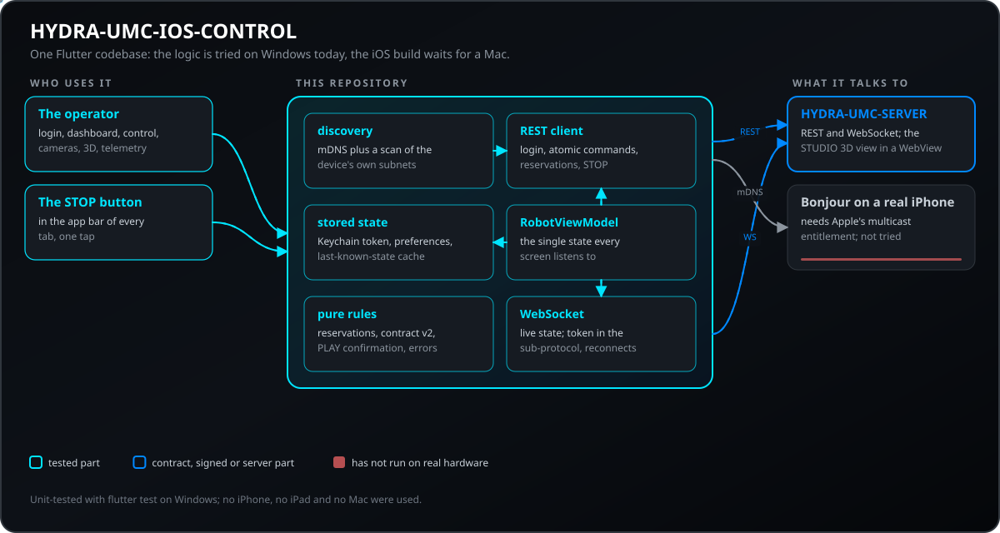
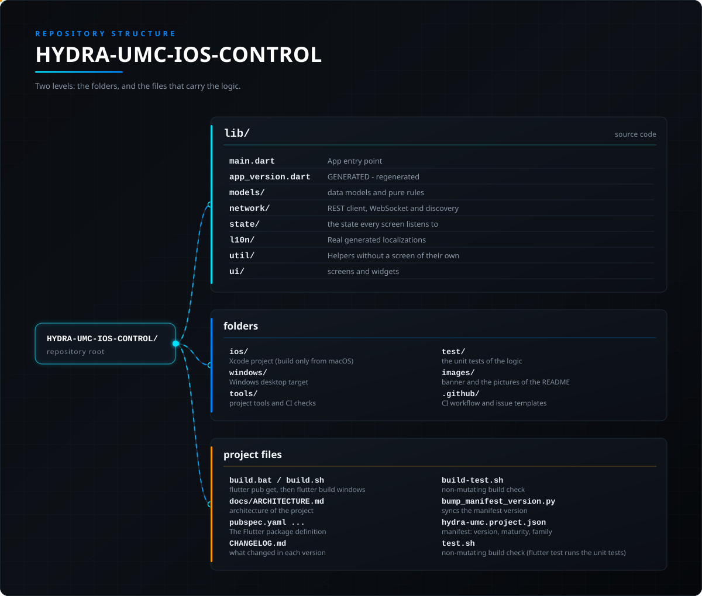

<!-- =============================================================================
HYDRA-UMC-IOS-CONTROL - iOS and iPadOS operator console for a HYDRA-UMC server, written in Flutter
Copyright (C) JuanenRac (Electro Hobby 3D) <electrohobby3d@gmail.com>
GPL-3.0-or-later - see LICENSE
============================================================================= -->

<p align="center">
  
</p>

# 🍎 HYDRA-UMC-IOS-CONTROL

<p align="center"><a href="README.md">🇺🇸 English</a> | <a href="README_spa.md">🇪🇸 Español</a> | <a href="README_fra.md">🇫🇷 Français</a> | <a href="README_ita.md">🇮🇹 Italiano</a> | <a href="README_deu.md">🇩🇪 Deutsch</a> | <a href="README_zho.md">🇨🇳 简体中文</a> | <a href="README_jpn.md">🇯🇵 日本語</a> | 🇵🇹 <b>Português</b></p>

### Os seus robôs HYDRA-UMC num iPhone ou iPad: encontre o servidor, mova e vigie os robôs e pare tudo com um botão vermelho.

<p align="center">
  
  
  
  
  
  
  
</p>

---

Uma aplicação Flutter multiplataforma (Dart) que controla um robô da plataforma [HYDRA-UMC](https://github.com/JuanenRac/HYDRA-UMC) por Wi-Fi, falando exatamente o mesmo contrato [`REMOTE_API.md`](https://github.com/JuanenRac/HYDRA-UMC-SERVER/blob/main/docs/REMOTE_API.md) que o [HYDRA-UMC SUITE](https://github.com/JuanenRac/HYDRA-UMC-SUITE) e o [HYDRA-UMC-ANDROID-CONTROL](https://github.com/JuanenRac/HYDRA-UMC-ANDROID-CONTROL) usam - descoberta, início de sessão, comandos atómicos por robô e sincronização WebSocket em direto contra uma instância [HYDRA-UMC-SERVER](https://github.com/JuanenRac/HYDRA-UMC-SERVER) em execução (o back-end headless separado do processo do próprio HYDRA-UMC STUDIO - o STUDIO é agora um cliente de frontend puro dele, tal como esta aplicação).

> **Estado de segurança (safety e security):** este ecossistema não é um sistema de segurança certificado. Ainda não existe um caminho de E-STOP por hardware, nem limites ou interlocks impostos pelo firmware, nem um comando de movimento verificado; as imagens de firmware são verificadas com CRC-32 e uma assinatura Ed25519, e uma compilação de versão recusa as chaves de desenvolvimento publicadas (as cabeças de ferramenta e as placas de expansão atrás do relé ainda usam os bootloaders do URTC, que aceitam um HMAC-SHA256 de chave partilhada em vez de uma assinatura); TLS e TLS mútuo são opcionais e estão desativados por defeito; nenhuma placa própria foi ainda montada ou testada. Leia a [base de segurança](https://github.com/JuanenRac/HYDRA-UMC-DOCS/blob/main/docs/SECURITY_BASELINE.md) e o [modelo de ameaças](https://github.com/JuanenRac/HYDRA-UMC-DOCS/blob/main/docs/THREAT_MODEL.md) antes de confiar em qualquer afirmação aqui para a segurança de uma pessoa.

---

## 📋 Num relance

| | |
|---|---|
| Versão | `0.3.5` |
| Maturidade | Funcional |
| Testes | 544 (`flutter test`) |
| Tecnologia | Flutter 3.x / Dart |
| Destino | Um iPhone ou iPad |
| Em hardware real | Ainda não: não há registo de execução em hardware real para esta versão |

**Ir para:** [Visão geral](#-visão-geral) · [Arquitetura](#-arquitetura) · [Funcionalidades](#-funcionalidades) · [Segurança e proteção](#-segurança-e-proteção) · [Interfaces](#-interfaces) · [Configuração](#-configuração) · [Início rápido](#-início-rápido) · [Testes](#-testes) · [Resolução de problemas](#-resolução-de-problemas) · [Estrutura do repositório](#-estrutura-do-repositório) · [Projetos relacionados](#-projetos-relacionados)

## 🚦 Estado do projeto

Cada linha é uma parte deste repositório e a luz diz até onde chega hoje. É escrita com o que o repositório consegue demonstrar (testes, compilações, execuções), não com o que está previsto.

🟢 Feito e verificado · 🟡 Funciona, com limites conhecidos · 🟠 Feito a meio ou ainda por verificar · 🔴 Por fazer ou a não funcionar

| Área | Estado | O que significa aqui |
|---|---|---|
| Software | 🟡 | Funciona para o seu propósito principal; a verificação de honestidade acima lista o que ainda falta |
| Testes | 🟢 | 544 testes automáticos, executados a cada alteração |
| Hardware real | 🔴 | Ainda não: não há registo de execução em hardware real para esta versão |
| Interface e protocolos | 🟡 | As rotas ou mensagens que oferece estão documentadas e testadas com um cliente; ainda nem todos os clientes as usaram |
| Integração | 🟠 | As suas mensagens e rotas são verificadas contra os contratos partilhados do SDK; ainda não funcionou em conjunto com o equipamento real |
| Segurança | 🟡 | O controlo de acesso, os limites de entrada ou as assinaturas estão implementados e testados num computador; ninguém fora do projeto os reviu |
| Implantação | 🟠 | Publicado como release; instalá-lo numa máquina limpa está documentado mas não registado |
| Paragem e segurança | 🟠 | O caminho de paragem e os seus limites estão implementados e testados com simuladores; nunca funcionaram numa máquina real, e isto não é um sistema de segurança certificado |
| Idiomas e acessibilidade | 🟡 | A interface e a sua ajuda estão em oito idiomas; a utilização com teclado e leitor de ecrã não foi testada |
| Documentação | 🟢 | README em oito idiomas, verificado contra o manifesto a cada alteração |

## 🎯 Visão geral

Ecrãs da aplicação: **início de sessão** (endereço do servidor, conta, uma pesquisa da rede local), **painel** (um cartão por robô com o seu LED em direto e a saúde do módulo de cálculo), **controlo** (cruz de movimento, velocidade, válvulas e bombas, reserva do robô, PLAY com uma pergunta opcional antes), **câmara** (MJPEG em direto), **vista 3D** (a cena real do STUDIO), **telemetria** (um registo ao estilo de terminal) e **definições** (idioma, bloqueio biométrico, interruptores). Um botão vermelho **PARAGEM** está na barra de cada separador.

## 🧩 Papel no HYDRA-UMC

A **HYDRA-UMC-IOS-CONTROL** é a consola de operador do HYDRA-UMC para iPhone e iPad. Está escrita em Flutter para que a sua lógica possa ser compilada, executada e testada no Windows; a compilação iOS em si continua a precisar do Xcode num Mac. Encontra um HYDRA-UMC-SERVER na rede local, inicia sessão, mostra e move os robôs, vigia as suas câmaras e uma vista 3D, e pára tudo com um toque, com o mesmo contrato remoto da SUITE e da aplicação Android. Não é um dispositivo de segurança.

## 🏛️ Arquitetura

<p align="center">
  
</p>

### Porquê Flutter e não Swift nativo

Esta aplicação destina-se a iOS/iPadOS, mas é construída em **Flutter** em vez de Swift/SwiftUI: o ambiente de trabalho deste repositório é só Windows, e um projeto Swift nativo pode ser *escrito* no Windows mas nunca *compilado nem executado* aí (o Xcode e o SDK do iOS são só para macOS). O alvo de desktop Windows do próprio Flutter permite que esta aplicação seja realmente compilada, executada e testada nesta máquina - `flutter analyze` limpo, `flutter build windows` com êxito, `flutter test` a passar, e o `.exe` compilado arranca e renderiza sem erros de execução - em vez de escrever milhares de linhas de Swift às cegas, sem forma de verificar nada até haver um Mac disponível.

**Isto não retira a própria restrição da Apple** - um `.ipa` real continua a exigir o Xcode num Mac (ou num executor de CI macOS) para compilar e assinar; nada na escolha da framework muda isso. O que o Flutter compra é a capacidade de verificar hoje, nesta máquina, todas as outras linhas da lógica desta aplicação (rede, estado, interface) e de distribuir mais tarde uma base de código idêntica para iOS sem reescrita.

## ✨ Funcionalidades

- **Início de sessão** (`lib/ui/login_screen.dart`, `lib/state/robot_view_model.dart`) - IP/porta do servidor e campos de credenciais do operador editáveis, mais `POST /api/login`; nenhuma conta nem palavra-passe vem preenchida. Um servidor de produção exige credenciais de arranque configuradas explicitamente para o seu primeiro administrador, e contas adicionais de «operador», com menos privilégios, podem ser criadas em Config > Users na interface do navegador. O token de sessão persiste entre arranques no porta-chaves do iOS (`flutter_secure_storage`); o anfitrião e a porta ficam em `shared_preferences`. Um botão «Procurar na rede local» (`lib/network/discovery.dart`) encontra servidores sem que o utilizador precise de já saber o IP.
- **Descoberta de rede** (`lib/network/discovery.dart`) - dois caminhos independentes correm ao mesmo tempo a partir da folha «Procurar na rede local»: mDNS/Bonjour real (`discoverMdns()`, consulta o serviço `_hydra._tcp.local` que o `server.ts` publica através do pacote `multicast_dns` - esta aplicação é a primeira dos 3 clientes remotos do ecossistema a tê-lo) mais uma análise concorrente por força bruta de `GET /api/hydra-info` pela(s) sub-rede(s) locais reais do próprio dispositivo (`scanSubnets()`, derivada do `NetworkInterface.list()` do `dart:io` em vez de um único palpite codificado, já que a LAN de um telemóvel é tão provavelmente `192.168.0.x` ou `10.x.x.x` como `192.168.1.x`, recorrendo a `192.168.1.x` apenas se a própria enumeração de interfaces vier vazia). O mDNS falhar em silêncio numa compilação iOS sem autorização é esperado (o direito Multicast Networking da própria Apple não é concedido por um simples `flutter build ios`) - a análise de sub-rede continua a funcionar de forma independente em qualquer dos casos.
- **Porta de início de sessão biométrico** (`lib/network/biometric_helper.dart`, `lib/ui/biometric_gate_screen.dart`) - Face ID/Touch ID/Windows Hello através do `package:local_auth`, um interruptor opcional em `Definições` que condiciona a restauração, no arranque, de uma sessão guardada ainda válida (esta aplicação nunca guarda uma palavra-passe em bruto, apenas um token bearer - adaptado do desenho de repreenchimento de palavra-passe do próprio HYDRA-UMC-ANDROID-CONTROL a essa diferença).
- **Sincronização atómica de comandos** (o `_sendAtomicCommand()` do `lib/state/robot_view_model.dart`) - cada escrita (play/pause/stop/jog/válvula/bomba/velocidade/visão) usa o endpoint real `POST /api/robot/:id/command`, um payload pequeno e dirigido em vez de sobrescrever toda a árvore de definições, com a propagação correta dos robôs combinados (`combinedWith`) para os 5 comandos que a precisam.
- **Sincronização WebSocket em direto** (`lib/network/hydra_websocket.dart`) - envia o token como subprotocolo `hydra.bearer` e nunca no URL da ligação (o `server.ts` recusa `/ws?token=` por defeito), trata ambos os tipos de difusão `"settings"` e `"delta"`, volta a ligar-se automaticamente quando cai.
- **Painel** (`lib/ui/dashboard_screen.dart`) - cartões por robô, reativos em tempo real através do próprio `ChangeNotifier` do `Provider`, convenção de LED (verde a pulsar = ativo, vermelho fixo = inativo) e apresentação de robôs combinados (mostrada apenas do lado do seguidor, resolvida por id) em linha com o Dashboard Overview do próprio HYDRA-UMC-STUDIO.
- **Controlo manual** (`lib/ui/control_screen.dart`, `lib/ui/widgets/joystick_pad.dart`) - D-pad de jog (com/sem alvo da mesa XY), cursores de velocidade/aceleração, interruptores de válvula/bomba e o **STOP** global (`lib/ui/widgets/stop_all.dart`): um só toque, sem pressão longa nem confirmação, pára todos os robôs (`POST /api/stop-all`) e fica na barra superior de cada separador, incluindo o de Controlo. A resposta é mostrada robô a robô (aviso se um robô falhou ou a paragem não foi guardada; os robôs reservados por outra conta ficam assinalados), um erro de rede é repetido uma vez, um servidor acima do seu limite de pedidos ou sem essa rota é servido com a paragem por robô, e se ninguém responder fica um aviso permanente «STOP não confirmado» até um STOP posterior obter resposta. O botão redondo de paragem por robô mantém a sua proteção de pressão longa.
- **Reservas e limites de segurança** (`lib/ui/widgets/access_panel.dart`, `lib/models/access.dart`, `lib/network/hydra_api_client.dart`, `lib/state/robot_view_model.dart`) - O ecrã Control mostra quem detém o robô selecionado (ninguém, este dispositivo, a mesma conta noutro dispositivo ou outra conta) e oferece **Reservar** e **Libertar**, além da lista de todas as reservas do servidor (`GET /api/claims`). O dispositivo guarda um identificador de controlador por instalação e envia-o com cada reserva, libertação, armamento do jog e comando (no corpo e no cabeçalho `X-Controller-Id`), pelo que a reserva pertence à conta e a este dispositivo, não a toda a conta. As recusas do servidor distinguem-se: reservado por outra conta, pela sua conta noutro dispositivo ou janela, identificador de controlador obrigatório e jog não armado. Os limites do modelo do robô são lidos de `GET /api/safety-limits`: um passo de jog acima do limite não é enviado e os avisos do servidor são mostrados. Quando o administrador o exige, é preciso premir **Armar o jog** (com contagem decrescente) antes de o joystick mover o robô; o armamento termina sozinho, com STOP ou ao libertar. As reservas são opcionais: um robô que ninguém reservou é comandado como antes. Apenas para um **administrador**, aparece um botão **Assumir o controlo** num robô que outra pessoa tem; pede confirmação e depois reserva o robô com `force: true` (o servidor só o aceita de administradores e volta a verificar o papel). As escritas são condicionais: cada uma leva a revisão do robô que esta app viu pela última vez (`If-Match`, `lib/models/contract_v2.dart`); se outra pessoa mudou o robô entretanto, o servidor responde 412, nada é aplicado, o robô é lido de novo e a mensagem di-lo (o modo Padrão verifica reservas, mesa e comandos pontuais; o Estrito verifica tudo exceto STOP; o Desligado não verifica nada; a escolha está na lista de reservas; o STOP nunca é verificado). O jog da mesa XY é um único comando atómico `table` (um servidor mais antigo recebe os jogs que entende), o servidor envia as reservas pelo WebSocket para o ecrã Control deixar de consultar enquanto chegam, e os administradores leem o registo de auditoria (`lib/ui/widgets/audit_dialog.dart`) com a cadeia SHA-256 verificada duas vezes, pelo servidor e no dispositivo, e podem copiar as suas linhas como `.jsonl`.
- **Interruptores opcionais** - dois interruptores, ambos desligados por predefinição: *Bloquear comandos com dados guardados* (Definições) retém todos os comandos exceto o STOP enquanto o ecrã mostra a cópia guardada do estado dos robôs e não o estado real, e *Não analisar redes de dados móveis nem VPN* (ecrã de início de sessão) deixa essas interfaces fora da análise da sub-rede. Os botões do D-pad de jog têm pelo menos 44 pt e o VoiceOver anuncia-os com o eixo e a direção; a imagem da câmara é fechada enquanto a app está em segundo plano.
- **Perguntar antes de PLAY** - ativado por defeito, desativa-se nas Definições: antes de iniciar uma trajetória a app mostra o robô, os seus pontos gravados, a velocidade e quem o tem reservado (um robô reservado por outra pessoa avisa que o servidor vai recusar o comando). Um robô que já está a reproduzir não volta a perguntar. A escolha fica guardada.
- **Quem se liga ao servidor:** um botão Ligações do painel de acesso abre uma lista simples das aplicações que o servidor viu (tipo, utilizador, versão, rede local ou de fora, as sessões abertas agora, as entradas que correram bem ou foram recusadas, há quanto tempo) e das últimas entradas, entradas recusadas, saídas e sessões terminadas, lidas das rotas de ligações do servidor. Um administrador vê todas as entradas e qualquer outra conta só as suas; nenhuma lista tem palavras-passe nem tokens e um endereço só aparece se o servidor foi mandado guardá-lo. A aplicação di-lo com clareza quando o servidor é demasiado antigo para as oferecer.
- **Opções de acesso do servidor nas Definições (só administradores):** uma entrada das Definições abre nove interruptores lidos da configuração do servidor: a rota de saúde sem iniciar sessão, o anúncio da paragem global, guardar o endereço de cada cliente no histórico de ligações, as imagens da câmara sem bilhete, um token no endereço do WebSocket, o ocultar de segredos no registo, a assinatura de uma confirmação falada, a palavra-passe de uma câmara IP entregue através do ambiente do seu processo e o TLS ativado por uma instalação nova. Cada um mostra de onde vem o seu valor (por omissão, guardado a partir de um ecrã ou fixado pelo ambiente do servidor, que o bloqueia), só se envia o que mudou, qualquer alteração que baixe a proteção pergunta primeiro e um servidor que não oferece uma opção não a mostra.
- **Bluetooth LE (GATT)** (`lib/network/hydra_ble_client.dart`, `lib/network/ble_contract.dart`, `lib/network/ble_gatt_fbp.dart`) - Um cliente GATT real que segue um contrato documentado: procura filtrada pelo serviço HYDRA, ligação com negociação do MTU, verificação do serviço, notificações, mensagens divididas em tramas nos dois sentidos, uma escrita de cada vez, religação automática com esperas crescentes, a permissão de Bluetooth do iOS e uma mensagem clara na língua do utilizador para cada falha. **Nenhum dispositivo HYDRA-UMC implementa ainda o lado periférico:** o cliente só foi testado contra um GATT simulado, a ligação Bluetooth nunca correu num iPhone e os comandos do robô não são enviados por Bluetooth.
- **Notificações push** (`lib/network/push_bridge.dart`, `ios/Runner/AppDelegate.swift`, `lib/state/robot_view_model.dart`) - um interruptor nas Definições, desligado até a pessoa o ligar: a aplicação pede permissão, obtém o token de dispositivo do sistema e regista-o no servidor (`POST /api/push/devices`, com a língua da aplicação), que depois avisa o telemóvel pelo serviço push da Apple quando um trabalho termina ou é dada uma paragem global; o token é retirado do servidor ao desligar o interruptor ou terminar a sessão. O servidor tem-nas desligadas por predefinição. Construído e testado contra um sistema simulado e um servidor local; nenhuma notificação chegou a um iPhone real, porque isso precisa da conta de programador Apple descrita na documentação do servidor.
- **Paragem global a partir de fora da aplicação** (`ios/Runner/GlobalStopShortcut.swift`, `lib/network/shortcut_bridge.dart`, `lib/state/robot_view_model.dart`) - um atalho para a aplicação Atalhos, a Siri, o Spotlight e o botão de ação, e uma ação rápida no ícone da aplicação, nas oito línguas. Abrem a aplicação e fazem exatamente a mesma paragem global que o botão STOP (`POST /api/stop-all` com a sessão da pessoa, e o recurso robô a robô), por isso o contrato e o tratamento do token são os mesmos; um pedido espera por uma sessão no máximo um minuto e depois é descartado, de modo que uma paragem pedida há muito tempo nunca dispara mais tarde. Construído na CI, nunca executado num iPhone.
- **Câmara** (`lib/ui/camera_screen.dart`, `lib/ui/widgets/mjpeg_view.dart`) - um pequeno analisador de fluxo MJPEG feito à mão (sem pacote de terceiros), um estado claro «Câmara desativada» em vez de uma imagem em branco silenciosa e um interruptor para ligar/desligar o sistema de visão de um robô diretamente a partir do servidor (o comando atómico `"vision"` do `server.ts`).
- **Vista 3D** (`lib/ui/three_d_screen.dart`) - embebe a vista 3D em tempo real do próprio HYDRA-UMC-STUDIO numa WebView (`?hideUI=true&robotId=#token=`), a mesma abordagem da aplicação Android e pela mesma razão (obtém de graça a cena 3D real e atualmente distribuída). Recorre a um marcador honesto nas plataformas que o `webview_flutter` não suporta (o alvo de desktop Windows deste repositório, usado para verificação de compilação).
- **Métricas do sistema** (`lib/state/robot_view_model.dart`) - `GET /api/system/metrics` consultado a cada 5 s, a mesma cadência dos outros 2 clientes, mostrado no Painel.
- **Interface em 8 idiomas** (`lib/l10n/`, pipeline padrão `flutter gen-l10n`) - inglês, espanhol, francês, alemão, italiano, japonês, chinês e português, em linha com todos os outros clientes deste ecossistema. Uma substituição persistente em `Definições > Idioma` usa por defeito o locale do SO; o `RobotViewModel.lastError` é um `HydraError` tipado em vez de texto em inglês já formatado, pelo que as mensagens de erro da lógica de negócio (falhas de início de sessão/ligação/comando) também se localizam corretamente, e não apenas a decoração estática dos ecrãs. Um teste (`test/localization_test.dart`) falha se algum idioma perder uma chave ou mudar um `{marcador}` do inglês.
- **Cache de estado offline** (`lib/network/state_cache.dart`) - a última árvore de definições conhecida persiste em disco (com atraso de 1 s) ao lado do instante real em que foi guardada, para que os ecrãs Painel/Controlo mostrem de imediato, ao arrancar, dados reais - ainda que possivelmente desatualizados - dos robôs, em vez de um estado vazio enquanto a ida e volta em direto do `connect()` ainda decorre. Um aviso real e visível (não apenas um palpite silencioso) diz «a mostrar dados em cache das HH:mm» enquanto isso se mantiver verdade. Substituído pela obtenção real no instante em que esta tem êxito.
- **Telemetria** (`lib/ui/telemetry_screen.dart`) - um registo ao estilo de terminal, do mais recente para o mais antigo, de eventos reais do ciclo de vida de ligação/início de sessão/comando, limitado a 50 entradas, com uma ação de limpar o registo - a mesma convenção «Matrix Green» do separador Telemetria do próprio HYDRA-UMC-ANDROID-CONTROL.
- **Assistente de voz na aplicação** (`lib/ui/voice_assistant_dialog.dart`) - um ícone de microfone na barra da aplicação abre uma caixa de diálogo para escrever uma pergunta ou uma ordem, enviada ao `HYDRA-UMC-VOICE-UI` pela mesma rota real `POST /api/voice/turn` do Server que o botão de voz na aplicação e o relé do Watch emparelhado do próprio HYDRA-UMC-ANDROID-CONTROL usam. Um ditado opcional (um interruptor nas Definições, desligado por predefinição) escreve o que diz na caixa de texto com a framework Speech do iOS, no próprio iPhone a menos que permita o reconhecimento em linha da Apple; o texto nunca é enviado sozinho, e ao servidor só chega texto, nunca áudio. Uma resposta nunca invoca diretamente um comando de robô.
- **Separador Ecossistema, diagnóstico de ligação e superfícies fora da aplicação** (`lib/ui/ecosystem_tab.dart`, `lib/ui/connection_diagnostics_dialog.dart`, `lib/state/external_surfaces.dart`) - o ecrã de Telemetria tem um separador Ecossistema (os manifestos de projeto que o servidor encontra, com luz apenas para os serviços que declaram um); as Definições abrem o diagnóstico de ligação (esquema, como se confia no certificado, versões, latência de algumas leituras de `GET /api/hydra-info`, o estado da ligação e um relatório para copiar sem palavra-passe nem token); e três interruptores, todos desligados por predefinição, ativam notificações locais (trabalho concluído, robô sem ligação ou em modo seguro, ligação perdida), uma Atividade em direto com o progresso da trajetória em curso e um estado com pedido de STOP para um Apple Watch emparelhado. As partes em Swift e as fontes da Atividade em direto e da aplicação do relógio (`ios/HydraLiveActivity`, `ios/HydraWatch`) estão escritas mas não compiladas no Xcode nem testadas num iPhone ou num relógio, e essas duas extensões ainda precisam dos seus targets no Xcode.
- **Percurso dos comandos e manutenção da reserva** (`lib/state/robot_command_repository.dart`, `lib/models/robot_command_contract.dart`, `lib/models/access.dart`) - a mesma divisão do HYDRA-UMC-ANDROID-CONTROL: um repositório fora do view model guarda a revisão de cada robô, repete uma paragem quando ninguém responde, envia um movimento `table` como jogs a um servidor mais antigo, conta os jogs a caminho, agrupa os comandos contínuos e mede cada resposta; os nomes e os limites dos comandos são gerados a partir de `docs/robot_command_contract.json` (cópia idêntica do ficheiro do Android) por `tools/gen_command_contract.py`, verificado pela validação. Enquanto o ecrã de Controlo está aberto, uma reserva que este dispositivo detém é pedida de novo pouco antes de terminar, para que uma sessão longa não perca o robô, e as reservas do dispositivo são libertadas ao terminar a sessão. A leitura da carga do servidor de poucos em poucos segundos reconstrói apenas a barra que a mostra, não todos os ecrãs. Testado contra um servidor simulado; nunca executado num iPhone.
- **HOME/REPOR** (`lib/ui/control_screen.dart`, `lib/util/home_reset.dart`, `lib/state/robot_view_model.dart`) - um botão que leva o robô selecionado à posição zero através do comando `reset` do servidor. Vem desativado por predefinição: um interruptor em as Definições ativa-o e a escolha fica guardada. Pede confirmação duas vezes, por ordem e dentro de um prazo, antes de enviar o que quer que seja. É recusado, com uma frase própria, quando o robô está a executar uma trajetória, em modo seguro, offline ou sem posição, enquanto um STOP está a ser enviado ou não foi confirmado, enquanto um jog está a caminho, quando o jog tem de ser armado e não está, e para uma sessão que não é de operador nem de administrador (o servidor volta a decidir a função). O comando leva um número crescente como o jog, e um servidor que não conhece `reset` é reconhecido e fica registado. O valor predefinido, o número de passos e o prazo são lidos de `docs/robot_command_contract.json`. Testado contra um servidor falso local: nenhum robô intervém.
- **Movimento contínuo, estado da ligação, emparelhamento por ligação, alertas para o relógio e seletor de Work** (`lib/util/dead_man_jog.dart`, `lib/network/dead_man_jog_runner.dart`, `lib/state/dead_man_jog_controller.dart`, `lib/util/pairing_link.dart`, `lib/util/watch_alerts.dart`, `lib/util/watch_relay.dart`, `lib/util/work_files.dart`) - o mesmo que a aplicação Android, com cada número lido de `docs/robot_command_contract.json`. O **movimento contínuo** (um interruptor nas Definições, desativado por predefinição) move um eixo enquanto um botão é mantido premido: `jogStart`, um batimento a cada 100 ms e `jogStop`; o eixo pára (uma paragem enviada com a urgência de um STOP, repetida) ao largar, com STOP, ao sair do ecrã, ao perder a ligação, após dois batimentos falhados, após 30 segundos, com uma ligação má ou quando o servidor recusa um batimento. Um **indicador da ligação** (ativado por predefinição) mostra a rapidez com que o servidor responde, e um segundo interruptor (ativado por predefinição) bloqueia o movimento contínuo com uma ligação lenta ou perdida. O **emparelhamento por ligação** (desativado por predefinição) lê `hydra-umc://pair?host=..&port=..&fp=..&name=..`, aberto pela câmara do telemóvel ou colado no início de sessão ou nas Definições, valida-o com rigor, mostra o que leu e pergunta antes de guardar seja o que for; uma ligação sem a impressão digital do certificado é sempre recusada, e com ela a app exige TLS e fixa-o. Os **alertas para o Apple Watch** (ligação perdida ou restabelecida, robô offline ou em modo seguro, um STOP por confirmar ou confirmado) são racionados e precisam também da opção do Apple Watch; os reencaminhamentos da presença do operador e da confirmação em dois passos de uma ordem falada vêm desativados por predefinição e esperam endpoints que o servidor ainda não tem. O **seletor de Work** lista os ficheiros de trabalho da pasta do robô e carrega um com o comando `trajectory` depois de verificar os seus pontos como o servidor faz; nunca inicia a reprodução. Escrito sem um Mac: **não compilado no Xcode nem testado num iPhone ou num relógio**; a lógica é testada na VM do Dart com relógios, servidores e pontes falsos.

## 🔒 Segurança e proteção

| Ameaça | Defesa | Onde |
|---|---|---|
| Um token roubado do telemóvel | O token, o nome de utilizador e o token de renovação guardam-se com `flutter_secure_storage` (o porta-chaves do iOS); só o servidor, a porta e as preferências vão para `shared_preferences`; a aplicação nunca guarda uma palavra-passe em claro | `network/auth_prefs.dart` |
| Credenciais na cópia guardada do estado | A cópia do último estado escrita em disco perde as chaves `ipUsername` e `ipPassword` a qualquer profundidade, e é apagada ao terminar a sessão | `network/state_cache.dart` |
| O token num registo ou no endereço do WebSocket | O token vai no subprotocolo `hydra.bearer` do WebSocket e nunca no seu endereço; a vista 3D incorporada recebe-o no fragmento do endereço (`#token=`), que não é enviado ao servidor; um teste verifica ambas as coisas | `network/hydra_websocket.dart`, `util/viewer_url.dart` |
| Alguém com o telemóvel desbloqueado | Um bloqueio biométrico opcional (Face ID, Touch ID) condiciona o restauro de uma sessão guardada ao arrancar; a imagem da câmara fecha-se enquanto a aplicação está em segundo plano | `network/biometric_helper.dart`, `ui/biometric_gate_screen.dart` |
| Um robô movido por duas pessoas, um PLAY premido por engano ou uma paragem que não chega | O robô é reservado antes de ser movido e o ecrã diz quem o detém; o PLAY pergunta primeiro por predefinição e mostra o robô, os seus pontos, a velocidade e quem o reservou; a paragem global é repetida uma vez, recorre a uma paragem por robô e mantém um aviso persistente «PARAGEM não confirmada» se ninguém respondeu | `models/access.dart`, `util/play_confirmation.dart`, `ui/widgets/stop_all.dart` |

**O que nunca faz:** substituir uma paragem de emergência física, nem cifrar o tráfego por si só: a aplicação tenta HTTPS uma vez quando uma sonda HTTP simples não obtém resposta, e não tem fixação de certificados nem proteção contra tráfego sem cifra fora da rede local. A PARAGEM é a paragem por software do servidor.

## 🔌 Interfaces

| Tópico ou rota | O que leva |
|---|---|
| `POST /api/login`, `/api/logout`, `/api/refresh` | iniciar e terminar sessão e renová-la |
| `GET /api/hydra-info` | reconhece um servidor real; usado pela pesquisa da sub-rede e pelo endereço manual, com uma nova tentativa por HTTPS |
| `GET /api/settings`, `/api/system/metrics`, `/api/safety-limits`, `/api/claims` | o estado dos robôs, o módulo de cálculo (a cada 5 s), os limites de segurança de cada modelo e as reservas |
| `POST /api/robot/{id}/command`, `/claim`, `/release`, jog arming | um pequeno comando para um robô, a sua reserva e o armar de um movimento manual, com escritas condicionais por revisão do robô |
| `POST /api/stop-all` | a PARAGEM global: todos os robôs, com resposta robô a robô |
| `GET /api/audit`, `POST /api/voice/turn`, `GET /api/camera/{id}/stream` | o registo de auditoria (administradores, com a sua própria verificação de cadeia SHA-256), um turno de voz escrito e o fluxo MJPEG de uma câmara |
| WebSocket `hydra.bearer`, mDNS `_hydra._tcp.local` | alterações de estado em direto (mensagens `settings` e `delta`, religação após 3 s até 30 s, um ping a cada 20 s) e o anúncio Bonjour do servidor |

## ⚙️ Configuração

A aplicação não tem ficheiro de configuração: tudo se define no ecrã e fica guardado no dispositivo. Os valores predefinidos vêm do código.

| Variável | Predefinição | O que define |
|---|---|---|
| Definições > Perguntar antes de PLAY | ligado | mostra o robô, os seus pontos, a velocidade e quem o reservou antes de começar uma trajetória |
| Definições > Bloquear comandos com dados guardados | desligado | retém todos os comandos exceto a PARAGEM enquanto o ecrã mostra a cópia guardada do estado e não o estado em direto |
| Início de sessão > Não pesquisar redes de dados móveis nem VPN | desligado | deixa essas interfaces fora da pesquisa da sub-rede (32 equipamentos de cada vez, porta 3000 salvo se escrever outra) |
| Definições > Bloqueio biométrico | desligado | pede Face ID ou Touch ID antes de restaurar uma sessão guardada ao arrancar |
| Definições > Idioma | o idioma do sistema | um dos oito idiomas da aplicação (`lib/l10n/`), mantido entre arranques |

## 🚀 Início rápido

Requer o SDK Flutter estável (Dart 3.13 ou superior). O Windows executa a lógica e os testes; uma compilação real para iPhone precisa do Xcode num Mac.

```bash
flutter pub get                  # downloads the packages
flutter test                     # runs the unit tests on this machine
./build-test.sh                  # non-mutating build check (build-test.bat on Windows)
flutter build ios --no-codesign  # a real iOS build; only on a Mac with Xcode
```

## 🧪 Testes

544 testes automáticos correm com `flutter test`. Não precisam de hardware nem de nada fora desta máquina.

A CI executa `HYDRA_UMC_CI=1 python tools/ci_validate.py`, que verifica o manifesto, os documentos, os oito README e as imagens.

## 🏗️ Compilação e publicação

Requer o [Flutter SDK](https://docs.flutter.dev/get-started/install) (canal estável). Este repositório é compilado/verificado com o Flutter 3.47.0. Só `windows/` e `ios/` estão configuradas como plataformas neste repositório (sem pastas `android/`, `linux/`, `web/` nem `macos/`) - o Windows existe para que a lógica desta aplicação possa ser compilada e executada sem um Mac; o iOS é o alvo real.

### Scripts de compilação

```bash
./build.sh     # Git Bash / WSL - flutter pub get + flutter build windows
build.bat      # cmd.exe / PowerShell - flutter pub get + flutter build windows
```

Ambos produzem `build/windows/x64/runner/Release/hydra_umc_control.exe`, e ambos não alteram a versão da aplicação - ver [Versionamento](#versionamento) abaixo.

### Compilação manual

```bash
flutter pub get
flutter analyze          # análise estática - não precisa de compilador
flutter test             # testes de widgets
dart run tool/bump_version.dart  # sobe a versão, tal como o build.sh/build.bat fazem
flutter build windows    # produz build/windows/x64/runner/Release/hydra_umc_control.exe
flutter run -d windows   # ou -d <id-do-dispositivo-ios> a partir de um Mac
```

**Compilar o `.ipa` real de iOS** exige o Xcode no macOS - a partir dessa máquina: `flutter build ipa` (ou abra o `ios/Runner.xcworkspace` diretamente no Xcode). Isto não pode ser feito a partir do Windows; ver «Porquê Flutter e não Swift nativo» acima.

### Versionamento

Este repositório segue uma política de todo o ecossistema: compilar nunca altera a versão. O comando `bump` explícito (`python tools/hydra_project_tool.py bump`) executa o `tool/bump_version.dart`, que aplica:

- **Número de compilação** (a parte depois do `+`): um contador monótono
  simples, +1 em cada bump, sem transporte.

O mesmo script regenera o `lib/app_version.dart` (gerado, não editado à mão -
um ficheiro `const` simples, não uma nova dependência de execução como o
`package_info_plus`), que a aplicação lê em execução para mostrar a sua própria
versão no ecrã **Definições**. Consulte o [CHANGELOG.md](CHANGELOG.md) para o
histórico de versões.

## 🩺 Resolução de problemas

| Vê | Porque | Faça |
|---|---|---|
| «Sessão não autorizada: inicie sessão de novo» | O servidor recusou o token (o WebSocket fechou com o código 1008) ou este expirou | Inicie sessão de novo |
| «PARAGEM não confirmada pelo servidor» | Nada respondeu à PARAGEM global dentro do seu curto limite de tempo, ou o servidor não conseguiu guardar o estado de paragem | Prima de novo; se o aviso se mantiver, use a paragem de emergência física |
| O robô está reservado por outra conta, ou pela sua conta noutro dispositivo | Uma reserva pertence à conta e ao dispositivo (um identificador de controlador por instalação) | Use esse dispositivo, ou liberte lá a reserva |
| «A mostrar dados guardados das HH:mm» | O servidor está fora de alcance e o ecrã mostra a cópia guardada do último estado; com Bloquear comandos com dados guardados ligado, todos os comandos exceto a PARAGEM ficam retidos | Verifique o servidor e o Wi-Fi; o ecrã volta sozinho ao direto quando a ligação regressa |
| «Movimento recusado: o passo excede o limite» | O passo excede o limite que o servidor define para este modelo de robô (`GET /api/safety-limits`) | Use um passo menor; nada foi enviado |
| «Pesquisar rede local» não encontra nenhum servidor | Num iPhone real, o Bonjour precisa de uma autorização que uma compilação simples não tem, e a pesquisa pode deixar de fora as redes de dados móveis e VPN | Ligue-se ao mesmo Wi-Fi do servidor, ou escreva à mão o endereço e a porta |

## 📂 Estrutura do repositório

<p align="center">
  
</p>

<details>
<summary>Versão em texto da árvore</summary>

```text
HYDRA-UMC-IOS-CONTROL/
├── lib/                                                              código-fonte
│   ├── main.dart                                                     Ponto de entrada da aplicação, ChangeNotifierProvider + porta de login
│   ├── app_version.dart                                              GERADO - regenerado pelo bump_manifest_version.py, não editar à mão
│   ├── models/                                                       modelos de dados e regras puras
│   ├── network/                                                      cliente REST, WebSocket e descoberta
│   ├── state/                                                        o estado que cada ecrã escuta
│   ├── l10n/                                                         Localizações geradas reais (8 idiomas) - ver o l10n.yaml na raiz do repositório
│   ├── util/                                                         Utilitários sem ecrã próprio
│   └── ui/                                                           ecrãs e widgets
├── ios/                                                              Projeto Xcode (compilar apenas a partir do macOS)
├── windows/                                                          Alvo de desktop Windows - verificação de compilação sem um Mac
├── tools/                                                            ferramentas do projeto e verificações da CI
├── test/                                                             os testes unitários da lógica
├── images/                                                           faixa e imagens do README
├── .github/                                                          fluxo de CI e modelos de problemas
├── build.bat / build.sh                                              flutter pub get e depois flutter build windows; nunca muda a versão
├── docs/ARCHITECTURE.md                                              arquitetura do projeto
├── pubspec.yaml / pubspec.lock / l10n.yaml / analysis_options.yaml   A definição do pacote Flutter e as suas versões fixadas, as definições do gerador de l10n e as regras de lint
├── CHANGELOG.md                                                      o que mudou em cada versão
├── build-test.sh                                                     verificação de compilação sem alterações
├── bump_manifest_version.py                                          sincroniza a versão do manifesto
├── hydra-umc.project.json                                            manifesto: versão, maturidade, família
└── test.sh                                                           verificação de compilação sem alterações (flutter test executa os testes unitários)
```

</details>

## 🗺️ Roteiro e limites conhecidos

Não há compilação para iPhone ou iPad na CI: `flutter build ios` precisa do Xcode num Mac, por isso a aplicação só foi executada e testada no Windows. A descoberta por Bonjour precisa de uma autorização que uma compilação simples não tem, pelo que num iPhone real é a pesquisa da sub-rede que encontra o servidor. As partes em Swift (ditado, notificações locais, Atividade em direto, ligação ao Apple Watch) estão escritas mas nunca foram compiladas no Xcode nem executadas num iPhone ou num relógio; a Atividade em direto e a aplicação do relógio aguardam os seus targets no Xcode.

## 🌍 Idiomas

Este README e os documentos do repositório existem em oito idiomas: inglês, espanhol, alemão, francês, italiano, japonês, chinês e português (Portugal). São escritos em conjunto e a CI verifica que os oito ficheiros têm as mesmas secções e as mesmas ligações.

## 🔗 Projetos relacionados

Este projeto faz parte do ecossistema de robótica HYDRA-UMC do mesmo autor (JuanenRac / Electro Hobby 3D). Vale a pena conhecê-los, porque um pedido pode ser, na verdade, sobre um destes e não sobre este repositório.

**Projeto-mãe**
- **[HYDRA-UMC-SERVER](https://github.com/JuanenRac/HYDRA-UMC-SERVER)** — o back-end headless real (REST/WebSocket) com que todos os clientes de controlo realmente comunicam; o back-end contra o qual correm o início de sessão, os comandos atómicos e a sincronização WebSocket desta aplicação.

**Projetos irmãos** — também falam com a API do próprio HYDRA-UMC-SERVER, cada um como cliente próprio
- **[HYDRA-UMC-STUDIO](https://github.com/JuanenRac/HYDRA-UMC-STUDIO)** — painel web de controlo com visualização 3D em tempo real de vários robôs; a sua própria vista 3D está embebida diretamente no ecrã de Vista 3D desta aplicação através de uma WebView.
- **[HYDRA-UMC-SUITE](https://github.com/JuanenRac/HYDRA-UMC-SUITE)** — centro de comando de enxame para desktop (PySide6) para vários servidores ao mesmo tempo, empacotado como executável independente; fala exatamente o mesmo contrato `REMOTE_API.md` que esta aplicação.
- **[HYDRA-UMC-ANDROID-CONTROL](https://github.com/JuanenRac/HYDRA-UMC-ANDROID-CONTROL)** — aplicação Android nativa de controlo, com início de sessão biométrico e um companheiro Wear OS emparelhado; fala exatamente o mesmo contrato `REMOTE_API.md` que esta aplicação.
- **[HYDRA-UMC-DSI](https://github.com/JuanenRac/HYDRA-UMC-DSI)** — interface tátil nativa para o ecrã tátil DSI de 7" integrado, executada no próprio CM5.
- **[HYDRA-UMC-BRIDGE-AMR](https://github.com/JuanenRac/HYDRA-UMC-BRIDGE-AMR)** — fronteira de coordenação para frotas AGV/AMR através de um publicador MQTT VDA 5050 (testado apenas contra uma frota emulada).
- **[HYDRA-UMC-BRIDGE-CNC](https://github.com/JuanenRac/HYDRA-UMC-BRIDGE-CNC)** — coordenador de células CNC de alto nível com acesso ao estado GRBL e aos bytes de controlo (testado apenas contra um emulador).
- **[HYDRA-UMC-BRIDGE-DROIDS](https://github.com/JuanenRac/HYDRA-UMC-BRIDGE-DROIDS)** — fronteira de coordenação para droides com patas/humanoides, com um emissor de comandos para o Boston Dynamics Spot (testado apenas contra um emulador).
- **[HYDRA-UMC-BRIDGE-LASER](https://github.com/JuanenRac/HYDRA-UMC-BRIDGE-LASER)** — coordenador de células laser que lê 3 sinais GPIO (chave, caixa e interlock) (testado apenas contra um chip simulado; não pode armar nem disparar um laser).
- **[HYDRA-UMC-BRIDGE-OPENPNP](https://github.com/JuanenRac/HYDRA-UMC-BRIDGE-OPENPNP)** — coordenador seguro de fluxo de placa de alto nível para pick-and-place com OpenPnP.
- **[HYDRA-UMC-BRIDGE-PRINTER3D](https://github.com/JuanenRac/HYDRA-UMC-BRIDGE-PRINTER3D)** — fronteira de coordenação segura para impressoras 3D Moonraker/Klipper, com comandos de trabalho reais protegidos por portas.
- **[HYDRA-UMC-BRIDGE-ROS2](https://github.com/JuanenRac/HYDRA-UMC-BRIDGE-ROS2)** — coordenador com um transporte ROS 2 baseado em rclpy importado sob demanda (ainda não executado contra uma instalação ROS 2).
- **[HYDRA-UMC-BRIDGE-UAV](https://github.com/JuanenRac/HYDRA-UMC-BRIDGE-UAV)** — fronteira de coordenação para UAV com câmara, com um emissor de comandos MAVLink (testado apenas contra um emulador).

**Diretamente relacionados**
- **[HYDRA-UMC-WATCH](https://github.com/JuanenRac/HYDRA-UMC-WATCH)** — aplicação companheira WearOS com padrões de alerta tátil e um relé de voz para o telemóvel emparelhado (ainda não executada num relógio físico); o companheiro de pulso do HYDRA-UMC-ANDROID-CONTROL (só WearOS; a aplicação Apple Watch desta aplicação iOS está escrita mas ainda não compilada).
- **[HYDRA-UMC-HIL-BRIDGE](https://github.com/JuanenRac/HYDRA-UMC-HIL-BRIDGE)** — encaminhador hardware-in-the-loop com um interlock de software de colisão entre a simulação e o hardware real (testado sem hardware real); a ponte que permite a esta aplicação controlar remotamente o gémeo digital, em hardware-in-the-loop.

**Também fazem parte do ecossistema**

*Hardware e plataforma centrais*
- **[HYDRA-UMC](https://github.com/JuanenRac/HYDRA-UMC)** — o desenho da placa-mãe do braço robótico: anfitrião CM5 + STM32H745 de dois núcleos, pensado para orquestrar até 8 braços de ferramenta por CAN-OTA/SPI-OTA (firmware numa fase inicial; ainda sem placa montada).
- **[HYDRA-UMC-OS](https://github.com/JuanenRac/HYDRA-UMC-OS)** — camada de produto reproduzível do Raspberry Pi OS para o CM5: agente só de leitura, configuração/perfis validados, aprovisionamento Wi-Fi de primeiro contacto.
- **[HYDRA-UMC-SDK](https://github.com/JuanenRac/HYDRA-UMC-SDK)** — o contrato JSON-Schema partilhado e a fronteira de software de controlo de trabalhos contra a qual cada bridge valida os seus comandos (não é uma função de segurança certificada).
- **[HYDRA-UMC-CONNECTOR-HUB](https://github.com/JuanenRac/HYDRA-UMC-CONNECTOR-HUB)** — registo declarativo de manifestos de adaptador e validador para conectores de máquinas externas; estende a ideia de contrato do SDK a máquinas externas sem substituir os projetos de gateway industrial.

*Backend central e clientes*
- **[HYDRA-UMC-EDITOR-URDF](https://github.com/JuanenRac/HYDRA-UMC-EDITOR-URDF)** — criador/editor gráfico de URDF para desktop que envia os modelos concluídos para o catálogo do STUDIO.
- **[HYDRA-UMC-EDITOR-STL](https://github.com/JuanenRac/HYDRA-UMC-EDITOR-STL)** — editor de modelos STL para desktop que transforma/substitui/remove/adiciona peças reais no mesmo catálogo de modelos que o HYDRA-UMC-EDITOR-URDF também edita.

*Plataforma de ferramentas URTC*
- **[URTC](https://github.com/JuanenRac/URTC)** — firmware da placa física Universal Robot Tool Controller, mais de 25 perfis de ferramenta por barramento CAN.
- **[URTC-FLASHER](https://github.com/JuanenRac/URTC-FLASHER)** — ferramenta gráfica de gravação para desktop das placas URTC, por CAN-OTA e também SWD/JTAG de chip completo.
- **[URTC-TESTER](https://github.com/JuanenRac/URTC-TESTER)** — ferramenta de diagnóstico CAN em tempo real para desktop das placas URTC, com um painel por perfil de ferramenta.
- **[URTC-WEB-STUDIO](https://github.com/JuanenRac/URTC-WEB-STUDIO)** — alternativa no navegador ao URTC-TESTER através da Web Serial API, sem instalação local.
- **[URTC-GATEWAY](https://github.com/JuanenRac/URTC-GATEWAY)** — gateway à frente do barramento CAN do URTC: lista de identificadores permitidos, limite de taxa e chave de sessão; software testado num computador, ainda não num barramento real.

*Nó de IA de visão (Hailo-8)*
- **[HYDRA-UMC-VISION-NODE](https://github.com/JuanenRac/HYDRA-UMC-VISION-NODE)** — centro de integração do pipeline de visão Hailo-8, com uma verificação real de prontidão de hardware por fase.
- **[HYDRA-UMC-DETECTION-HEF](https://github.com/JuanenRac/HYDRA-UMC-DETECTION-HEF)** — registo real de modelos compilados com verificação segura de carga por arquitetura Hailo e soma de verificação.
- **[HYDRA-UMC-VISION-STREAMER](https://github.com/JuanenRac/HYDRA-UMC-VISION-STREAMER)** — pipeline GStreamer real e gerador de configuração MediaMTX com uma fronteira de integração HailoRT real.
- **[HYDRA-UMC-VISUAL-SERVOING-API](https://github.com/JuanenRac/HYDRA-UMC-VISUAL-SERVOING-API)** — lei de correção de servovisão baseada em posição com autorização condicionada ao estado da zona; ainda sem estimativa de pose por câmara.
- **[HYDRA-UMC-SAFETY-ZONES](https://github.com/JuanenRac/HYDRA-UMC-SAFETY-ZONES)** — lógica v0 de violação de zonas, atualidade da calibração e pedido de E-STOP que lê as posições dos objetos de um ficheiro; nenhum detetor a alimenta e ainda não há E-STOP físico ligado.

*Nó de IA cognitiva (Hailo-10)*
- **[HYDRA-UMC-COGNITIVE-NODE](https://github.com/JuanenRac/HYDRA-UMC-COGNITIVE-NODE)** — centro de integração do pipeline cognitivo do Hailo-10 (orquestração de LLM/VLA/voz).
- **[HYDRA-UMC-VLA-ENGINE](https://github.com/JuanenRac/HYDRA-UMC-VLA-ENGINE)** — codificação/descodificação real de tokens de ação e geração de trajetórias para um modelo Visão-Linguagem-Ação.
- **[HYDRA-UMC-VOICE-UI](https://github.com/JuanenRac/HYDRA-UMC-VOICE-UI)** — front-end de voz real (VAD + analisador de intenções) com um relé para o relógio limitado e protegido por confirmação.
- **[HYDRA-UMC-SEMANTIC-PLANNER](https://github.com/JuanenRac/HYDRA-UMC-SEMANTIC-PLANNER)** — decomposição real de tarefas baseada em regras e recuperação semântica de erros sobre os códigos de erro do MCU.
- **[HYDRA-UMC-DOCS-QA](https://github.com/JuanenRac/HYDRA-UMC-DOCS-QA)** — pesquisa real de documentos TF-IDF só com a biblioteca padrão sobre a documentação Markdown deste ecossistema.
- **[HYDRA-UMC-LOCAL-TECHNICIAN](https://github.com/JuanenRac/HYDRA-UMC-LOCAL-TECHNICIAN)** — técnico de manutenção de IA local, protegido por políticas, para o próprio ecossistema: observa, diagnostica e propõe correções; os dois níveis de maior risco não estão implementados de propósito.

*Orquestração e enxame*
- **[HYDRA-UMC-ORCHESTRATOR](https://github.com/JuanenRac/HYDRA-UMC-ORCHESTRATOR)** — centro de integração com um contrato real de relatório de saúde gRPC/Protobuf e uma máquina de estados de missões.
- **[HYDRA-UMC-JOB-DISPATCHER](https://github.com/JuanenRac/HYDRA-UMC-JOB-DISPATCHER)** — fila real de trabalhos por prioridade com deduplicação, sobre uma API HTTP real.
- **[HYDRA-UMC-NODE-HEALING](https://github.com/JuanenRac/HYDRA-UMC-NODE-HEALING)** — vigilante real de saúde da frota por gRPC com repetição/recuo e deteção de identidade incoerente.
- **[HYDRA-UMC-PATH-PLANNER-3D](https://github.com/JuanenRac/HYDRA-UMC-PATH-PLANNER-3D)** — planeador real de trajetórias 3D baseado em RRT com validação real de colisões com obstáculos e espaço de trabalho.
- **[HYDRA-UMC-SWARM-SYNC](https://github.com/JuanenRac/HYDRA-UMC-SWARM-SYNC)** — sincronização real de estado CRDT LWW-Element-Map, testada por propriedades para a convergência de várias células.

*Gémeo digital e simulação*
- **[HYDRA-UMC-TWIN](https://github.com/JuanenRac/HYDRA-UMC-TWIN)** — centro de integração do motor de gémeo digital, com um contrato real de sincronização de compatibilidade de versões.
- **[HYDRA-UMC-PHYSICS-REPLICA](https://github.com/JuanenRac/HYDRA-UMC-PHYSICS-REPLICA)** — cinemática direta real e validação de limites de juntas sobre um subconjunto real de URDF.
- **[HYDRA-UMC-SYNTHETIC-DATA-GEN](https://github.com/JuanenRac/HYDRA-UMC-SYNTHETIC-DATA-GEN)** — gerador procedural real de cenas 2D com exportação de anotações YOLO/COCO.

*Dados e análise*
- **[HYDRA-UMC-DATALAKE](https://github.com/JuanenRac/HYDRA-UMC-DATALAKE)** — armazém real de séries temporais sobre sqlite3 com uma API HTTP real de ingestão/consulta.
- **[HYDRA-UMC-ANOMALY-DETECTOR](https://github.com/JuanenRac/HYDRA-UMC-ANOMALY-DETECTOR)** — detetor real de anomalias por FFT e linha de base estatística, com monitorização de deriva.
- **[HYDRA-UMC-PRODUCTION-REPORTS](https://github.com/JuanenRac/HYDRA-UMC-PRODUCTION-REPORTS)** — cálculo real de OEE/disponibilidade sobre o histórico do DATALAKE, com exportação CSV reprodutível.
- **[HYDRA-UMC-TELEMETRY-COLLECTOR](https://github.com/JuanenRac/HYDRA-UMC-TELEMETRY-COLLECTOR)** — pipeline real de ingestão CAN/WebSocket para o DATALAKE, com deduplicação por sequência.

*Gateway industrial*
- **[HYDRA-UMC-GATEWAY-INDUSTRIAL](https://github.com/JuanenRac/HYDRA-UMC-GATEWAY-INDUSTRIAL)** — centro de integração que retransmite para protocolos industriais, com uma camada real de lista de comandos permitidos e contrapressão.
- **[HYDRA-UMC-OPCUA-SERVER](https://github.com/JuanenRac/HYDRA-UMC-OPCUA-SERVER)** — espaço de endereços OPC-UA real, verificado com uma sessão de cliente real do protocolo binário.
- **[HYDRA-UMC-MQTT-BROKER](https://github.com/JuanenRac/HYDRA-UMC-MQTT-BROKER)** — broker MQTT real com autenticação opcional por cliente e ACL de tópicos.
- **[HYDRA-UMC-MTCONNECT-ADAPTER](https://github.com/JuanenRac/HYDRA-UMC-MTCONNECT-ADAPTER)** — endpoints XML MTConnect `/probe` e `/current` reais com saída em modo degradado.

*Ferramentas complementares e operações do ecossistema*
- **[HYDRA-UMC-DASHBOARD-AI](https://github.com/JuanenRac/HYDRA-UMC-DASHBOARD-AI)** — painéis de Resumos Inteligentes e Realce de Anomalias sobre o DATALAKE/ANOMALY-DETECTOR, com um recurso estatístico honesto.
- **[HYDRA-UMC-TOOL-CLI](https://github.com/JuanenRac/HYDRA-UMC-TOOL-CLI)** — CLI da frota com um contrato de códigos de saída real e estável, um cliente vivo genuíno da API do HYDRA-UMC-SERVER.
- **[URTC-SMART-RACK](https://github.com/JuanenRac/URTC-SMART-RACK)** — firmware de um rack de montagem de placas com descodificação real do ID da ferramenta e lógica de pré-aquecimento Smart Idle.
- **[URTC-VISION-TOOL](https://github.com/JuanenRac/URTC-VISION-TOOL)** — firmware mais um companheiro de visão em Python real para uma cabeça de ferramenta de inspeção térmica/RGB.
- **[HYDRA-UMC-UPDATER](https://github.com/JuanenRac/HYDRA-UMC-UPDATER)** — ferramenta administrativa de desktop que descobre, clona e atualiza todos os repositórios deste ecossistema.
- **[HYDRA-UMC-OS-REBUILDER](https://github.com/JuanenRac/HYDRA-UMC-OS-REBUILDER)** — ferramenta de desktop para Windows/Linux que constrói uma imagem do CM5 pronta a gravar com as versões mais recentes do ecossistema, com configuração de primeiro arranque de Wi-Fi/utilizador/SSH ao estilo do Raspberry Pi Imager.
- **[HYDRA-UMC-OPS-AGENT](https://github.com/JuanenRac/HYDRA-UMC-OPS-AGENT)** — coordenador de incidentes de manutenção: um papel de borda de poucos privilégios recolhe um inventário/estado higienizado, um papel de plano de controlo mostra-o só de leitura e pede a um fornecedor de IA que sugira um diagnóstico; nunca aplica um patch nem implanta nada.
- **[HYDRA-UMC-DEV-SERVER](https://github.com/JuanenRac/HYDRA-UMC-DEV-SERVER)** — anfitrião de desenvolvimento reproduzível (Raspberry Pi 5 / CM5) que guarda o código-fonte do ecossistema e executa tarefas limitadas de compilação/teste numa fila durável; um papel de desenvolvimento dedicado, explicitamente não um CM5 operacional.

## 📚 Documentação

Onde ler mais:

* [docs/SOURCE_MAP.md](docs/SOURCE_MAP.md) - cada ficheiro fonte da aplicação com uma linha sobre o que faz
* **[docs/ARCHITECTURE.md](docs/ARCHITECTURE.md)** — o contrato de transporte Wi-Fi que esta aplicação fala contra o `server.ts` (endpoint a endpoint), porque é que ainda não há caminho por Bluetooth, o mecanismo real de descoberta por dois caminhos e a relação desta aplicação com o resto do ecossistema.
* [Base de segurança do ecossistema](https://github.com/JuanenRac/HYDRA-UMC-DOCS/blob/main/docs/SECURITY_BASELINE.md)
* [Modelo de ameaças do ecossistema](https://github.com/JuanenRac/HYDRA-UMC-DOCS/blob/main/docs/THREAT_MODEL.md)
* [Registo de alterações deste repositório](CHANGELOG.md)
* [Licença deste repositório](LICENSE.md)

## 🤝 Contribuir e comunidade

* Antes de um pull request execute `HYDRA_UMC_CI=1 py -3 tools/ci_validate.py` (ou `HYDRA_UMC_CI=1 python3 tools/ci_validate.py`): tem de imprimir `CI_VALIDATION=PASS`. Não execute `build.sh` nem `build.bat` para esta verificação; compilar não é verificar.
* Os oito README são escritos a partir de uma única fonte em HYDRA-UMC-DOCS; não os edite à mão. Altere a fonte e escreva-os de novo com `tools/make_readmes.py`.
* Não afirme num README o que não foi executado: diga «simulado» ou «não testado em hardware» quando for a verdade.
* Consulte [CONTRIBUTING.md](CONTRIBUTING.md), o [código de conduta](CODE_OF_CONDUCT.md), [SECURITY.md](SECURITY.md) e [SUPPORT.md](SUPPORT.md).

## 👤 AUTOR

**JuanenRac (Electro Hobby 3D)** · electrohobby3d@gmail.com

## 📜 LICENÇA

GPL-3.0-or-later - [LICENSE](LICENSE).
