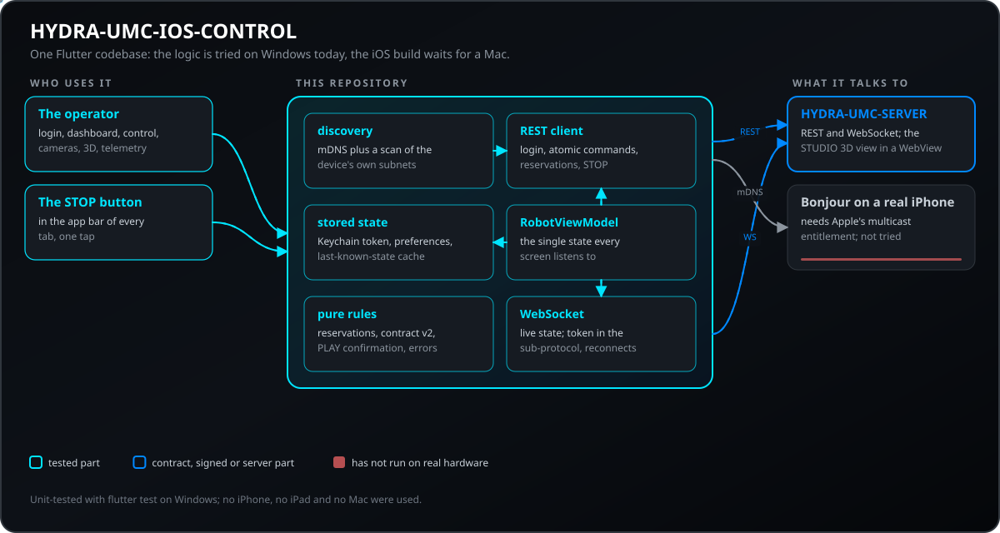
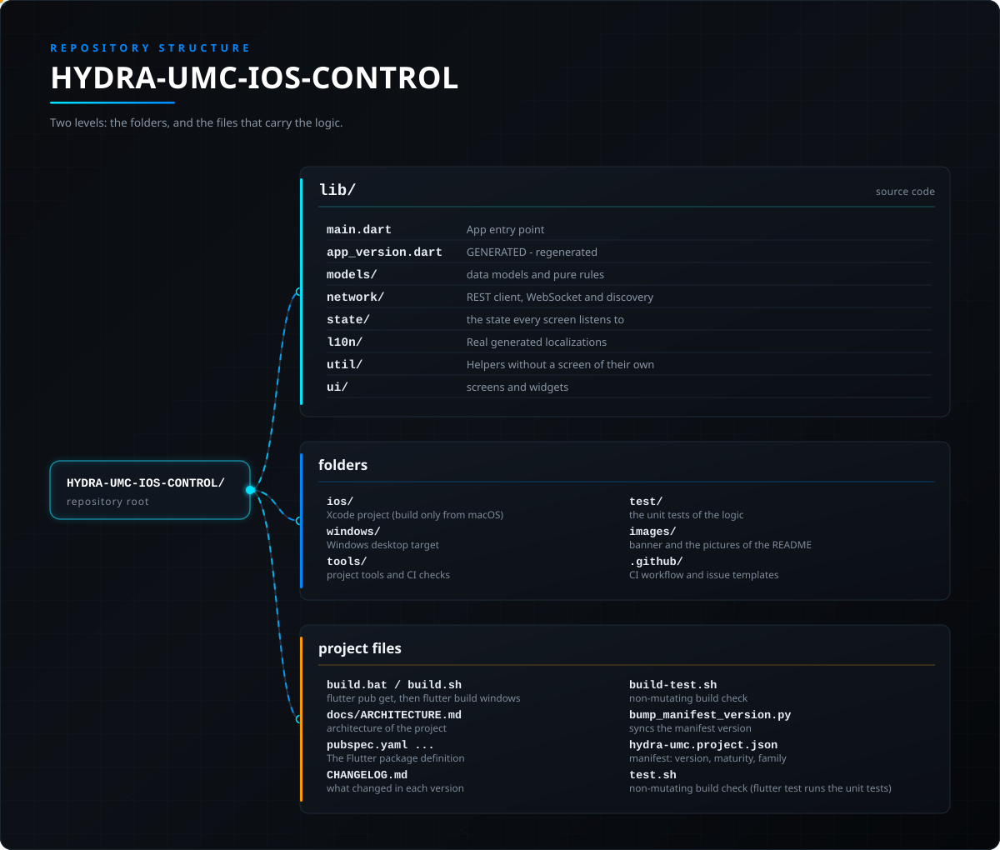

<!-- =============================================================================
HYDRA-UMC-IOS-CONTROL - iOS and iPadOS operator console for a HYDRA-UMC server, written in Flutter
Copyright (C) JuanenRac (Electro Hobby 3D) <electrohobby3d@gmail.com>
GPL-3.0-or-later - see LICENSE
============================================================================= -->

<p align="center">
  
</p>

# 🍎 HYDRA-UMC-IOS-CONTROL

<p align="center"><a href="README.md">🇺🇸 English</a> | 🇪🇸 <b>Español</b> | <a href="README_fra.md">🇫🇷 Français</a> | <a href="README_ita.md">🇮🇹 Italiano</a> | <a href="README_deu.md">🇩🇪 Deutsch</a> | <a href="README_zho.md">🇨🇳 简体中文</a> | <a href="README_jpn.md">🇯🇵 日本語</a> | <a href="README_por.md">🇵🇹 Português</a></p>

### Tus robots HYDRA-UMC en un iPhone o iPad: encuentra el servidor, mueve y vigila los robots y páralo todo con un botón rojo.

<p align="center">
  
  
  
  
  
  
  
</p>

---

Una app Flutter (Dart) multiplataforma que controla un robot de la plataforma [HYDRA-UMC](https://github.com/JuanenRac/HYDRA-UMC) por Wi-Fi, hablando exactamente el mismo contrato [`REMOTE_API.md`](https://github.com/JuanenRac/HYDRA-UMC-SERVER/blob/main/docs/REMOTE_API.md) que usan [HYDRA-UMC SUITE](https://github.com/JuanenRac/HYDRA-UMC-SUITE) y [HYDRA-UMC-ANDROID-CONTROL](https://github.com/JuanenRac/HYDRA-UMC-ANDROID-CONTROL) - descubrimiento, login, comandos atómicos por robot, y sincronización WebSocket en vivo contra una instancia de [HYDRA-UMC-SERVER](https://github.com/JuanenRac/HYDRA-UMC-SERVER) en ejecución (el backend headless separado del propio proceso de HYDRA-UMC STUDIO - STUDIO es ahora un cliente puro de frontend de ese servidor, igual que esta app).

> **Estado de seguridad física y de ciberseguridad:** este ecosistema no es un sistema de seguridad certificado. Todavía no existe una ruta de E-STOP por hardware, ni límites ni enclavamientos aplicados por el firmware, ni un comando de movimiento verificado; las imágenes de firmware se comprueban con CRC-32 y una firma Ed25519, y una compilación de versión rechaza las claves de desarrollo publicadas (los cabezales de herramienta y las placas de expansión detrás del relé siguen con cargadores de URTC, que usan un HMAC-SHA256 de clave compartida en lugar de una firma); TLS y TLS mutuo son opcionales y están desactivados por defecto; aún no se ha poblado ni probado ninguna placa propia. Lee la [línea base de seguridad](https://github.com/JuanenRac/HYDRA-UMC-DOCS/blob/main/docs/SECURITY_BASELINE.md) y el [modelo de amenazas](https://github.com/JuanenRac/HYDRA-UMC-DOCS/blob/main/docs/THREAT_MODEL.md) antes de fiarte de cualquier afirmación de aquí para la seguridad de una persona.

---

## 📋 De un vistazo

| | |
|---|---|
| Versión | `0.3.5` |
| Madurez | Funcional |
| Tests | 546 (`flutter test`) |
| Tecnología | Flutter 3.x / Dart |
| Destino | Un iPhone o iPad |
| En hardware real | Todavía no: no consta ninguna ejecución en hardware real para esta versión |

**Ir a:** [Resumen](#-resumen) · [Arquitectura](#-arquitectura) · [Funciones](#-funciones) · [Seguridad y protección](#-seguridad-y-protección) · [Interfaces](#-interfaces) · [Configuración](#-configuración) · [Inicio rápido](#-inicio-rápido) · [Pruebas](#-pruebas) · [Resolución de problemas](#-resolución-de-problemas) · [Estructura del repositorio](#-estructura-del-repositorio) · [Proyectos relacionados](#-proyectos-relacionados)

## 🚦 Estado del proyecto

Cada línea es una parte de este repositorio y la luz dice hasta dónde llega hoy. Se escribe con lo que el repositorio puede demostrar (pruebas, compilaciones, ejecuciones), no con lo previsto.

🟢 Hecho y verificado · 🟡 Funciona, con límites conocidos · 🟠 Hecho a medias o sin verificar · 🔴 Sin hacer o sin funcionar

| Área | Estado | Qué significa aquí |
|---|---|---|
| Software | 🟡 | Funciona para su propósito principal; la comprobación de honestidad de arriba lista lo que aún falta |
| Pruebas | 🟢 | 546 pruebas automáticas, ejecutadas en cada cambio |
| Hardware real | 🔴 | Todavía no: no consta ninguna ejecución en hardware real para esta versión |
| Interfaz y protocolos | 🟡 | Las rutas o los mensajes que ofrece están documentados y probados con un cliente; aún no los han usado todos los clientes |
| Integración | 🟠 | Sus mensajes y rutas se comprueban contra los contratos compartidos del SDK; no ha funcionado junto con el equipo real |
| Seguridad | 🟡 | El control de acceso, los límites de entrada o las firmas están implementados y probados en un ordenador; nadie ajeno al proyecto los ha revisado |
| Despliegue | 🟠 | Publicado como release; instalarlo en un equipo limpio está documentado pero no consta |
| Parada y seguridad | 🟠 | El camino de parada y sus límites están implementados y probados con simuladores; nunca han funcionado en una máquina real, y esto no es un sistema de seguridad certificado |
| Idiomas y accesibilidad | 🟡 | La interfaz y su ayuda están en ocho idiomas; el uso con teclado y lector de pantalla no se ha probado |
| Documentación | 🟢 | README en ocho idiomas, comprobado contra el manifiesto en cada cambio |

## 🎯 Resumen

Pantallas de la aplicación: **acceso** (dirección del servidor, cuenta, un escaneo de la red local), **panel** (una tarjeta por robot con su LED en vivo y la salud del módulo de cálculo), **control** (cruceta de movimiento, velocidad, válvulas y bombas, reserva del robot, PLAY con una pregunta opcional antes), **cámara** (MJPEG en directo), **vista 3D** (la escena real de STUDIO), **telemetría** (un registro estilo terminal) y **ajustes** (idioma, bloqueo biométrico, interruptores). Un botón rojo **PARO** está en la barra de cada pestaña.

## 🧩 Papel en HYDRA-UMC

**HYDRA-UMC-IOS-CONTROL** es la consola de operador de HYDRA-UMC para iPhone e iPad. Está escrita en Flutter para poder compilar, ejecutar y probar su lógica en Windows; la compilación de iOS sigue necesitando Xcode en un Mac. Encuentra un HYDRA-UMC-SERVER en la red local, inicia sesión, muestra y mueve los robots, vigila sus cámaras y una vista 3D, y lo para todo con una pulsación, con el mismo contrato remoto que la SUITE y la aplicación de Android. No es un dispositivo de seguridad.

## 🏛️ Arquitectura

<p align="center">
  
</p>

### Por qué Flutter, no Swift nativo

Esta app tiene como objetivo iOS/iPadOS, pero está construida en **Flutter** en vez de Swift/SwiftUI: el entorno de trabajo de este repositorio es exclusivamente Windows, y un proyecto Swift nativo se puede *escribir* en Windows pero nunca *compilar o ejecutar* ahí (Xcode y el SDK de iOS son exclusivos de macOS). El propio target de escritorio Windows de Flutter permite que esta app se construya, ejecute y pruebe de verdad en esta máquina - `flutter analyze` limpio, `flutter build windows` con éxito, `flutter test` pasando, y el `.exe` compilado arrancando y renderizando sin errores en tiempo de ejecución - en vez de escribir miles de líneas de Swift a ciegas, sin forma alguna de verificar nada de ello hasta que haya un Mac disponible.

**Esto no elimina la propia restricción de Apple** - un `.ipa` real sigue requiriendo Xcode en un Mac (o un runner de CI macOS) para compilarlo y firmarlo; nada de la elección de framework cambia eso. Lo que Flutter aporta es la capacidad de verificar cada otra línea de la lógica propia de esta app (redes, estado, UI) en esta máquina hoy, y de enviar un código base idéntico a iOS más adelante sin reescribirlo.

## ✨ Funciones

- **Login** (`lib/ui/login_screen.dart`, `lib/state/robot_view_model.dart`) - campos editables de IP/puerto y credenciales del operador más `POST /api/login`; no hay cuenta ni contraseña predefinidas. Un servidor de producción requiere credenciales de arranque configuradas explícitamente para su primer administrador; las cuentas "operator" adicionales de menor privilegio se crean desde Config > Users en la interfaz del navegador. El token de sesión persiste entre arranques en el llavero de iOS (`flutter_secure_storage`); el host y el puerto se guardan con `shared_preferences`. Un botón "Scan local network" (`lib/network/discovery.dart`) encuentra servidores sin que el usuario necesite saber ya la IP.
- **Descubrimiento de red** (`lib/network/discovery.dart`) - dos rutas independientes corren a la vez desde la hoja "Scan local network": mDNS/Bonjour real (`discoverMdns()`, consulta el servicio `_hydra._tcp.local` que publica `server.ts` vía el paquete `multicast_dns` - esta app es la primera de los 3 clientes remotos del ecosistema en añadirlo) más un escaneo concurrente por fuerza bruta de `GET /api/hydra-info` a través de la(s) subred(es) local(es) real(es) propia(s) de este dispositivo (`scanSubnets()`, derivadas del `NetworkInterface.list()` propio de `dart:io` en vez de una única suposición fija, ya que la LAN de un teléfono tiene tantas probabilidades de ser `192.168.0.x` o `10.x.x.x` como `192.168.1.x`, recayendo en `192.168.1.x` solo si la enumeración de interfaces en sí vuelve vacía). Que mDNS falle en silencio en un build de iOS sin el permiso correspondiente es esperado (el permiso Multicast Networking de Apple no lo concede un `flutter build ios` normal) - el escaneo de subred sigue funcionando de forma independiente de todas formas.
- **Puerta de acceso biométrica** (`lib/network/biometric_helper.dart`, `lib/ui/biometric_gate_screen.dart`) - Face ID/Touch ID/Windows Hello vía `package:local_auth`, un interruptor opcional en `Settings` que protege la restauración de una sesión guardada válida al arrancar (esta app nunca guarda una contraseña en texto plano, solo un token - adaptado del diseño de relleno de contraseña propio de HYDRA-UMC-ANDROID-CONTROL a esa diferencia).
- **Sincronización de comandos atómicos** (el propio `_sendAtomicCommand()` de `lib/state/robot_view_model.dart`) - cada escritura (play/pause/stop/jog/valve/pump/speed/vision) usa el endpoint real `POST /api/robot/:id/command`, una carga útil pequeña y dirigida en vez de sobrescribir todo el árbol de settings, con propagación correcta de robot combinado (`combinedWith`) para los 5 comandos que la necesitan.
- **Sincronización WebSocket en vivo** (`lib/network/hydra_websocket.dart`) - envía el token como subprotocolo `hydra.bearer` y nunca en la URL de conexión (`server.ts` rechaza `/ws?token=` por defecto), maneja tanto tipos de difusión `"settings"` como `"delta"`, se reconecta automáticamente al caerse.
- **Dashboard** (`lib/ui/dashboard_screen.dart`) - tarjetas por robot, reactivas en tiempo real vía el propio `ChangeNotifier` de `Provider`, convención de LED (verde parpadeando = activo, rojo fijo = inactivo) y visualización de robot combinado (mostrada solo en el lado seguidor, resuelta por id) igualando el propio Dashboard Overview de HYDRA-UMC-STUDIO.
- **Control Manual** (`lib/ui/control_screen.dart`, `lib/ui/widgets/joystick_pad.dart`) - D-pad de jog (con/sin objetivo de mesa XY), sliders de velocidad/aceleración, interruptores de válvula/bomba, y el **STOP** global (`lib/ui/widgets/stop_all.dart`): una pulsación, sin pulsación larga ni confirmación, para todos los robots (`POST /api/stop-all`), siempre en la barra superior de cada pestaña, también en la de Control. El resultado se muestra robot a robot (aviso si un robot falló o la parada no se guardó; los robots reservados por otra cuenta se marcan), un error de red se reintenta una vez, un servidor que superó su límite de peticiones o sin esa ruta se atiende con la parada por robot, y si nadie responde queda un aviso permanente «STOP no confirmado» hasta que un STOP posterior obtenga respuesta. El botón redondo de parada por robot conserva su protección de pulsación larga.
- **Reservas y límites de seguridad** (`lib/ui/widgets/access_panel.dart`, `lib/models/access.dart`, `lib/network/hydra_api_client.dart`, `lib/state/robot_view_model.dart`) - La pantalla de Control muestra quién tiene el robot seleccionado (nadie, este dispositivo, la misma cuenta en otro dispositivo u otra cuenta) y ofrece **Reservar** y **Liberar**, además de la lista de todas las reservas del servidor (`GET /api/claims`). El dispositivo guarda un identificador de controlador por instalación y lo envía con cada reserva, liberación, armado del jog y comando (en el cuerpo y en la cabecera `X-Controller-Id`), de modo que la reserva pertenece a la cuenta y a este dispositivo, no a toda la cuenta. Las negativas del servidor se distinguen: reservado por otra cuenta, por tu cuenta en otro dispositivo o ventana, falta el identificador de controlador y jog sin armar. Los límites del modelo del robot se leen de `GET /api/safety-limits`: un paso de jog por encima del límite no se envía y se muestran los avisos del servidor. Cuando el administrador lo exige, hay que pulsar **Armar jog** (con cuenta atrás) antes de que el joystick mueva el robot; el armado termina solo, con STOP o al liberar. Las reservas son opcionales: un robot que nadie reservó se controla como antes. Solo para un **administrador**, aparece un botón **Tomar el control** sobre un robot que tiene otra persona; pide confirmación y luego reserva el robot con `force: true` (el servidor solo lo admite de administradores y vuelve a comprobar el rol). Las escrituras son condicionales: cada una lleva la revisión del robot que esta app vio por última vez (`If-Match`, `lib/models/contract_v2.dart`) y, si otra persona cambió el robot entretanto, el servidor responde 412, no se aplica nada, el robot se vuelve a leer y el mensaje lo dice (Estándar comprueba reservas, mesa y comandos puntuales; Estricto comprueba todo salvo STOP; Desactivado no comprueba nada; la elección está en la lista de reservas; STOP nunca se comprueba). El jog de la mesa XY es un único comando atómico `table` (un servidor antiguo recibe los jogs que entiende), el servidor empuja las reservas por el WebSocket para que la pantalla Control deje de consultar mientras llegan, y los administradores leen el registro de auditoría (`lib/ui/widgets/audit_dialog.dart`) con su cadena SHA-256 verificada dos veces, por el servidor y en el dispositivo, y pueden copiar sus líneas como `.jsonl`.
- **Interruptores opcionales** - dos interruptores, ambos apagados por defecto: *Bloquear órdenes con datos guardados* (Ajustes) retiene toda orden salvo el STOP mientras la pantalla muestra la copia guardada del estado de los robots y no el estado real, y *No explorar redes de datos móviles ni VPN* (pantalla de acceso) deja esas interfaces fuera del barrido de la subred. Los botones del D-pad de jog miden al menos 44 pt y VoiceOver los anuncia con su eje y dirección; la imagen de la cámara se cierra mientras la app está en segundo plano.
- **Preguntar antes de PLAY** - activado por defecto, se desactiva en Ajustes: antes de empezar una trayectoria la app muestra el robot, sus puntos grabados, la velocidad y quién lo tiene reservado (un robot reservado por otra persona avisa de que el servidor rechazará la orden). Un robot que ya está reproduciendo no vuelve a preguntar. La elección se conserva.
- **Quién se conecta al servidor:** un botón Conexiones del panel de acceso abre una lista sencilla de las apps que el servidor ha visto (tipo, usuario, versión, red local o desde fuera, las sesiones abiertas ahora, las entradas que funcionaron o fueron rechazadas, hace cuánto) y las últimas entradas, entradas rechazadas, salidas y sesiones terminadas, leídas de las rutas de conexiones del servidor. Un administrador ve todas las entradas y cualquier otra cuenta solo las suyas; ninguna lista lleva contraseñas ni tokens y una dirección solo aparece si se indicó al servidor que la guardara. Lo dice con claridad cuando el servidor es demasiado antiguo para ofrecerlas.
- **Opciones de acceso del servidor en Ajustes (solo administradores):** una entrada de Ajustes abre nueve interruptores leídos de la configuración del servidor: la ruta de salud sin iniciar sesión, el anuncio de la parada global, guardar la dirección de cada cliente en el historial de conexiones, las imágenes de cámara sin ticket, un token en la dirección del WebSocket, el ocultado de secretos en el registro, la firma de una confirmación hablada, la contraseña de una cámara IP entregada por el entorno de su proceso y TLS activado por una instalación nueva. Cada uno muestra de dónde viene su valor (por defecto, guardado desde una pantalla o fijado por el entorno del servidor, que lo bloquea), solo se envía lo que cambió, todo cambio que baja la protección pregunta antes y un servidor que no ofrece una opción no la muestra.
- **Bluetooth LE (GATT)** (`lib/network/hydra_ble_client.dart`, `lib/network/ble_contract.dart`, `lib/network/ble_gatt_fbp.dart`) - Un cliente GATT real que sigue un contrato documentado: búsqueda filtrada por el servicio HYDRA, conexión con negociación de MTU, comprobación del servicio, notificaciones, mensajes por tramas en ambos sentidos, una escritura cada vez, reconexión automática con esperas crecientes, el permiso de Bluetooth de iOS y un mensaje claro en el idioma del usuario para cada fallo. **Ningún dispositivo HYDRA-UMC implementa todavía la parte periférica:** el cliente solo se ha probado contra un GATT simulado, el enlace Bluetooth nunca se ha ejecutado en un iPhone y los comandos al robot no se envían por Bluetooth.
- **Notificaciones push** (`lib/network/push_bridge.dart`, `ios/Runner/AppDelegate.swift`, `lib/state/robot_view_model.dart`) - un interruptor en Ajustes, apagado hasta que la persona lo activa: la app pide permiso, toma el token de dispositivo del sistema y lo registra en el servidor (`POST /api/push/devices`, con el idioma de la app), que después avisa al teléfono por el servicio push de Apple cuando termina un trabajo o se da una parada global; el token se quita del servidor al apagar el interruptor o al cerrar sesión. El servidor las tiene apagadas por defecto. Construido y probado contra un sistema simulado y un servidor local; ninguna notificación ha llegado a un iPhone real, porque eso necesita la cuenta de desarrollador de Apple descrita en la documentación del servidor.
- **Parada global desde fuera de la app** (`ios/Runner/GlobalStopShortcut.swift`, `lib/network/shortcut_bridge.dart`, `lib/state/robot_view_model.dart`) - un atajo para la app Atajos, Siri, Spotlight y el botón de acción, y una acción rápida en el icono de la app, en los ocho idiomas. Abren la app y hacen la misma parada global que el botón STOP (`POST /api/stop-all` con la sesión de la persona, y el respaldo robot a robot), así que el contrato y el manejo del token son los mismos; una petición espera una sesión un minuto como máximo y después se descarta, de modo que una parada pedida hace tiempo nunca se dispara más tarde. Construido en CI, nunca ejecutado en un iPhone.
- **Cámara** (`lib/ui/camera_screen.dart`, `lib/ui/widgets/mjpeg_view.dart`) - un pequeño analizador de stream MJPEG hecho a mano (sin paquete de terceros), un estado claro de "Camera Disabled" en vez de una imagen en blanco silenciosa, y un interruptor para activar/desactivar el sistema de visión de un robot directamente desde el servidor (el comando atómico `"vision"` propio de `server.ts`).
- **Vista 3D** (`lib/ui/three_d_screen.dart`) - embebe el propio viewport 3D en tiempo real de HYDRA-UMC-STUDIO en un WebView (`?hideUI=true&robotId=#token=`), el mismo enfoque que la app de Android, por la misma razón (obtiene gratis la escena 3D real, actualmente en producción). Recae en un placeholder honesto en plataformas que `webview_flutter` no soporta (el target de escritorio Windows de este repositorio, usado para verificación de build).
- **Métricas del sistema** (`lib/state/robot_view_model.dart`) - `GET /api/system/metrics` consultado cada 5s, la misma cadencia que los otros 2 clientes, mostrado en el Dashboard.
- **UI en 8 idiomas** (`lib/l10n/`, pipeline estándar `flutter gen-l10n`) - inglés, español, francés, alemán, italiano, japonés, chino y portugués, igualando al resto de clientes de este ecosistema. Un ajuste persistido en `Ajustes > Idioma` usa por defecto el idioma del sistema; `RobotViewModel.lastError` es un `HydraError` tipado en lugar de texto en inglés ya formateado, así que los mensajes de error de la lógica de negocio (fallos de inicio de sesión/conexión/comando) también se traducen correctamente, no solo el texto estático de las pantallas.
- **Caché de estado sin conexión** (`lib/network/state_cache.dart`) - el último árbol de ajustes conocido se guarda en disco (con debounce de 1s) junto con el instante real en que se guardó, así que las pantallas de Dashboard/Control muestran datos reales, aunque potencialmente desactualizados, inmediatamente al arrancar en vez de un estado vacío mientras el `connect()` real todavía está en curso. Un aviso real y visible (no una suposición silenciosa) indica "mostrando datos en caché de las HH:mm" mientras eso siga siendo cierto. Se sustituye por los datos reales en cuanto la conexión tiene éxito.
- **Telemetría** (`lib/ui/telemetry_screen.dart`) - un registro estilo terminal, más reciente primero, de eventos reales de conexión/inicio de sesión/comandos, limitado a 50 entradas, con una acción para borrarlo - la misma convención "verde Matrix" que la propia pestaña de Telemetría de HYDRA-UMC-ANDROID-CONTROL.
- **Asistente de Voz en la App** (`lib/ui/voice_assistant_dialog.dart`) - un icono de micrófono en la barra superior abre un diálogo para escribir una pregunta o una orden, enviada a `HYDRA-UMC-VOICE-UI` por la misma ruta real `POST /api/voice/turn` que usan el botón de voz propio de HYDRA-UMC-ANDROID-CONTROL y su relé con el reloj emparejado. Un dictado opcional (un interruptor en Ajustes, apagado por defecto) escribe lo que dices en el cuadro de texto con el framework Speech de iOS, en el propio iPhone salvo que permitas el reconocimiento en línea de Apple; el texto nunca se envía solo, y al servidor solo llega texto, nunca audio. Una respuesta nunca emite un comando de robot directamente.
- **Pestaña Ecosistema, diagnóstico de conexión y superficies fuera de la app** (`lib/ui/ecosystem_tab.dart`, `lib/ui/connection_diagnostics_dialog.dart`, `lib/state/external_surfaces.dart`) - la pantalla de Telemetría tiene una pestaña Ecosistema (los manifiestos de proyecto que encuentra el servidor, con bombilla solo para los servicios que declaran uno); Ajustes abre el diagnóstico de conexión (esquema, cómo se confía en el certificado, versiones, latencia de unas lecturas de `GET /api/hydra-info`, el estado del enlace y un informe para copiar sin contraseñas ni tokens); y tres interruptores, todos apagados por defecto, activan notificaciones locales (trabajo terminado, robot sin conexión o en modo seguro, conexión perdida), una Live Activity con el progreso de la trayectoria en curso y un estado con petición de STOP para un Apple Watch emparejado. Las partes en Swift y las fuentes de la Live Activity y de la app del reloj (`ios/HydraLiveActivity`, `ios/HydraWatch`) están escritas pero no compiladas en Xcode ni probadas en un iPhone o un reloj, y esas dos extensiones aún necesitan sus targets en Xcode.
- **Canal de comandos y mantenimiento de la reserva** (`lib/state/robot_command_repository.dart`, `lib/models/robot_command_contract.dart`, `lib/models/access.dart`) - el mismo reparto que HYDRA-UMC-ANDROID-CONTROL: un repositorio fuera del view model guarda la revisión de cada robot, repite un stop cuando nadie responde, envía un movimiento `table` como jogs a un servidor antiguo, cuenta los jogs en el cable, agrupa los comandos continuos y mide cada respuesta, y los nombres y límites de los comandos se generan desde `docs/robot_command_contract.json` (copia idéntica del fichero de Android) con `tools/gen_command_contract.py`, comprobado por la validación. Mientras la pantalla de Control está abierta, una reserva que tiene este dispositivo se pide de nuevo poco antes de acabar, para que una sesión larga no pierda el robot, y las reservas del dispositivo se liberan al cerrar sesión. La lectura de la carga del servidor cada pocos segundos reconstruye solo la barra que la muestra, no todas las pantallas. Probado con un servidor falso; no se ha ejecutado en un iPhone.
- **HOME/RESET** (`lib/ui/control_screen.dart`, `lib/util/home_reset.dart`, `lib/state/robot_view_model.dart`) - un botón que lleva el robot seleccionado a su posición cero mediante el comando `reset` del servidor. Viene apagado: un interruptor en Ajustes lo activa y la elección se conserva. Pide confirmación dos veces, en orden y dentro de un plazo, antes de enviar nada. Se rechaza, con una frase propia, cuando el robot está reproduciendo, en modo seguro, sin conexión o sin posición, mientras se envía un STOP o no se confirmó, mientras hay un jog en el cable, cuando el jog debe armarse y no lo está, y para una sesión que no es de operador ni de administrador (el servidor vuelve a decidir el rol). El comando lleva un número creciente como el jog, y un servidor que no conoce `reset` se distingue y se recuerda. El valor por defecto, el número de pasos y el plazo se leen de `docs/robot_command_contract.json`. Probado contra un servidor falso local: no interviene ningún robot.
- **Movimiento continuo, salud del enlace, emparejamiento por enlace, alertas al reloj y selector de Work** (`lib/util/dead_man_jog.dart`, `lib/network/dead_man_jog_runner.dart`, `lib/state/dead_man_jog_controller.dart`, `lib/util/pairing_link.dart`, `lib/util/watch_alerts.dart`, `lib/util/watch_relay.dart`, `lib/util/work_files.dart`) - lo mismo que la aplicación de Android, con cada número leído de `docs/robot_command_contract.json`. El **movimiento continuo** (un interruptor en Ajustes, apagado por defecto) mueve un eje mientras se mantiene un botón: `jogStart`, un latido cada 100 ms y `jogStop`; el eje se detiene (una parada enviada con la urgencia de un STOP, reintentada) al soltar, con STOP, al salir de la pantalla, al perder la conexión, tras dos latidos fallidos, tras 30 segundos, con un enlace malo o cuando el servidor rechaza un latido. Un **indicador del enlace** (encendido por defecto) muestra lo rápido que responde el servidor, y un segundo interruptor (encendido por defecto) bloquea el movimiento continuo con un enlace lento o perdido. El **emparejamiento por enlace** (apagado por defecto) lee `hydra-umc://pair?host=..&port=..&fp=..&name=..`, abierto por la cámara del teléfono o pegado en el acceso o en Ajustes, lo valida con rigor, muestra lo leído y pregunta antes de guardar nada; un enlace sin la huella del certificado se rechaza siempre, y con ella la app exige TLS y la fija. Las **alertas al Apple Watch** (conexión perdida o restablecida, robot sin conexión o en modo seguro, un STOP sin confirmar o confirmado) están racionadas y necesitan también la opción del Apple Watch; los relés de la presencia del operador y de la confirmación en dos pasos de una orden hablada están apagados por defecto y esperan endpoints que el servidor aún no tiene. El **selector de Work** lista los ficheros de trabajo de la carpeta del robot y carga uno con el comando `trajectory` tras comprobar sus puntos como lo hace el servidor; nunca inicia la reproducción. Escrito sin un Mac: **sin compilar en Xcode ni probado en un iPhone o un reloj**; la lógica se prueba en la VM de Dart con relojes, servidores y puentes falsos.

## 🔒 Seguridad y protección

| Amenaza | Defensa | Dónde |
|---|---|---|
| Un token robado del teléfono | El token, el nombre de usuario y el token de renovación se guardan con `flutter_secure_storage` (el llavero de iOS); solo el servidor, el puerto y las preferencias van a `shared_preferences`; la aplicación nunca guarda una contraseña en claro | `network/auth_prefs.dart` |
| Credenciales en la copia guardada del estado | La copia del último estado que se escribe en disco pierde las claves `ipUsername` e `ipPassword` a cualquier profundidad, y se borra al cerrar sesión | `network/state_cache.dart` |
| El token en un registro o en la dirección del WebSocket | El token va en el subprotocolo `hydra.bearer` del WebSocket y nunca en su dirección; la vista 3D incrustada lo recibe en el fragmento de la dirección (`#token=`), que no se envía al servidor; una prueba comprueba ambas cosas | `network/hydra_websocket.dart`, `util/viewer_url.dart` |
| Alguien con el teléfono desbloqueado | Un bloqueo biométrico opcional (Face ID, Touch ID) controla la restauración de una sesión guardada al arrancar; la imagen de la cámara se cierra mientras la aplicación está en segundo plano | `network/biometric_helper.dart`, `ui/biometric_gate_screen.dart` |
| Un robot movido por dos personas, un PLAY pulsado por error o un paro que no llega | El robot se reserva antes de moverlo y la pantalla dice quién lo tiene; PLAY pregunta primero por defecto y muestra el robot, sus puntos, la velocidad y quién lo tiene reservado; el paro global se reintenta una vez, recurre a un paro por robot y mantiene un aviso persistente «PARO sin confirmar» si nadie respondió | `models/access.dart`, `util/play_confirmation.dart`, `ui/widgets/stop_all.dart` |

**Lo que nunca hace:** sustituir una parada de emergencia física, ni cifrar el tráfico por sí sola: la aplicación prueba HTTPS una vez cuando una sonda HTTP sin cifrar no obtiene respuesta, y no tiene fijado de certificados ni protección contra tráfico sin cifrar fuera de la red local. El PARO es el paro por software del servidor.

## 🔌 Interfaces

| Topic o ruta | Qué lleva |
|---|---|
| `POST /api/login`, `/api/logout`, `/api/refresh` | iniciar y cerrar sesión y renovarla |
| `GET /api/hydra-info` | reconoce un servidor real; lo usan el escaneo de subred y la dirección manual, con un reintento por HTTPS |
| `GET /api/settings`, `/api/system/metrics`, `/api/safety-limits`, `/api/claims` | el estado de los robots, el módulo de cálculo (cada 5 s), los límites de seguridad de cada modelo y las reservas |
| `POST /api/robot/{id}/command`, `/claim`, `/release`, jog arming | un comando pequeño para un robot, su reserva y el armado de un movimiento manual, con escrituras condicionales por revisión del robot |
| `POST /api/stop-all` | el PARO global: todos los robots, con respuesta robot por robot |
| `GET /api/audit`, `POST /api/voice/turn`, `GET /api/camera/{id}/stream` | el registro de auditoría (administradores, con su propia comprobación de cadena SHA-256), un turno de voz escrito y el flujo MJPEG de una cámara |
| WebSocket `hydra.bearer`, mDNS `_hydra._tcp.local` | cambios de estado en vivo (mensajes `settings` y `delta`, reconexión tras 3 s hasta 30 s, un ping cada 20 s) y el anuncio Bonjour del servidor |

## ⚙️ Configuración

La aplicación no tiene fichero de configuración: todo se fija en pantalla y se guarda en el dispositivo. Los valores por defecto vienen del código.

| Variable | Por defecto | Qué fija |
|---|---|---|
| Ajustes > Preguntar antes de PLAY | activado | muestra el robot, sus puntos, la velocidad y quién lo tiene reservado antes de empezar una trayectoria |
| Ajustes > Bloquear órdenes con datos guardados | desactivado | retiene toda orden salvo PARO mientras la pantalla muestra la copia guardada del estado y no la viva |
| Acceso > No escanear redes de datos móviles ni VPN | desactivado | deja esas interfaces fuera del escaneo de subred (32 equipos a la vez, puerto 3000 salvo que escribas otro) |
| Ajustes > Bloqueo biométrico | desactivado | pide Face ID o Touch ID antes de restaurar una sesión guardada al arrancar |
| Ajustes > Idioma | el idioma del sistema | uno de los ocho idiomas de la aplicación (`lib/l10n/`), que se mantiene entre arranques |

## 🚀 Inicio rápido

Requiere el SDK estable de Flutter (Dart 3.13 o superior). Windows ejecuta la lógica y las pruebas; una compilación real para iPhone necesita Xcode en un Mac.

```bash
flutter pub get                  # downloads the packages
flutter test                     # runs the unit tests on this machine
./build-test.sh                  # non-mutating build check (build-test.bat on Windows)
flutter build ios --no-codesign  # a real iOS build; only on a Mac with Xcode
```

## 🧪 Pruebas

546 pruebas automáticas se ejecutan con `flutter test`. No necesitan hardware ni nada fuera de esta máquina.

El CI ejecuta `HYDRA_UMC_CI=1 python tools/ci_validate.py`, que comprueba el manifiesto, los documentos, los ocho README y las imágenes.

## 🏗️ Compilación y publicación

Requiere el [Flutter SDK](https://docs.flutter.dev/get-started/install) (canal stable). Este repositorio se compila/verifica contra Flutter 3.47.0. Solo `windows/` e `ios/` están configuradas como plataformas en este repositorio (sin carpetas `android/`, `linux/`, `web/`, o `macos/`) - Windows existe para que la lógica propia de esta app se pueda compilar y ejecutar sin un Mac; iOS es el objetivo real.

### Scripts de build

```bash
./build.sh     # Git Bash / WSL - flutter pub get + flutter build windows
build.bat      # cmd.exe / PowerShell - flutter pub get + flutter build windows
```

Ambos producen `build/windows/x64/runner/Release/hydra_umc_control.exe`, y ninguno cambia la versión de la app - ver [Versionado](#versionado) más abajo.

### Build manual

```bash
flutter pub get
flutter analyze          # analisis estatico - sin necesidad de compilador
flutter test             # pruebas de widgets
dart run tool/bump_version.dart  # sube la versión, igual que hacen build.sh/build.bat
flutter build windows    # produce build/windows/x64/runner/Release/hydra_umc_control.exe
flutter run -d windows   # o -d <ios-device-id> desde un Mac
```

**Compilar el `.ipa` real de iOS** requiere Xcode en macOS - desde esa máquina: `flutter build ipa` (o abrir `ios/Runner.xcworkspace` directamente en Xcode). Esto no se puede hacer desde Windows; ver "Por qué Flutter, no Swift nativo" arriba.

### Versionado

Este repositorio sigue una política a nivel de ecosistema: compilar nunca cambia la versión. El comando `bump` explícito (`python tools/hydra_project_tool.py bump`) ejecuta `tool/bump_version.dart`, que aplica:

- **Patch, estilo cuentakilómetros (base 10):** +1 en cada bump; al
  superar 9 se resetea a 0 y minor sube +1 - p. ej. `0.0.9` ->
  `0.1.0`. Major nunca se toca automáticamente.
- **Build number** (la parte tras `+`): un contador monotónico simple,
  +1 en cada bump, sin acarreo.

El mismo script regenera `lib/app_version.dart` (generado, no editado a
mano - un simple archivo `const`, no una dependencia nueva en tiempo de
ejecución como `package_info_plus`), que la app lee en tiempo real para
mostrar su propia versión en la pantalla de **Ajustes**. Ver
[CHANGELOG.md](CHANGELOG.md) para el historial de versiones.

## 🩺 Resolución de problemas

| Ves | Porque | Haz |
|---|---|---|
| «Sesión no autorizada: inicia sesión de nuevo» | El servidor rechazó el token (el WebSocket se cerró con el código 1008) o caducó | Inicia sesión otra vez |
| «PARO sin confirmar por el servidor» | Nada respondió al PARO global dentro de su tiempo límite corto, o el servidor no pudo guardar el estado de paro | Púlsalo otra vez; si el aviso sigue, usa la parada de emergencia física |
| El robot está reservado por otra cuenta, o por tu cuenta en otro dispositivo | Una reserva pertenece a la cuenta y al dispositivo (un identificador de controlador por instalación) | Usa ese dispositivo, o libera allí la reserva |
| «Mostrando datos guardados de HH:mm» | El servidor no está al alcance y la pantalla muestra la copia guardada del último estado; con Bloquear órdenes con datos guardados activado, toda orden salvo PARO queda retenida | Revisa el servidor y el Wi-Fi; la pantalla vuelve a estar en vivo sola cuando vuelve la conexión |
| «Movimiento rechazado: el paso supera el límite» | El paso supera el límite que el servidor fija para este modelo de robot (`GET /api/safety-limits`) | Usa un paso menor; no se envió nada |
| «Buscar en la red local» no encuentra ningún servidor | En un iPhone real, Bonjour necesita un permiso que una compilación simple no lleva, y el escaneo puede dejar fuera las redes de datos móviles y VPN | Conéctate al mismo Wi-Fi que el servidor, o escribe a mano su dirección y puerto |

## 📂 Estructura del repositorio

<p align="center">
  
</p>

<details>
<summary>Versión en texto del árbol</summary>

```text
HYDRA-UMC-IOS-CONTROL/
├── lib/                                                              código fuente
│   ├── main.dart                                                     Punto de entrada de la app, ChangeNotifierProvider + puerta de login
│   ├── app_version.dart                                              GENERADO - regenerado por bump_manifest_version.py, no editar a mano
│   ├── models/                                                       modelos de datos y reglas puras
│   ├── network/                                                      cliente REST, WebSocket y descubrimiento
│   ├── state/                                                        el estado que escucha cada pantalla
│   ├── l10n/                                                         Localizaciones reales generadas (8 idiomas) - ver l10n.yaml en la raíz del repo
│   ├── util/                                                         Utilidades sin pantalla propia
│   └── ui/                                                           pantallas y widgets
├── ios/                                                              Proyecto Xcode (compilar solo desde macOS)
├── windows/                                                          Target de escritorio Windows - verificacion de build sin un Mac
├── tools/                                                            herramientas del proyecto y comprobaciones del CI
├── test/                                                             las pruebas unitarias de la lógica
├── images/                                                           banner e imágenes del README
├── .github/                                                          flujo de CI y plantillas de incidencias
├── build.bat / build.sh                                              flutter pub get y luego flutter build windows; nunca cambia la versión
├── docs/ARCHITECTURE.md                                              arquitectura del proyecto
├── pubspec.yaml / pubspec.lock / l10n.yaml / analysis_options.yaml   La definición del paquete Flutter y sus versiones fijadas, los ajustes del generador de l10n y las reglas de lint
├── CHANGELOG.md                                                      qué cambió en cada versión
├── build-test.sh                                                     comprobación de compilación sin cambios
├── bump_manifest_version.py                                          sincroniza la versión del manifiesto
├── hydra-umc.project.json                                            manifiesto: versión, madurez, familia
└── test.sh                                                           comprobación de compilación sin cambios (flutter test ejecuta las pruebas unitarias)
```

</details>

## 🗺️ Hoja de ruta y límites conocidos

No hay compilación para iPhone ni iPad en el CI: `flutter build ios` necesita Xcode en un Mac, así que la aplicación solo se ha ejecutado y probado en Windows. El descubrimiento por Bonjour necesita un permiso que una compilación simple no lleva, así que en un iPhone real el escaneo de subred es lo que encuentra el servidor. Las partes en Swift (dictado, notificaciones locales, Live Activity, enlace con el Apple Watch) están escritas pero nunca se han compilado en Xcode ni ejecutado en un iPhone o un reloj; la Live Activity y la app del reloj esperan sus targets en Xcode.

## 🌍 Idiomas

Este README y los documentos del repositorio existen en ocho idiomas: inglés, español, alemán, francés, italiano, japonés, chino y portugués (Portugal). Se escriben a la vez y el CI comprueba que los ocho ficheros tengan las mismas secciones y los mismos enlaces.

## 🔗 Proyectos relacionados

Este proyecto es parte del ecosistema de robótica HYDRA-UMC del mismo autor (JuanenRac / Electro Hobby 3D). Vale la pena conocerlo, ya que una petición podría en realidad ser sobre alguno de estos en vez de sobre este repositorio.

**Proyecto Padre**
- **[HYDRA-UMC-SERVER](https://github.com/JuanenRac/HYDRA-UMC-SERVER)** — el backend headless real (REST/WebSocket) con el que habla de verdad cada cliente de control; el backend contra el que se ejecutan el inicio de sesión, los comandos atómicos y la sincronización WebSocket propios de esta app.

**Proyectos Hermanos** — también hablan con la propia API de HYDRA-UMC-SERVER, cada uno como su propio cliente
- **[HYDRA-UMC-STUDIO](https://github.com/JuanenRac/HYDRA-UMC-STUDIO)** — panel de control web con visualización 3D multi-robot en tiempo real; su propio visor 3D se integra directamente en la pantalla de Vista 3D de esta app mediante WebView.
- **[HYDRA-UMC-SUITE](https://github.com/JuanenRac/HYDRA-UMC-SUITE)** — centro de mando de enjambre de escritorio (PySide6) para varios servidores a la vez, empaquetado como ejecutable independiente; habla exactamente el mismo contrato `REMOTE_API.md` que esta app.
- **[HYDRA-UMC-ANDROID-CONTROL](https://github.com/JuanenRac/HYDRA-UMC-ANDROID-CONTROL)** — app nativa de control para Android con inicio de sesión biométrico y un compañero Wear OS emparejado; habla exactamente el mismo contrato `REMOTE_API.md` que esta app.
- **[HYDRA-UMC-DSI](https://github.com/JuanenRac/HYDRA-UMC-DSI)** — interfaz táctil nativa para la pantalla táctil DSI de 7" a bordo, embebida en el propio CM5.
- **[HYDRA-UMC-BRIDGE-AMR](https://github.com/JuanenRac/HYDRA-UMC-BRIDGE-AMR)** — barrera de coordinación para flotas AGV/AMR mediante un publicador MQTT VDA 5050 (probado solo contra una flota emulada).
- **[HYDRA-UMC-BRIDGE-CNC](https://github.com/JuanenRac/HYDRA-UMC-BRIDGE-CNC)** — coordinador de alto nivel para celdas CNC con acceso a estado/bytes de control GRBL (probado solo contra un emulador).
- **[HYDRA-UMC-BRIDGE-DROIDS](https://github.com/JuanenRac/HYDRA-UMC-BRIDGE-DROIDS)** — barrera de coordinación para droides con patas/humanoides, con un emisor de comandos para Boston Dynamics Spot (probado solo contra un emulador).
- **[HYDRA-UMC-BRIDGE-LASER](https://github.com/JuanenRac/HYDRA-UMC-BRIDGE-LASER)** — coordinador de celdas láser que lee 3 señales GPIO de llave/carcasa/enclavamiento (probado solo contra un chip simulado; no puede armar ni disparar un láser).
- **[HYDRA-UMC-BRIDGE-OPENPNP](https://github.com/JuanenRac/HYDRA-UMC-BRIDGE-OPENPNP)** — coordinador de alto nivel seguro para el flujo de placas de pick-and-place OpenPnP.
- **[HYDRA-UMC-BRIDGE-PRINTER3D](https://github.com/JuanenRac/HYDRA-UMC-BRIDGE-PRINTER3D)** — barrera de coordinación segura para impresoras 3D Moonraker/Klipper, con comandos de trabajo reales y controlados.
- **[HYDRA-UMC-BRIDGE-ROS2](https://github.com/JuanenRac/HYDRA-UMC-BRIDGE-ROS2)** — coordinador con un transporte ROS 2 rclpy importado de forma perezosa (todavía no ejecutado contra una instalación de ROS 2).
- **[HYDRA-UMC-BRIDGE-UAV](https://github.com/JuanenRac/HYDRA-UMC-BRIDGE-UAV)** — barrera de coordinación para UAV equipados con cámara, con un emisor de comandos MAVLink (probado solo contra un emulador).

**Directamente Relacionados**
- **[HYDRA-UMC-WATCH](https://github.com/JuanenRac/HYDRA-UMC-WATCH)** — app compañera de WearOS con patrones de alerta háptica y un relé de voz al teléfono emparejado (todavía no ejecutada en un reloj físico); la compañera de muñeca de HYDRA-UMC-ANDROID-CONTROL (solo WearOS; la app de Apple Watch de esta app de iOS está escrita pero aún no compilada).
- **[HYDRA-UMC-HIL-BRIDGE](https://github.com/JuanenRac/HYDRA-UMC-HIL-BRIDGE)** — enrutador hardware-in-the-loop con un enclavamiento de software por colisión entre simulación y hardware real (probado sin hardware real); el puente que permite a esta app controlar de forma remota el gemelo digital, hardware-in-the-loop.

**También Forma Parte del Ecosistema**

*Hardware y Plataforma Base*
- **[HYDRA-UMC](https://github.com/JuanenRac/HYDRA-UMC)** — el diseño de la placa madre del brazo robótico: host CM5 + coprocesador STM32H745 de doble núcleo, pensado para coordinar hasta 8 brazos herramienta por CAN-OTA/SPI-OTA (firmware en fase temprana; todavía no hay ninguna placa poblada).
- **[HYDRA-UMC-OS](https://github.com/JuanenRac/HYDRA-UMC-OS)** — capa de producto reproducible sobre Raspberry Pi OS para el CM5: agente de solo lectura, config/perfiles validados, aprovisionamiento WiFi de primer contacto.
- **[HYDRA-UMC-SDK](https://github.com/JuanenRac/HYDRA-UMC-SDK)** — el contrato JSON-Schema compartido y la barrera de software de puerta de trabajos contra la que cada bridge valida sus comandos (no es una función de seguridad certificada).
- **[HYDRA-UMC-CONNECTOR-HUB](https://github.com/JuanenRac/HYDRA-UMC-CONNECTOR-HUB)** — registro declarativo y validador de manifiestos de adaptador para conectores de máquinas externas; extiende la propia idea de contrato del SDK a máquinas externas sin sustituir a los proyectos de pasarela industrial.

*Backend Central y Clientes*
- **[HYDRA-UMC-EDITOR-URDF](https://github.com/JuanenRac/HYDRA-UMC-EDITOR-URDF)** — creador/editor gráfico de URDF de escritorio que envía los modelos terminados al propio catálogo de STUDIO.
- **[HYDRA-UMC-EDITOR-STL](https://github.com/JuanenRac/HYDRA-UMC-EDITOR-STL)** — editor de escritorio de modelos STL, que transforma/reemplaza/quita/añade piezas reales en el mismo catálogo de modelos que también edita HYDRA-UMC-EDITOR-URDF.

*Plataforma de Herramientas URTC*
- **[URTC](https://github.com/JuanenRac/URTC)** — firmware para la placa física del Universal Robot Tool Controller, más de 25 perfiles de herramienta por bus CAN.
- **[URTC-FLASHER](https://github.com/JuanenRac/URTC-FLASHER)** — herramienta de escritorio con GUI para flashear placas URTC, CAN-OTA más SWD/JTAG de chip completo.
- **[URTC-TESTER](https://github.com/JuanenRac/URTC-TESTER)** — herramienta de escritorio de diagnóstico CAN-bus en vivo para placas URTC, un panel por perfil de herramienta.
- **[URTC-WEB-STUDIO](https://github.com/JuanenRac/URTC-WEB-STUDIO)** — alternativa basada en navegador a URTC-TESTER mediante la Web Serial API, sin instalación local.
- **[URTC-GATEWAY](https://github.com/JuanenRac/URTC-GATEWAY)** — pasarela delante del bus CAN de URTC: lista de identificadores permitidos, límite de tasa y clave de sesión; software probado en ordenador, aún no en un bus real.

*Nodo IA de Visión (Hailo-8)*
- **[HYDRA-UMC-VISION-NODE](https://github.com/JuanenRac/HYDRA-UMC-VISION-NODE)** — nodo de integración para el pipeline de visión Hailo-8, con una comprobación real de disponibilidad de hardware por etapa.
- **[HYDRA-UMC-DETECTION-HEF](https://github.com/JuanenRac/HYDRA-UMC-DETECTION-HEF)** — registro real de modelos compilados con verificación de carga segura por arquitectura Hailo/checksum.
- **[HYDRA-UMC-VISION-STREAMER](https://github.com/JuanenRac/HYDRA-UMC-VISION-STREAMER)** — generador real de pipeline GStreamer + config MediaMTX, con una frontera de integración HailoRT real.
- **[HYDRA-UMC-VISUAL-SERVOING-API](https://github.com/JuanenRac/HYDRA-UMC-VISUAL-SERVOING-API)** — ley de corrección Position-Based Visual Servoing con autorización condicionada al estado de zona; todavía sin estimación de pose por cámara.
- **[HYDRA-UMC-SAFETY-ZONES](https://github.com/JuanenRac/HYDRA-UMC-SAFETY-ZONES)** — lógica v0 de invasión de zona, vigencia de calibración y solicitud de E-STOP que toma las posiciones de los objetos de un fichero; ningún detector la alimenta y todavía no hay un E-STOP físico conectado.

*Nodo IA Cognitivo (Hailo-10)*
- **[HYDRA-UMC-COGNITIVE-NODE](https://github.com/JuanenRac/HYDRA-UMC-COGNITIVE-NODE)** — nodo de integración para el pipeline cognitivo Hailo-10 (orquestación de LLM/VLA/voz).
- **[HYDRA-UMC-VLA-ENGINE](https://github.com/JuanenRac/HYDRA-UMC-VLA-ENGINE)** — codificación/decodificación real de tokens de acción y generación de trayectoria para un modelo Vision-Language-Action.
- **[HYDRA-UMC-VOICE-UI](https://github.com/JuanenRac/HYDRA-UMC-VOICE-UI)** — front-end de voz real (VAD + analizador de intención) con un relé a Watch acotado y con confirmación.
- **[HYDRA-UMC-SEMANTIC-PLANNER](https://github.com/JuanenRac/HYDRA-UMC-SEMANTIC-PLANNER)** — descomposición real de tareas basada en reglas y recuperación semántica de errores sobre códigos de error del MCU.
- **[HYDRA-UMC-DOCS-QA](https://github.com/JuanenRac/HYDRA-UMC-DOCS-QA)** — búsqueda real de documentos TF-IDF (solo librería estándar) sobre los propios documentos Markdown de este ecosistema.
- **[HYDRA-UMC-LOCAL-TECHNICIAN](https://github.com/JuanenRac/HYDRA-UMC-LOCAL-TECHNICIAN)** — técnico de mantenimiento con IA local y con puertas de política para el propio ecosistema - observa, diagnostica y propone arreglos; los dos niveles de riesgo más altos están deliberadamente sin implementar todavía.

*Orquestación y Enjambre*
- **[HYDRA-UMC-ORCHESTRATOR](https://github.com/JuanenRac/HYDRA-UMC-ORCHESTRATOR)** — nodo de integración con un contrato real de informe de salud gRPC/Protobuf y una máquina de estados de misión.
- **[HYDRA-UMC-JOB-DISPATCHER](https://github.com/JuanenRac/HYDRA-UMC-JOB-DISPATCHER)** — cola de trabajos real basada en prioridad con deduplicación, sobre una API HTTP real.
- **[HYDRA-UMC-NODE-HEALING](https://github.com/JuanenRac/HYDRA-UMC-NODE-HEALING)** — watchdog de salud de flota real basado en gRPC, con reintento/backoff y detección de discrepancia de identidad.
- **[HYDRA-UMC-PATH-PLANNER-3D](https://github.com/JuanenRac/HYDRA-UMC-PATH-PLANNER-3D)** — planificador de rutas 3D real basado en RRT, con validación real de colisión de obstáculos/espacio de trabajo.
- **[HYDRA-UMC-SWARM-SYNC](https://github.com/JuanenRac/HYDRA-UMC-SWARM-SYNC)** — sincronización de estado real mediante CRDT LWW-Element-Map, con pruebas de propiedades para convergencia multi-celda.

*Gemelo Digital y Simulación*
- **[HYDRA-UMC-TWIN](https://github.com/JuanenRac/HYDRA-UMC-TWIN)** — nodo de integración para el motor de gemelo digital, con un contrato real de sincronización por compatibilidad de versión.
- **[HYDRA-UMC-PHYSICS-REPLICA](https://github.com/JuanenRac/HYDRA-UMC-PHYSICS-REPLICA)** — cinemática directa real y validación de límites articulares sobre un subconjunto real de URDF.
- **[HYDRA-UMC-SYNTHETIC-DATA-GEN](https://github.com/JuanenRac/HYDRA-UMC-SYNTHETIC-DATA-GEN)** — generador real de escenas 2D procedurales con exportación de anotaciones YOLO/COCO.

*Datos y Analítica*
- **[HYDRA-UMC-DATALAKE](https://github.com/JuanenRac/HYDRA-UMC-DATALAKE)** — almacén de series temporales real respaldado por sqlite3, con una API HTTP real de ingesta/consulta.
- **[HYDRA-UMC-ANOMALY-DETECTOR](https://github.com/JuanenRac/HYDRA-UMC-ANOMALY-DETECTOR)** — detector de anomalías real basado en FFT + línea base estadística, con monitorización de deriva.
- **[HYDRA-UMC-PRODUCTION-REPORTS](https://github.com/JuanenRac/HYDRA-UMC-PRODUCTION-REPORTS)** — cálculo real de OEE/disponibilidad sobre el histórico de DATALAKE, con exportación CSV reproducible.
- **[HYDRA-UMC-TELEMETRY-COLLECTOR](https://github.com/JuanenRac/HYDRA-UMC-TELEMETRY-COLLECTOR)** — pipeline real de ingesta CAN/WebSocket hacia DATALAKE, con deduplicación por secuencia.

*Pasarela Industrial*
- **[HYDRA-UMC-GATEWAY-INDUSTRIAL](https://github.com/JuanenRac/HYDRA-UMC-GATEWAY-INDUSTRIAL)** — nodo de integración que retransmite a protocolos industriales, con una capa real de lista blanca de comandos/contrapresión.
- **[HYDRA-UMC-OPCUA-SERVER](https://github.com/JuanenRac/HYDRA-UMC-OPCUA-SERVER)** — espacio de direcciones OPC-UA real, verificado con una sesión de cliente real del protocolo binario.
- **[HYDRA-UMC-MQTT-BROKER](https://github.com/JuanenRac/HYDRA-UMC-MQTT-BROKER)** — broker MQTT real con autenticación por cliente opcional y ACL de tópicos.
- **[HYDRA-UMC-MTCONNECT-ADAPTER](https://github.com/JuanenRac/HYDRA-UMC-MTCONNECT-ADAPTER)** — endpoints XML reales `/probe` y `/current` de MTConnect, con salida en modo degradado.

*Herramientas Complementarias y Operaciones del Ecosistema*
- **[HYDRA-UMC-DASHBOARD-AI](https://github.com/JuanenRac/HYDRA-UMC-DASHBOARD-AI)** — paneles de Resúmenes Inteligentes y Resaltado de Anomalías sobre DATALAKE/ANOMALY-DETECTOR, con un respaldo estadístico honesto.
- **[HYDRA-UMC-TOOL-CLI](https://github.com/JuanenRac/HYDRA-UMC-TOOL-CLI)** — CLI de flota con un contrato real y estable de códigos de salida, cliente real y en vivo de la propia API de HYDRA-UMC-SERVER.
- **[URTC-SMART-RACK](https://github.com/JuanenRac/URTC-SMART-RACK)** — firmware para un rack de montaje de placas con decodificación real de ID de herramienta y lógica de precalentamiento Smart Idle.
- **[URTC-VISION-TOOL](https://github.com/JuanenRac/URTC-VISION-TOOL)** — firmware más un compañero de visión real en Python para un cabezal de inspección térmica/RGB.
- **[HYDRA-UMC-UPDATER](https://github.com/JuanenRac/HYDRA-UMC-UPDATER)** — herramienta administrativa de escritorio que descubre, clona y actualiza cada repositorio de este ecosistema.
- **[HYDRA-UMC-OS-REBUILDER](https://github.com/JuanenRac/HYDRA-UMC-OS-REBUILDER)** — herramienta de escritorio Windows/Linux que construye una imagen de la CM5 lista para grabar, precargada con las versiones más actuales del ecosistema, con configuración de primer arranque de Wi-Fi/usuario/SSH al estilo de Raspberry Pi Imager.
- **[HYDRA-UMC-OPS-AGENT](https://github.com/JuanenRac/HYDRA-UMC-OPS-AGENT)** — coordinador de incidencias de mantenimiento: un rol edge de bajo privilegio recopila un snapshot de inventario/salud saneado, un rol control-plane lo renderiza de solo lectura y pide a un proveedor de IA que sugiera un diagnóstico - nunca aplica un parche ni despliega nada.
- **[HYDRA-UMC-DEV-SERVER](https://github.com/JuanenRac/HYDRA-UMC-DEV-SERVER)** — host de desarrollo reproducible (Raspberry Pi 5 / CM5) que almacena el código del ecosistema y ejecuta tareas acotadas de compilación/pruebas bajo una cola duradera; un rol de desarrollo dedicado, explícitamente distinto de un CM5 operativo.

## 📚 Documentación

Dónde leer más:

* [docs/SOURCE_MAP.md](docs/SOURCE_MAP.md) - cada fichero fuente de la aplicación con una línea sobre lo que hace
* **[docs/ARCHITECTURE.md](docs/ARCHITECTURE.md)** — el contrato de transporte Wi-Fi que esta app habla contra `server.ts` (endpoint por endpoint), por qué todavía no hay ruta Bluetooth, el mecanismo real de descubrimiento de dos vías, y la relación de esta app con el resto del ecosistema.
* [Base de seguridad del ecosistema](https://github.com/JuanenRac/HYDRA-UMC-DOCS/blob/main/docs/SECURITY_BASELINE.md)
* [Modelo de amenazas del ecosistema](https://github.com/JuanenRac/HYDRA-UMC-DOCS/blob/main/docs/THREAT_MODEL.md)
* [Historial de cambios de este repositorio](CHANGELOG.md)
* [Licencia de este repositorio](LICENSE.md)

## 🤝 Contribuir y comunidad

* Antes de un pull request ejecuta `HYDRA_UMC_CI=1 py -3 tools/ci_validate.py` (o `HYDRA_UMC_CI=1 python3 tools/ci_validate.py`): debe imprimir `CI_VALIDATION=PASS`. No ejecutes `build.sh` ni `build.bat` para esta comprobación; compilar no es comprobar.
* Los ocho README se escriben desde una sola fuente en HYDRA-UMC-DOCS; no los edites a mano. Cambia la fuente y vuelve a escribirlos con `tools/make_readmes.py`.
* No afirmes en un README lo que no se ha ejecutado: di «simulado» o «sin probar en hardware» cuando esa sea la verdad.
* Mira [CONTRIBUTING.md](CONTRIBUTING.md), el [código de conducta](CODE_OF_CONDUCT.md), [SECURITY.md](SECURITY.md) y [SUPPORT.md](SUPPORT.md).

## 👤 AUTOR

**JuanenRac (Electro Hobby 3D)** · electrohobby3d@gmail.com

## 📜 LICENCIA

GPL-3.0-or-later - [LICENSE](LICENSE).
