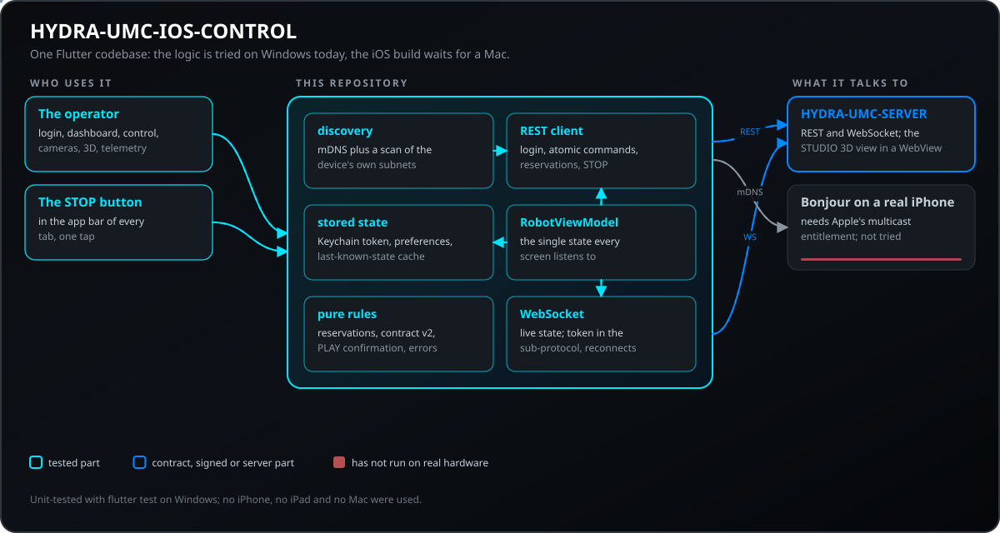
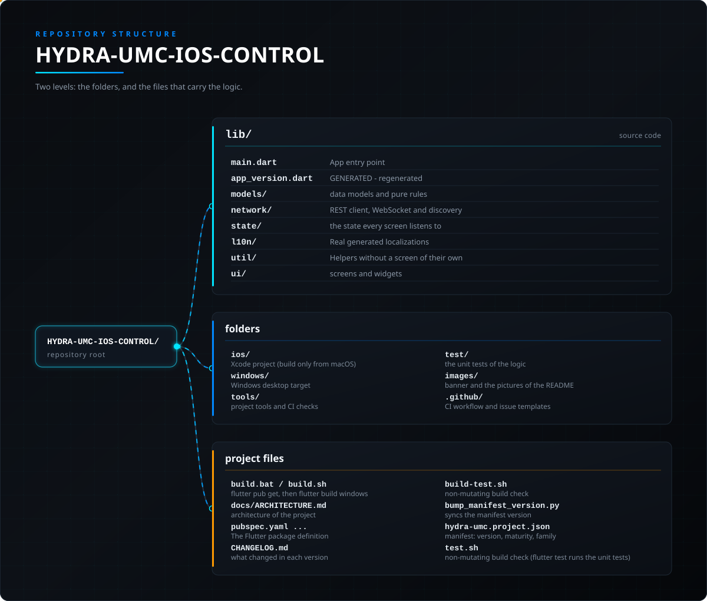

<!-- =============================================================================
HYDRA-UMC-IOS-CONTROL - iOS and iPadOS operator console for a HYDRA-UMC server, written in Flutter
Copyright (C) JuanenRac (Electro Hobby 3D) <electrohobby3d@gmail.com>
GPL-3.0-or-later - see LICENSE
============================================================================= -->

<p align="center">
  
</p>

# 🍎 HYDRA-UMC-IOS-CONTROL

<p align="center"><a href="README.md">🇺🇸 English</a> | <a href="README_spa.md">🇪🇸 Español</a> | <a href="README_fra.md">🇫🇷 Français</a> | <a href="README_ita.md">🇮🇹 Italiano</a> | <a href="README_deu.md">🇩🇪 Deutsch</a> | 🇨🇳 <b>简体中文</b> | <a href="README_jpn.md">🇯🇵 日本語</a> | <a href="README_por.md">🇵🇹 Português</a></p>

### 在 iPhone 或 iPad 上操作 HYDRA-UMC 机器人：找到服务器，移动并监看机器人，用一个红色按钮全部停止。

<p align="center">
  
  
  
  
  
  
  
</p>

---

一款跨平台的 Flutter 应用（Dart），通过 Wi-Fi 控制 [HYDRA-UMC](https://github.com/JuanenRac/HYDRA-UMC) 平台上的机器人，使用与 [HYDRA-UMC SUITE](https://github.com/JuanenRac/HYDRA-UMC-SUITE) 和 [HYDRA-UMC-ANDROID-CONTROL](https://github.com/JuanenRac/HYDRA-UMC-ANDROID-CONTROL) 完全相同的 [`REMOTE_API.md`](https://github.com/JuanenRac/HYDRA-UMC-SERVER/blob/main/docs/REMOTE_API.md) 契约——针对运行中的 [HYDRA-UMC-SERVER](https://github.com/JuanenRac/HYDRA-UMC-SERVER) 实例（从 HYDRA-UMC STUDIO 自身进程中拆分出来的无头式后端——STUDIO 现在是它的一个纯前端客户端，与本应用一样）进行发现、登录、原子化的逐机器人指令,以及实时 WebSocket 同步。

> **安全与安防现状:**本生态系统不是经认证的安全系统。目前尚无硬件 E-STOP 通路,没有由固件强制执行的限位或联锁,也没有经过验证的运动指令;固件映像使用 CRC32 和共享密钥的 HMAC-SHA256 校验,而非非对称签名;TLS 与双向 TLS 均为可选项,默认关闭;自制电路板尚未组装或测试。在依赖此处任何说法来保障人身安全之前,请先阅读[安全基线](https://github.com/JuanenRac/HYDRA-UMC-DOCS/blob/main/docs/SECURITY_BASELINE.md)和[威胁模型](https://github.com/JuanenRac/HYDRA-UMC-DOCS/blob/main/docs/THREAT_MODEL.md)。

---

## 📋 速览

| | |
|---|---|
| 版本 | `0.2.7` |
| 成熟度 | 可用 |
| 测试 | 220 (`flutter test`) |
| 技术栈 | Flutter 3.x / Dart |
| 目标 | iPhone 或 iPad |
| 真实硬件 | 尚未：此版本没有在真实硬件上运行的记录 |

**跳转：** [概述](#-概述) · [架构](#-架构) · [功能](#-功能) · [安全与防护](#-安全与防护) · [接口](#-接口) · [配置](#-配置) · [快速开始](#-快速开始) · [测试](#-测试) · [故障排除](#-故障排除) · [仓库结构](#-仓库结构) · [相关项目](#-相关项目)

## 🚦 项目状态

每一行是本仓库的一个部分，灯号表示它今天做到了哪一步。内容依据仓库能够展示的证据（测试、构建、运行），而不是计划。

🟢 已完成并验证 · 🟡 可用，有已知限制 · 🟠 部分完成或尚未验证 · 🔴 未完成或不可用

| 领域 | 状态 | 在这里的含义 |
|---|---|---|
| 软件 | 🟡 | 主要用途可用；上面的诚实性检查列出了仍然缺少的内容 |
| 测试 | 🟢 | 220 项自动测试，每次变更都会运行 |
| 真实硬件 | 🔴 | 尚未：此版本没有在真实硬件上运行的记录 |
| 文档 | 🟢 | 八种语言的 README，每次变更都会与清单核对 |

## 🎯 概述

应用的界面：**登录**（服务器地址、账户、扫描本地网络）、**仪表盘**（每个机器人一张卡片，附实时 LED 和计算模块的健康状态）、**控制**（点动面板、速度、阀门和泵、机器人预约、可先询问确认的 PLAY）、**摄像头**（实时 MJPEG）、**3D 视图**（STUDIO 的真实场景）、**遥测**（终端风格的日志）和**设置**（语言、生物识别锁、开关）。红色的**停止**按钮位于每个标签页的栏中。

## 🧩 在 HYDRA-UMC 中的角色

**HYDRA-UMC-IOS-CONTROL** 是 HYDRA-UMC 面向 iPhone 和 iPad 的操作员控制台。它用 Flutter 编写，因此其逻辑可以在 Windows 上构建、运行和测试；iOS 构建本身仍需要 Mac 上的 Xcode。它在本地网络中找到 HYDRA-UMC-SERVER，登录后显示并移动机器人、查看摄像头和 3D 视图，并可一键全部停止，使用与 SUITE 和 Android 应用相同的远程契约。它不是安全设备。

## 🏛️ 架构

<p align="center">
  
</p>

### 为何选择 Flutter，而非原生 Swift

本应用面向 iOS/iPadOS,但它是用 **Flutter** 而非 Swift/SwiftUI 构建的:本仓库的工作环境仅限 Windows,而一个原生 Swift 项目虽然可以在 Windows 上*编写*,但永远无法在其上*编译或运行*（Xcode 和 iOS SDK 仅限 macOS）。Flutter 自身的 Windows 桌面目标让本应用可以在这台机器上真正地构建、运行和测试——`flutter analyze` 干净通过,`flutter build windows` 成功,`flutter test` 通过,构建出的 `.exe` 能够启动并渲染,没有任何运行时错误——而不是盲目地编写数千行 Swift 代码,在拿到 Mac 之前完全无法验证任何一行。

**这并不能消除苹果自身的限制**——一个真正的 `.ipa` 仍然需要在 Mac 上（或 macOS CI 运行器上）使用 Xcode 来构建和签名;框架的选择并不会改变这一点。Flutter 带来的好处是,能够在这台机器上今天就验证本应用自身逻辑（网络、状态、界面）的每一行代码,并在日后无需重写就能将完全相同的代码库发布到 iOS。

## ✨ 功能

- **登录**（`lib/ui/login_screen.dart`、`lib/state/robot_view_model.dart`）—— 可编辑的服务器 IP/端口和操作员凭据字段，加上 `POST /api/login`；不会预填账户或密码。生产服务器必须为首个管理员显式配置引导凭据；可在浏览器界面的 Config > Users 中创建额外的低权限“操作员”账户。会话令牌保存在 iOS 钥匙串（`flutter_secure_storage`）中并在多次启动之间保持；主机和端口则保存在 `shared_preferences`。“扫描本地网络”按钮（`lib/network/discovery.dart`）无需用户预先知道 IP 即可找到服务器。
- **网络发现**（`lib/network/discovery.dart`）—— 从同一个“扫描本地网络”面板同时运行两条独立路径：真实的 mDNS/Bonjour（`discoverMdns()`，通过 `multicast_dns` 包查询 `server.ts` 发布的 `_hydra._tcp.local` 服务——本应用是本生态系统 3 个远程客户端中第一个加入该能力的）,以及针对本设备自身真实本地子网的并发暴力扫描 `GET /api/hydra-info`（`scanSubnets()`，该子网通过 `dart:io` 的 `NetworkInterface.list()` 推导,而非单一的硬编码猜测,因为手机的局域网同样可能是 `192.168.0.x` 或 `10.x.x.x`,而不一定是 `192.168.1.x`,仅当接口枚举本身返回为空时才回退到 `192.168.1.x`）。在未获得相应权限的 iOS 构建上，mDNS 静默失败是预期行为（Apple 的 Multicast Networking 权限并非普通 `flutter build ios` 就能获得）——无论如何，子网扫描都会独立继续工作。
- **生物识别登录锁**（`lib/network/biometric_helper.dart`、`lib/ui/biometric_gate_screen.dart`）—— 通过 `package:local_auth` 实现的 Face ID/Touch ID/Windows Hello，`Settings` 中的一个可选开关，用于在启动时保护已保存有效会话的恢复过程（本应用从不保存明文密码，只保存令牌——相较 HYDRA-UMC-ANDROID-CONTROL 自身的密码重填设计，针对这一差异做了适配）。
- **原子化指令同步**（`lib/state/robot_view_model.dart` 自身的 `_sendAtomicCommand()`）—— 每一次写入（播放/暂停/停止/点动/阀门/泵/速度/视觉）都使用真实的 `POST /api/robot/:id/command` 端点,发送一个小型的定向负载,而非覆盖整棵设置树,并对需要它的 5 种指令进行正确的合并机器人（`combinedWith`）传播。
- **实时 WebSocket 同步**（`lib/network/hydra_websocket.dart`）—— 以 `hydra.bearer` 子协议发送令牌，从不放入连接 URL（`server.ts` 默认拒绝 `/ws?token=`），同时处理 `"settings"` 和 `"delta"` 两种广播类型,断线后自动重连。
- **仪表盘**（`lib/ui/dashboard_screen.dart`）—— 每机器人卡片,通过 `Provider` 自身的 `ChangeNotifier` 实时响应,LED 惯例（绿色脉冲=活动,红色常亮=非活动）,以及合并机器人显示（仅在从属方一侧显示,按 id 解析）,与 HYDRA-UMC-STUDIO 自身的仪表盘概览一致。
- **手动控制**（`lib/ui/control_screen.dart`、`lib/ui/widgets/joystick_pad.dart`）—— 点动方向键（带/不带 XY 工作台目标）、速度/加速度滑块、阀门/泵开关,以及全局 **STOP**（`lib/ui/widgets/stop_all.dart`）：只需轻触一次，无需长按也无需确认，即可停止所有机器人（`POST /api/stop-all`），并固定显示在每个标签页（包括控制标签页）的顶部栏中。结果按机器人逐个显示（有机器人失败或停止未保存时给出警告，被其他账户预约的机器人会被标出），网络错误会重试一次，超出请求限制或没有该路由的服务器则改用逐个机器人停止，若无人应答，则会一直显示“STOP 未确认”横幅，直到之后的某次 STOP 得到应答。圆形的单机器人停止按钮保留长按保护。
- **预留与安全限值**（`lib/ui/widgets/access_panel.dart`、`lib/models/access.dart`、`lib/network/hydra_api_client.dart`、`lib/state/robot_view_model.dart`）- Control 屏幕显示谁持有所选机器人（无人、本手机、同一账户的另一台设备，或其他账户），提供**预留**和**释放**，并列出服务器上的所有预留（`GET /api/claims`）。设备为每次安装保存一个控制器 ID，并在每次预留、释放、点动解锁和指令中发送（请求体和 `X-Controller-Id` 头），因此预留属于账户和这台设备，而不是整个账户。服务器的拒绝会被区分：被其他账户预留、被你的账户在另一台设备或窗口预留、需要控制器 ID、点动未解锁。机器人型号的限值从 `GET /api/safety-limits` 读取：超过限值的点动步长不会发送，并显示服务器的警告。当管理员要求时，必须先按**解锁点动**（带倒计时），摇杆才会移动机器人；解锁会自动结束，也会在按下 STOP 或释放时结束。预留是可选的：没人预留的机器人照常控制。 仅**管理员**会在他人持有的机器人上看到 **接管控制** 按钮；点击后先要求确认，然后以 `force: true` 预约该机器人（服务器只接受管理员的此请求，并会再次检查角色）。 写入是有条件的:每次写入都带有此应用最后看到的机器人修订号(`If-Match`,`lib/models/contract_v2.dart`),如果期间有其他人修改了机器人,服务器返回 412,不会应用任何内容,机器人会被重新读取并给出提示(标准模式检查预约、工作台和一次性命令;严格模式检查除 STOP 外的全部命令;关闭则不检查;该选项位于预约列表中;STOP 永远不检查)。XY 工作台的点动是一条原子的 `table` 命令(较旧的服务器会收到它能理解的点动),服务器通过 WebSocket 推送预约,因此在推送到达期间 Control 屏幕不再轮询,管理员可以读取审计记录(`lib/ui/widgets/audit_dialog.dart`),其 SHA-256 链由服务器和设备各校验一次,并可将各行以 `.jsonl` 复制。
- **可选开关** - 两个开关，默认均为关闭：*显示已保存数据时禁止发送指令*（设置）会在屏幕显示的是机器人状态的已保存副本而非实时状态时，拦截除停止以外的所有指令；*不扫描移动数据网络和VPN*（登录界面）会在子网扫描中排除这些网络接口。点动方向键按钮至少 44 pt，VoiceOver 会读出其轴和方向；应用处于后台时，摄像头画面会被关闭。
- **PLAY 之前先确认** - 默认开启,可在设置中关闭:开始轨迹之前,应用会显示机器人、已记录的点、速度以及预留者(被他人预留的机器人会提示服务器将拒绝该命令)。已在播放的机器人不会再次询问。该选择会被保存。
- **摄像头**（`lib/ui/camera_screen.dart`、`lib/ui/widgets/mjpeg_view.dart`）—— 一个小型的手写 MJPEG 流解析器（无第三方包）,一个明确的“摄像头已禁用”状态（而非静默显示空白画面）,以及一个可直接从服务器打开/关闭机器人视觉系统的开关（`server.ts` 的 `"vision"` 原子指令）。
- **3D 视图**（`lib/ui/three_d_screen.dart`）—— 通过 WebView 嵌入 HYDRA-UMC-STUDIO 自身的实时 3D 视口（`?hideUI=true&robotId=#token=`）,与 Android 应用的方式相同,原因也相同（免费获得真实的、当前正在使用的 3D 场景）。在 `webview_flutter` 不支持的平台（本仓库用于构建验证的 Windows 桌面目标）上,会回退到一个诚实的占位符。
- **系统指标**（`lib/state/robot_view_model.dart`）—— 每 5 秒轮询一次 `GET /api/system/metrics`,与其他 2 个客户端的节奏相同,显示在仪表盘中。
- **8 语言界面**（`lib/l10n/`，标准的 `flutter gen-l10n` 流程）—— 英语、西班牙语、法语、德语、意大利语、日语和中文，与本生态系统的其他客户端保持一致。`设置 > 语言` 中的持久化设置默认跟随系统语言；`RobotViewModel.lastError` 现在是带类型的 `HydraError`，而不是预先格式化好的英文文本，因此业务逻辑层的错误提示（登录/连接/指令失败）也能正确本地化，而不只是界面上的静态文本。
- **离线状态缓存**（`lib/network/state_cache.dart`）—— 最后一次已知的设置树会连同真实的保存时刻一起持久化到磁盘（1 秒防抖），这样在真正的 `connect()` 往返请求仍在进行时，仪表盘/控制界面会立即显示真实（即使可能已过时）的机器人数据，而不是空白状态。只要这种情况还成立，一个真实可见的提示条(而不是默默猜测)就会显示"正在显示 HH:mm 的缓存数据"。一旦真正的数据获取成功，就会被替换。
- **遥测**（`lib/ui/telemetry_screen.dart`）—— 一个终端风格、最新在前的日志，记录真实的连接/登录/指令生命周期事件，最多保留 50 条，并提供清除日志的操作——与 HYDRA-UMC-ANDROID-CONTROL 自身的遥测标签页相同的"Matrix 绿"配色约定。
- **应用内语音助手**（`lib/ui/voice_assistant_dialog.dart`）—— 应用栏中的麦克风图标会打开一个对话框，可输入问题或指令,通过与 HYDRA-UMC-ANDROID-CONTROL 自身应用内语音按钮及其手表中继相同的真实 `POST /api/voice/turn` 路由发送给 `HYDRA-UMC-VOICE-UI`。绝不上传音频——目前仅支持文本输入,因为 iOS 原生语音识别需要 Speech 框架,而这个仅限 Windows 的开发环境无法针对真实设备/Xcode 进行编译或验证。回复绝不会直接发出机器人指令。

## 🔒 安全与防护

| 威胁 | 防御 | 位置 |
|---|---|---|
| 从手机窃取的令牌 | 令牌、用户名和刷新令牌用 `flutter_secure_storage`（iOS 钥匙串）保存；只有主机、端口和偏好设置进入 `shared_preferences`；应用从不保存明文密码 | `network/auth_prefs.dart` |
| 保存的状态副本中的凭据 | 写入磁盘的最后状态副本会在任何层级去掉 `ipUsername` 和 `ipPassword` 键，并在登出时清除 | `network/state_cache.dart` |
| 日志或 WebSocket 地址中的令牌 | 令牌放在 WebSocket 的 `hydra.bearer` 子协议中，从不放在地址里；内嵌的 3D 视图通过地址片段（`#token=`）获得它，该片段不会发送给服务器；有测试检查这两点 | `network/hydra_websocket.dart`, `util/viewer_url.dart` |
| 拿着已解锁手机的人 | 可选的生物识别锁（Face ID、Touch ID）控制启动时恢复已保存的会话；应用在后台时会关闭摄像头画面 | `network/biometric_helper.dart`, `ui/biometric_gate_screen.dart` |
| 被两个人同时移动的机器人、误按的 PLAY，或没有送达的停止 | 机器人在点动前先预约，屏幕会说明谁持有它；PLAY 默认先询问，并显示机器人、其点位、速度和预约者；全局停止重试一次，回退为逐个机器人停止，若无人应答则保持“停止未确认”横幅 | `models/access.dart`, `util/play_confirmation.dart`, `ui/widgets/stop_all.dart` |

**它绝不做的事：** 替代物理紧急停止，或自行加密流量：当明文 HTTP 探测没有应答时，应用会尝试一次 HTTPS，但没有证书固定，也没有针对本地网络之外明文流量的防护。停止是服务器的软件停止。

## 🔌 接口

| 主题或路由 | 内容 |
|---|---|
| `POST /api/login`, `/api/logout`, `/api/refresh` | 登录、登出并续期会话 |
| `GET /api/hydra-info` | 识别真正的服务器；子网扫描和手动地址都使用它，并会通过 HTTPS 重试一次 |
| `GET /api/settings`, `/api/system/metrics`, `/api/safety-limits`, `/api/claims` | 机器人状态、计算模块（每 5 秒）、每种型号的安全限制和预约 |
| `POST /api/robot/{id}/command`, `/claim`, `/release`, jog arming | 针对单个机器人的小命令、它的预约和点动的武装，并按机器人修订版进行条件写入 |
| `POST /api/stop-all` | 全局停止：所有机器人，逐个机器人应答 |
| `GET /api/audit`, `POST /api/voice/turn`, `GET /api/camera/{id}/stream` | 审计记录（管理员，带自己的 SHA-256 链校验）、键入的语音回合，以及摄像头的 MJPEG 流 |
| WebSocket `hydra.bearer`, mDNS `_hydra._tcp.local` | 实时状态变化（`settings` 和 `delta` 消息，3 秒起至最多 30 秒的重连，每 20 秒一次 ping）以及服务器的 Bonjour 通告 |

## ⚙️ 配置

应用没有配置文件：一切都在屏幕上设置并保存在设备上。默认值来自代码。

| 变量 | 默认值 | 设置内容 |
|---|---|---|
| 设置 > PLAY 前询问 | 开启 | 在轨迹开始前显示机器人、点位、速度和预约者 |
| 设置 > 在使用已保存数据时阻止命令 | 关闭 | 当屏幕显示的是已保存的状态副本而不是实时状态时，阻止除停止之外的所有命令 |
| 登录 > 不扫描移动数据或 VPN 网络 | 关闭 | 将这些接口排除在子网扫描之外（每次 32 台主机，除非输入其他端口，否则为 3000 端口） |
| 设置 > 生物识别锁 | 关闭 | 启动时恢复已保存的会话之前要求 Face ID 或 Touch ID |
| 设置 > 语言 | 系统语言 | 应用的八种语言之一（`lib/l10n/`），跨启动保留 |

## 🚀 快速开始

需要稳定版 Flutter SDK（Dart 3.13 或更高版本）。Windows 可运行逻辑和测试；真正的 iPhone 构建需要 Mac 上的 Xcode。

```bash
flutter pub get                  # downloads the packages
flutter test                     # runs the unit tests on this machine
./build-test.sh                  # non-mutating build check (build-test.bat on Windows)
flutter build ios --no-codesign  # a real iOS build; only on a Mac with Xcode
```

## 🧪 测试

运行 `flutter test` 会执行 220 个自动测试。 不需要硬件，也不需要这台机器以外的任何东西。

CI 运行 `HYDRA_UMC_CI=1 python tools/ci_validate.py`，检查清单、文档、八个 README 和图片。

## 🏗️ 构建与发布

需要 [Flutter SDK](https://docs.flutter.dev/get-started/install)（stable 渠道）。本仓库基于 Flutter 3.47.0 构建/验证。本仓库中只配置了 `windows/` 和 `ios/` 两个平台（没有 `android/`、`linux/`、`web/` 或 `macos/` 文件夹）——Windows 的存在是为了让本应用自身的逻辑能够在没有 Mac 的情况下构建和运行;iOS 才是真正的目标平台。

### 构建脚本

```bash
./build.sh     # Git Bash / WSL —— flutter pub get + flutter build windows
build.bat      # cmd.exe / PowerShell —— flutter pub get + flutter build windows
```

两者都会生成 `build/windows/x64/runner/Release/hydra_umc_control.exe`,并且都不会更改应用的版本号——见下文[版本管理](#-版本管理)。

### 手动构建

```bash
flutter pub get
flutter analyze          # 静态分析——无需编译器
flutter test             # 组件测试
dart run tool/bump_version.dart  # 递增版本号，与 build.sh/build.bat 所做的相同
flutter build windows    # 生成 build/windows/x64/runner/Release/hydra_umc_control.exe
flutter run -d windows   # 或在 Mac 上使用 -d <ios-device-id>
```

**构建真正的 iOS `.ipa`** 需要在 macOS 上使用 Xcode——在该机器上运行：`flutter build ipa`（或直接在 Xcode 中打开 `ios/Runner.xcworkspace`）。这无法在 Windows 上完成；见上文“为何选择 Flutter，而非原生 Swift”。

### 版本管理

本仓库遵循生态系统统一的策略：构建绝不会更改版本号。显式的 `bump` 命令（`python tools/hydra_project_tool.py bump`）会运行 `tool/bump_version.dart`，并应用：

- **构建号**（`+` 之后的部分）：一个纯粹的单调计数器,每次 bump +1,不进位。

同一个脚本会重新生成 `lib/app_version.dart`（这是生成的文件,不是手工编辑的——一个普通的 `const` 文件,而非像 `package_info_plus` 那样引入新的运行时依赖）,应用在运行时读取它,以在 **Settings** 界面显示自身版本。完整版本历史见 [CHANGELOG.md](CHANGELOG.md)。

## 🩺 故障排除

| 你看到 | 原因 | 处理 |
|---|---|---|
| “会话未获授权，请重新登录” | 服务器拒绝了令牌（WebSocket 以代码 1008 关闭）或令牌已过期 | 重新登录 |
| “服务器未确认停止” | 全局停止在其较短的时限内没有任何应答，或服务器无法保存停止状态 | 再按一次；若横幅仍在，请使用物理紧急停止 |
| 机器人被其他账户或你在另一台设备上的账户预约了 | 预约属于账户和设备（每次安装一个控制器 ID） | 使用那台设备，或在那里释放预约 |
| “正在显示 HH:mm 保存的数据” | 服务器不可达，屏幕显示的是最后状态的已保存副本；开启“在使用已保存数据时阻止命令”后，除停止外的所有命令都会被阻止 | 检查服务器和 Wi-Fi；连接恢复后屏幕会自动恢复实时 |
| “点动被拒绝：步长超过限制” | 步长超过服务器为该机器人型号设置的限制（`GET /api/safety-limits`） | 使用较小的步长；没有发送任何内容 |
| “扫描本地网络”找不到服务器 | 在真实 iPhone 上，Bonjour 需要普通构建不具备的授权，而且扫描可能会跳过移动数据和 VPN 网络 | 连接到与服务器相同的 Wi-Fi，或手动输入其地址和端口 |

## 📂 仓库结构

<p align="center">
  
</p>

<details>
<summary>目录树的文本版本</summary>

```text
HYDRA-UMC-IOS-CONTROL/
├── lib/                                                              源代码
│   ├── main.dart                                                     应用入口点，ChangeNotifierProvider + 登录门禁
│   ├── app_version.dart                                              生成文件——由 tool/bump_version.dart 重新生成，请勿手动编辑
│   ├── models/                                                       数据模型和纯规则
│   ├── network/                                                      REST 客户端、WebSocket 和发现
│   ├── state/                                                        每个界面监听的状态
│   ├── l10n/                                                         真实生成的本地化文件（8 种语言）——见仓库根目录的 l10n.yaml
│   ├── util/                                                         没有独立界面的辅助模块
│   └── ui/                                                           界面和控件
├── tool/                                                             版本工具
├── ios/                                                              Xcode 项目（仅可在 macOS 上构建）
├── windows/                                                          Windows 桌面目标——无需 Mac 即可进行构建验证
├── tools/                                                            项目工具和 CI 检查
├── test/                                                             逻辑的单元测试
├── images/                                                           横幅和 README 的图片
├── .github/                                                          CI 工作流和 Issue 模板
├── build.bat / build.sh                                              先 flutter pub get，再 flutter build windows；从不改变版本
├── docs/ARCHITECTURE.md                                              项目架构
├── pubspec.yaml / pubspec.lock / l10n.yaml / analysis_options.yaml   Flutter 包的定义及其锁定版本、l10n 生成器设置和 lint 规则
├── CHANGELOG.md                                                      每个版本的变更
├── build-test.sh                                                     不修改内容的构建检查
├── bump_manifest_version.py                                          同步清单版本
├── hydra-umc.project.json                                            清单：版本、成熟度、系列
└── test.sh                                                           不修改内容的构建检查（flutter test 运行单元测试）
```

</details>

## 🗺️ 路线图与已知限制

CI 中没有 iPhone 或 iPad 的构建：`flutter build ios` 需要 Mac 上的 Xcode，所以该应用只在 Windows 上运行和测试过。Bonjour 发现需要普通构建不具备的授权，因此在真实 iPhone 上由子网扫描找到服务器。目前还没有设备端语音识别（语音助手接受键入的文本），也没有 TLS 设置和蓝牙。

## 🌍 语言

本 README 和仓库文档提供八种语言：英语、西班牙语、德语、法语、意大利语、日语、中文和葡萄牙语（葡萄牙）。它们同时编写，并由 CI 检查八个文件拥有相同的章节和相同的链接。

## 🔗 相关项目

本项目是同一作者(JuanenRac / Electro Hobby 3D)打造的 HYDRA-UMC 机器人生态系统的一部分。值得了解,因为某个请求实际上可能是关于这些项目之一,而非本仓库本身。

**父项目**
- **[HYDRA-UMC-SERVER](https://github.com/JuanenRac/HYDRA-UMC-SERVER)** —— 每个控制客户端真正通信的真实无头后端(REST/WebSocket);本应用自身的登录、原子指令与 WebSocket 同步都基于此后端运行。

**兄弟项目** —— 同样与 HYDRA-UMC-SERVER 自身 API 通信,各自作为独立客户端
- **[HYDRA-UMC-STUDIO](https://github.com/JuanenRac/HYDRA-UMC-STUDIO)** —— 具有实时多机器人 3D 可视化的网页控制面板;其自身的 3D 视图通过 WebView 直接嵌入本应用的 3D 视图界面。
- **[HYDRA-UMC-SUITE](https://github.com/JuanenRac/HYDRA-UMC-SUITE)** —— 面向多台服务器的桌面(PySide6)集群指挥中心,打包为独立可执行文件;与本应用使用完全相同的 `REMOTE_API.md` 契约。
- **[HYDRA-UMC-ANDROID-CONTROL](https://github.com/JuanenRac/HYDRA-UMC-ANDROID-CONTROL)** —— 具有生物识别登录和配对 Wear OS 伴侣应用的原生 Android 控制应用;与本应用使用完全相同的 `REMOTE_API.md` 契约。
- **[HYDRA-UMC-DSI](https://github.com/JuanenRac/HYDRA-UMC-DSI)** —— 面向机载 7 英寸 DSI 触摸屏的原生触控界面,直接嵌入 CM5 本体。
- **[HYDRA-UMC-BRIDGE-AMR](https://github.com/JuanenRac/HYDRA-UMC-BRIDGE-AMR)** —— 通过 VDA 5050 MQTT 发布者为 AGV/AMR 车队提供的协调边界(仅针对仿真车队测试)。
- **[HYDRA-UMC-BRIDGE-CNC](https://github.com/JuanenRac/HYDRA-UMC-BRIDGE-CNC)** —— 具备 GRBL 状态/控制字节访问能力的高层 CNC 单元协调器(仅针对模拟器测试)。
- **[HYDRA-UMC-BRIDGE-DROIDS](https://github.com/JuanenRac/HYDRA-UMC-BRIDGE-DROIDS)** —— 面向足式/人形机器人的协调边界,带有 Boston Dynamics Spot 指令发送器(仅针对模拟器测试)。
- **[HYDRA-UMC-BRIDGE-LASER](https://github.com/JuanenRac/HYDRA-UMC-BRIDGE-LASER)** —— 读取 3 路钥匙/外壳/联锁 GPIO 信号的激光单元协调器(仅针对模拟芯片测试;无法使激光器上膛或发射)。
- **[HYDRA-UMC-BRIDGE-OPENPNP](https://github.com/JuanenRac/HYDRA-UMC-BRIDGE-OPENPNP)** —— 面向 OpenPnP 贴片机板级流程的安全高层协调器。
- **[HYDRA-UMC-BRIDGE-PRINTER3D](https://github.com/JuanenRac/HYDRA-UMC-BRIDGE-PRINTER3D)** —— 面向 Moonraker/Klipper 3D 打印机的安全协调边界,具备真实的受控作业指令。
- **[HYDRA-UMC-BRIDGE-ROS2](https://github.com/JuanenRac/HYDRA-UMC-BRIDGE-ROS2)** —— 带有惰性导入 rclpy ROS 2 传输层的协调器(尚未在 ROS 2 环境中运行)。
- **[HYDRA-UMC-BRIDGE-UAV](https://github.com/JuanenRac/HYDRA-UMC-BRIDGE-UAV)** —— 面向搭载摄像头的无人机的协调边界,带有 MAVLink 指令发送器(仅针对模拟器测试)。

**直接相关**
- **[HYDRA-UMC-WATCH](https://github.com/JuanenRac/HYDRA-UMC-WATCH)** —— 带有触觉提醒模式与配对手机语音中继的 WearOS 伴侣应用(尚未在实体手表上运行);HYDRA-UMC-ANDROID-CONTROL 的腕上伴侣(仅限 WearOS;本 iOS 应用目前还没有对应的 Apple Watch 版本)。
- **[HYDRA-UMC-HIL-BRIDGE](https://github.com/JuanenRac/HYDRA-UMC-HIL-BRIDGE)** —— 在仿真与真实硬件之间带有软件碰撞联锁的硬件在环路由器(未在真实硬件上测试);让本应用能够以硬件在环方式远程控制数字孪生的桥接。

**生态系统中的其他项目**

*核心硬件与平台*
- **[HYDRA-UMC](https://github.com/JuanenRac/HYDRA-UMC)** —— 机器人手臂主板设计——CM5 主机 + 双核 STM32H745,目标是通过 CAN-OTA/SPI-OTA 协调最多 8 条工具臂(固件处于早期阶段,尚无已组装的电路板)。
- **[HYDRA-UMC-OS](https://github.com/JuanenRac/HYDRA-UMC-OS)** —— 面向 CM5 的可复现 Raspberry Pi OS 产品层——只读代理、经过验证的配置/配置文件、WiFi 首次配网。
- **[HYDRA-UMC-SDK](https://github.com/JuanenRac/HYDRA-UMC-SDK)** —— 每个桥接都据此校验自身指令的共享 JSON-Schema 契约与软件作业门限边界(并非经认证的安全功能)。
- **[HYDRA-UMC-CONNECTOR-HUB](https://github.com/JuanenRac/HYDRA-UMC-CONNECTOR-HUB)** — 面向外部机器连接器的声明式适配器清单注册与校验工具；把 SDK 自身的契约理念扩展到外部机器，而不取代工业网关类项目。

*核心后端与客户端*
- **[HYDRA-UMC-EDITOR-URDF](https://github.com/JuanenRac/HYDRA-UMC-EDITOR-URDF)** —— 将完成的模型推送到 STUDIO 自身目录的桌面版图形化 URDF 创建/编辑工具。
- **[HYDRA-UMC-EDITOR-STL](https://github.com/JuanenRac/HYDRA-UMC-EDITOR-STL)** — 桌面 STL 模型编辑器，在 HYDRA-UMC-EDITOR-URDF 编辑的同一模型目录中变换/替换/移除/添加真实部件。

*URTC 工具平台*
- **[URTC](https://github.com/JuanenRac/URTC)** —— 面向实体 Universal Robot Tool Controller 板卡的固件,通过 CAN 总线支持 25 种以上工具配置。
- **[URTC-FLASHER](https://github.com/JuanenRac/URTC-FLASHER)** —— 面向 URTC 板卡的桌面图形烧录工具,支持 CAN-OTA 以及全芯片 SWD/JTAG。
- **[URTC-TESTER](https://github.com/JuanenRac/URTC-TESTER)** —— 面向 URTC 板卡的桌面实时 CAN 总线诊断工具,每种工具配置对应一个面板。
- **[URTC-WEB-STUDIO](https://github.com/JuanenRac/URTC-WEB-STUDIO)** —— 通过 Web Serial API 实现的浏览器版 URTC-TESTER 替代方案,无需本地安装。
- **[URTC-GATEWAY](https://github.com/JuanenRac/URTC-GATEWAY)** —— URTC CAN 总线前的网关：允许的标识符列表、速率限制和会话密钥；软件已在计算机上测试，尚未在真实总线上测试。

*视觉 AI 节点(Hailo-8)*
- **[HYDRA-UMC-VISION-NODE](https://github.com/JuanenRac/HYDRA-UMC-VISION-NODE)** —— 面向 Hailo-8 视觉流水线的集成中枢,具备逐阶段的真实硬件就绪检测。
- **[HYDRA-UMC-DETECTION-HEF](https://github.com/JuanenRac/HYDRA-UMC-DETECTION-HEF)** —— 具备 Hailo 架构/校验和安全加载验证的真实编译模型注册表。
- **[HYDRA-UMC-VISION-STREAMER](https://github.com/JuanenRac/HYDRA-UMC-VISION-STREAMER)** —— 具备真实 HailoRT 集成边界的真实 GStreamer 流水线 + MediaMTX 配置生成器。
- **[HYDRA-UMC-VISUAL-SERVOING-API](https://github.com/JuanenRac/HYDRA-UMC-VISUAL-SERVOING-API)** —— 以区域状态为授权条件的 Position-Based Visual Servoing 修正律;尚无摄像头位姿估计。
- **[HYDRA-UMC-SAFETY-ZONES](https://github.com/JuanenRac/HYDRA-UMC-SAFETY-ZONES)** —— 从文件读取物体位置的 v0 区域入侵、校准新鲜度与 E-STOP 请求逻辑;没有检测器为其供数,也尚未连接任何物理 E-STOP。

*认知 AI 节点(Hailo-10)*
- **[HYDRA-UMC-COGNITIVE-NODE](https://github.com/JuanenRac/HYDRA-UMC-COGNITIVE-NODE)** —— 面向 Hailo-10 认知流水线(LLM/VLA/语音编排)的集成中枢。
- **[HYDRA-UMC-VLA-ENGINE](https://github.com/JuanenRac/HYDRA-UMC-VLA-ENGINE)** —— 面向 Vision-Language-Action 模型的真实动作 token 编解码与轨迹生成。
- **[HYDRA-UMC-VOICE-UI](https://github.com/JuanenRac/HYDRA-UMC-VOICE-UI)** —— 具备受限、需确认的 Watch 中继的真实语音前端(VAD + 意图解析)。
- **[HYDRA-UMC-SEMANTIC-PLANNER](https://github.com/JuanenRac/HYDRA-UMC-SEMANTIC-PLANNER)** —— 基于真实规则的任务分解,以及针对 MCU 错误码的语义化错误恢复。
- **[HYDRA-UMC-DOCS-QA](https://github.com/JuanenRac/HYDRA-UMC-DOCS-QA)** —— 面向本生态系统自身 Markdown 文档的真实纯标准库 TF-IDF 文档检索。
- **[HYDRA-UMC-LOCAL-TECHNICIAN](https://github.com/JuanenRac/HYDRA-UMC-LOCAL-TECHNICIAN)** — 面向生态系统自身的本地、按策略门控的 AI 维护技师——观察、诊断并提出修复建议;两个最高风险等级目前特意尚未实现。

*编排与集群*
- **[HYDRA-UMC-ORCHESTRATOR](https://github.com/JuanenRac/HYDRA-UMC-ORCHESTRATOR)** —— 具备真实 gRPC/Protobuf 健康报告契约与任务状态机的集成中枢。
- **[HYDRA-UMC-JOB-DISPATCHER](https://github.com/JuanenRac/HYDRA-UMC-JOB-DISPATCHER)** —— 基于真实 HTTP API 的真实优先级任务队列,支持去重。
- **[HYDRA-UMC-NODE-HEALING](https://github.com/JuanenRac/HYDRA-UMC-NODE-HEALING)** —— 具备重试/退避与身份不匹配检测的真实基于 gRPC 的车队健康看门狗。
- **[HYDRA-UMC-PATH-PLANNER-3D](https://github.com/JuanenRac/HYDRA-UMC-PATH-PLANNER-3D)** —— 具备真实障碍物/工作空间碰撞校验的真实基于 RRT 的三维路径规划器。
- **[HYDRA-UMC-SWARM-SYNC](https://github.com/JuanenRac/HYDRA-UMC-SWARM-SYNC)** —— 经过多单元收敛属性测试的真实 CRDT LWW-Element-Map 状态同步。

*数字孪生与仿真*
- **[HYDRA-UMC-TWIN](https://github.com/JuanenRac/HYDRA-UMC-TWIN)** —— 面向数字孪生引擎的集成中枢,具备真实的版本兼容性同步契约。
- **[HYDRA-UMC-PHYSICS-REPLICA](https://github.com/JuanenRac/HYDRA-UMC-PHYSICS-REPLICA)** —— 面向真实 URDF 子集的真实正向运动学与关节限位校验。
- **[HYDRA-UMC-SYNTHETIC-DATA-GEN](https://github.com/JuanenRac/HYDRA-UMC-SYNTHETIC-DATA-GEN)** —— 具备 YOLO/COCO 标注导出功能的真实程序化 2D 场景生成器。

*数据与分析*
- **[HYDRA-UMC-DATALAKE](https://github.com/JuanenRac/HYDRA-UMC-DATALAKE)** —— 具备真实数据摄入/查询 HTTP API 的真实 sqlite3 时序数据存储。
- **[HYDRA-UMC-ANOMALY-DETECTOR](https://github.com/JuanenRac/HYDRA-UMC-ANOMALY-DETECTOR)** —— 具备漂移监测能力的真实 FFT + 统计基线异常检测器。
- **[HYDRA-UMC-PRODUCTION-REPORTS](https://github.com/JuanenRac/HYDRA-UMC-PRODUCTION-REPORTS)** —— 基于 DATALAKE 历史数据的真实 OEE/可用率计算,支持可复现的 CSV 导出。
- **[HYDRA-UMC-TELEMETRY-COLLECTOR](https://github.com/JuanenRac/HYDRA-UMC-TELEMETRY-COLLECTOR)** —— 面向 DATALAKE 的真实 CAN/WebSocket 数据摄入管道,支持序列去重。

*工业网关*
- **[HYDRA-UMC-GATEWAY-INDUSTRIAL](https://github.com/JuanenRac/HYDRA-UMC-GATEWAY-INDUSTRIAL)** —— 中继至工业协议的集成中枢,具备真实的指令白名单/背压控制层。
- **[HYDRA-UMC-OPCUA-SERVER](https://github.com/JuanenRac/HYDRA-UMC-OPCUA-SERVER)** —— 经真实二进制协议客户端会话验证的真实 OPC-UA 地址空间。
- **[HYDRA-UMC-MQTT-BROKER](https://github.com/JuanenRac/HYDRA-UMC-MQTT-BROKER)** —— 具备可选按客户端认证与主题 ACL 的真实 MQTT 代理。
- **[HYDRA-UMC-MTCONNECT-ADAPTER](https://github.com/JuanenRac/HYDRA-UMC-MTCONNECT-ADAPTER)** —— 具备降级模式输出的真实 MTConnect `/probe` 与 `/current` XML 端点。

*辅助工具与生态系统运维*
- **[HYDRA-UMC-DASHBOARD-AI](https://github.com/JuanenRac/HYDRA-UMC-DASHBOARD-AI)** —— 基于 DATALAKE/ANOMALY-DETECTOR 的智能摘要与异常高亮面板,具备诚实的统计回退机制。
- **[HYDRA-UMC-TOOL-CLI](https://github.com/JuanenRac/HYDRA-UMC-TOOL-CLI)** —— 具备真实、稳定退出码契约的车队 CLI,是 HYDRA-UMC-SERVER 自身 API 的真实在线客户端。
- **[URTC-SMART-RACK](https://github.com/JuanenRac/URTC-SMART-RACK)** —— 面向板卡安装机架的固件,具备真实的工具 ID 解码与 Smart Idle 预热逻辑。
- **[URTC-VISION-TOOL](https://github.com/JuanenRac/URTC-VISION-TOOL)** —— 面向热成像/RGB 检测工具头的固件及真实 Python 视觉伴侣程序。
- **[HYDRA-UMC-UPDATER](https://github.com/JuanenRac/HYDRA-UMC-UPDATER)** —— 发现、克隆并更新本生态系统中每个仓库的管理类桌面工具。
- **[HYDRA-UMC-OS-REBUILDER](https://github.com/JuanenRac/HYDRA-UMC-OS-REBUILDER)** —— 构建即刻可烧录、预装生态系统最新版本的 CM5 镜像的 Windows/Linux 桌面工具,具备类似 Raspberry Pi Imager 风格的首次启动 Wi-Fi/用户/SSH 配置。
- **[HYDRA-UMC-OPS-AGENT](https://github.com/JuanenRac/HYDRA-UMC-OPS-AGENT)** — 维护事件协调器：一个低权限的边缘角色采集经过脱敏的库存/健康快照，一个控制面角色以只读方式渲染它，并请求某个 AI 提供方给出诊断建议——从不应用补丁，也从不部署任何内容。
- **[HYDRA-UMC-DEV-SERVER](https://github.com/JuanenRac/HYDRA-UMC-DEV-SERVER)** — 可复现的开发主机（Raspberry Pi 5 / CM5），保存整个生态系统的源代码，并在持久队列下运行有界的构建/测试任务；这是专用的开发角色，明确区别于运行中的 CM5。

## 📚 文档

更多阅读：

* [docs/SOURCE_MAP.md](docs/SOURCE_MAP.md) - 应用的每个源文件及一行说明
* **[docs/ARCHITECTURE.md](docs/ARCHITECTURE.md)** —— 本应用与 `server.ts` 之间的 Wi-Fi 传输契约（逐个端点说明）、为何目前仍没有蓝牙路径、真实的双路径发现机制，以及本应用与生态系统其余部分的关系。
* [生态系统的安全基线](https://github.com/JuanenRac/HYDRA-UMC-DOCS/blob/main/docs/SECURITY_BASELINE.md)
* [生态系统的威胁模型](https://github.com/JuanenRac/HYDRA-UMC-DOCS/blob/main/docs/THREAT_MODEL.md)
* [本仓库的更新日志](CHANGELOG.md)
* [本仓库的许可证](LICENSE.md)

## 🤝 参与贡献与社区

* 提交 pull request 之前，请运行 `HYDRA_UMC_CI=1 py -3 tools/ci_validate.py`（或 `HYDRA_UMC_CI=1 python3 tools/ci_validate.py`）：它必须输出 `CI_VALIDATION=PASS`。此检查不要运行 `build.sh` 或 `build.bat`；构建不是检查。
* 八个 README 由 HYDRA-UMC-DOCS 中的同一个源生成；请勿手工编辑。修改源文件，再用 `tools/make_readmes.py` 重新生成。
* 不要在 README 中声称尚未运行过的内容：属实时请写“仅模拟”或“尚未在硬件上试过”。
* 请参阅 [CONTRIBUTING.md](CONTRIBUTING.md)、[行为准则](CODE_OF_CONDUCT.md)、[SECURITY.md](SECURITY.md) 和 [SUPPORT.md](SUPPORT.md)。

## 👤 作者

**JuanenRac (Electro Hobby 3D)** · electrohobby3d@gmail.com

## 📜 许可证

GPL-3.0-or-later - [LICENSE](LICENSE).
